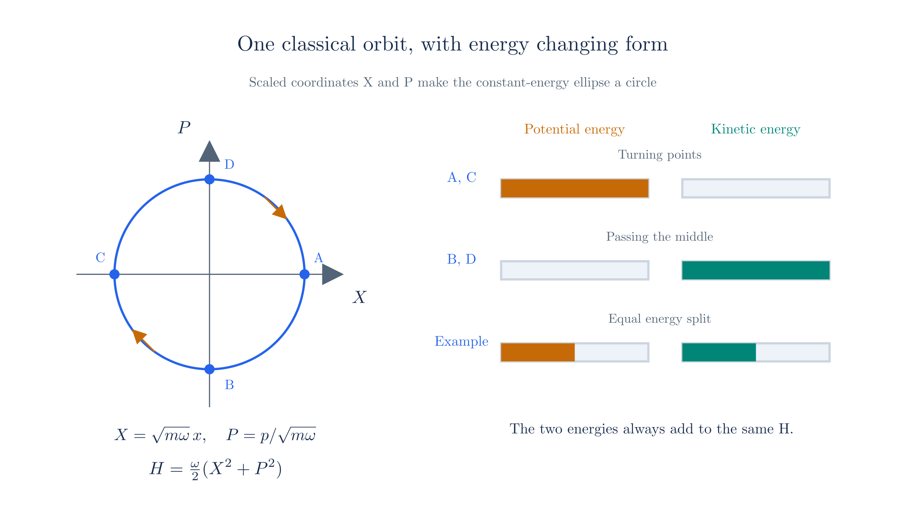

# Classical Mechanics

Particle physics is built from quantum theory, and the basic equations of quantum theory contain no force term and no trajectory. A quantum particle has no definite path, so there is nothing to put into $F = ma$. What does carry over is one function, built from the system's kinetic and potential energies, from which its motion follows. This chapter rewrites ordinary mechanics in that form, using a ball, a spring and a pendulum, so that the next chapters can take the same function and quantize it.

## The chapter at a glance

The chapter describes the same motion three times. For every system here the three give identical trajectories. What changes is what you supply and the form of the answer, and later parts of physics build on each form.

| | Newton | Lagrange | Hamilton |
| --- | --- | --- | --- |
| Question it answers | Given the forces, how does the body accelerate? | Of all paths between two moments, which one does the body take? | Given the present state, where does it go next? |
| What you supply | The forces | One function, $L = T - V$ (kinetic minus potential energy) | One function, the energy $H$, built from $L$ and written in position $q$ and momentum $p$ |
| What you get | One equation for the acceleration | The same equation, called the Euler–Lagrange equation, in any coordinates you like | Two equations that move a point $(q, p)$ through a space of states, called phase space |
| Where it returns | Everyday mechanics | Field theories and path integrals | Quantum mechanics, from the next chapter on |

There are three new ideas: the **action**, one number that scores a whole path; the **state** as a point made of position and momentum; and the **Poisson bracket**, which gives the rate of change of any quantity. One consequence comes along with the action: a coordinate that the Lagrangian does not depend on gives a quantity that never changes. Each step has a reason:

1. **Newton to Lagrange.** Forces are awkward when a body is held to a track or a string, and quantum theory is not written in terms of them. A function of energies avoids both. Add it up along a path, and the real path is the one where a small change to the path barely changes the total. That rule gives back Newton's law.
2. **Lagrange to Hamilton.** The quantum mechanics of the next chapters describes a system at one instant and gives a rule that carries it forward. So we describe one instant by position and momentum. Then one function, which turns out to be the energy, gives the motion of both.
3. **Hamilton to the bracket.** Asking how any quantity changes along the motion produces one fixed combination of derivatives, the Poisson bracket.
4. **The bracket to quantum mechanics.** The next chapter replaces the bracket of position and momentum, which is the same for every system and from which every other bracket follows, with a commutator, which measures how much the order of two operations matters, and quantization starts there.

We go through Lagrange rather than straight to Hamilton because both the momentum $p$ and the energy $H$ are built from $L$, and because fields and path integrals later reuse the action itself.

## 1. Newton's law: forces in, motion out

Newton's second law relates the acceleration of a body to the force on it: $F = ma$. Acceleration is the rate of change of velocity, and velocity is the rate of change of position. So the law fixes the future once we know where the body starts and how fast it is moving. We write $\dot x$ for the velocity and $\ddot x$ for the acceleration, one dot for each derivative with respect to time (see [derivatives](appendix-math-calculus.md#_1-derivatives) in the Math Refresher).

**Example: a dropped ball.** Near the ground, gravity pulls with a constant force $F = -mg$, where $g = 9.8\ \mathrm{m/s^2}$ and the minus sign means downward. Newton's law gives the constant acceleration $\ddot x = -g$. The force is known in advance, so [integrating](appendix-math-calculus.md#_4-integrals-and-integration-by-parts) once gives the speed, $gt$, and integrating again gives the distance fallen, $\tfrac12 g t^2$, for a ball dropped from rest:

| Time $t$ (s) | Speed $gt$ (m/s) | Distance fallen $\tfrac12 g t^2$ (m) |
| ---: | ---: | ---: |
| 0 | 0 | 0 |
| 1 | 9.8 | 4.9 |
| 2 | 19.6 | 19.6 |
| 3 | 29.4 | 44.1 |

*The dropped ball from the table. The acceleration is constant, the speed grows linearly, and the distance fallen grows with the square of the time.*

For a spring or a pendulum the force depends on where the body is, so we solve the law as an equation for the unknown path, but the logic is the same.

The rest of the chapter works with two energies, so we name them here. The **kinetic energy** of a body of mass $m$ moving at speed $v$ is $T = \tfrac12 m v^2$. The **potential energy** $V(x)$ is energy stored by position. For the ball, with $x$ its height above the ground, $V = mgx$; for a spring of stiffness $k$ stretched by $x$, $V = \tfrac12 k x^2$. The force is minus the slope of the potential, $F = -dV/dx$, because a body is pushed toward lower potential energy, downhill in $V$. For the ball this gives $F = -mg$; for the spring it gives $F = -kx$, the pull back toward the rest position.

## 2. Where forces become awkward

Applying Newton's law means listing every force on the body, including forces whose only job is to keep it on its allowed path. Take a pendulum, a bob of mass $m$ on a string of length $\ell$. Two forces act on the bob: gravity, and the tension in the string. Gravity is known. The tension is not, because it adjusts at every moment to whatever value keeps the bob on its circle.

For a single pendulum you can avoid the tension by taking the component of $F = ma$ along the circle, because the string always pulls at right angles to the motion. Hang a second pendulum from the first, and this stops working: the lower string pulls on the upper bob at an angle to its motion, so you have to solve for that tension first. We want one recipe that works with the angle $\theta$ of each string directly and never mentions constraint forces.

**Forces are awkward for constrained bodies.** The next two sections build a description of motion from energies alone that handles the pendulum without the tension.

## 3. One number for a whole path: the action

A description built from energies alone still has to pick out the motion. Conservation of energy is not enough: it is one equation, and the double pendulum has two angles to find. The rule that works compares whole paths.

So change the question. Instead of asking how the body accelerates at each moment, fix where it is at a start time and at an end time, and ask which path between those two events it takes. Fixing both endpoints usually pins down the motion just as fixing the starting position and speed does. In the example below, a ball that comes back to the hand after 2 s can only have been thrown at one speed.

To compare candidate paths, give each one a score. For each moment along a path, compute

$$L = T - V,$$

called the **Lagrangian**, and add up $L$ over the whole time interval. The total is the **action** of that path:

$$S = \int_{t_i}^{t_f} L \, dt.$$

The integral adds up the contributions of each small time interval (see [integrals](appendix-math-calculus.md#_4-integrals-and-integration-by-parts)). Every candidate path gets a number, including paths the body never takes.

The rule that selects the real path is the **principle of stationary action**. Bend the real path a little, by an amount $\epsilon$, keeping its two endpoints fixed. The action changes, but only by an amount that grows like $\epsilon^2$: halve the bend and the change drops to a quarter. So for small bends the change shrinks much faster than the bend, and we say the action does not change *to first order*. The real path sits at a flat spot of $S$, like the bottom of a valley, the top of a hill, or a saddle, which rises one way and falls the other. That is what *stationary* means. The principle is often called *least action*, but the flat spot need not be a minimum.

**Example: a ball thrown up and caught.** Throw a ball of mass $1\ \mathrm{kg}$ straight up so that it returns to the hand after $2\ \mathrm{s}$. It must rise for 1 s and fall for 1 s, so it leaves the hand at $9.8\ \mathrm{m/s}$. The throw carries it up $9.8\,t$ metres while gravity pulls it back $\tfrac12 g t^2 = 4.9\,t^2$, as in the dropped-ball table, so its height above the hand is $x(t) = 9.8\,t - 4.9\,t^2$ metres, which rises to $4.9\ \mathrm{m}$ and falls back. Compare it with deformed paths $x(t) + \epsilon \sin(\pi t/2)$, which leave and return at the same moments but bulge by up to $\epsilon$ metres. With heights measured from the hand, $V = 9.8\,x$, and the action of each path, in joule-seconds, is:

| Bulge $\epsilon$ (m) | Action with $L = T - V$ | Total of $T + V$ instead |
| ---: | ---: | ---: |
| −0.5 | −31.70 | 83.87 |
| −0.2 | −31.96 | 91.10 |
| 0 (real path) | −32.01 | 96.04 |
| 0.2 | −31.96 | 101.08 |
| 0.5 | −31.70 | 108.83 |

With $L = T - V$, bulging the path either way raises the action by the same amount. Making the bulge 2.5 times larger, from 0.2 to 0.5, makes the change in action $2.5^2 = 6.25$ times larger, from 0.049 to 0.308. That is the $\epsilon^2$ growth of a flat spot. **The real path is a flat spot of $T - V$, not of $T + V$.** In the last column the total keeps changing as the path moves through $\epsilon = 0$. A rule built on $T + V$ would pick a different path, one where the ball accelerates upward (Section 4).

Where the numbers in the table come from

Write the deformation as $\epsilon\eta(t)$ with $\eta = \sin(\pi t/2)$, and the real velocity as $v = 9.8 - 9.8\,t$. For $m = 1$, the kinetic energy of the deformed path is $\tfrac12(v + \epsilon\dot\eta)^2$ and the potential is $g(x + \epsilon\eta)$. Collect the terms by powers of $\epsilon$.

First the real path, $\epsilon = 0$. The kinetic energy totals $\int_0^2 \tfrac12(9.8)^2(1-t)^2\,dt = 96.04/3 \approx 32.01$, and the potential energy totals $\int_0^2 9.8\,(9.8t - 4.9t^2)\,dt = 2 \cdot 96.04/3 \approx 64.03$, exactly twice as much. So the action of $T - V$ is $-96.04/3 \approx -32.01$, and the total of $T + V$ is $96.04$.

The terms in $\epsilon^2$ come from the kinetic energy only, $\tfrac12\epsilon^2\int_0^2 \dot\eta^2\,dt = (\pi^2/8)\,\epsilon^2$, and they are the same for both columns.

The terms in $\epsilon$ are $\epsilon\int_0^2 v\dot\eta\,dt$ from the kinetic energy and $\epsilon\int_0^2 g\eta\,dt$ from the potential, and they are equal. The second is $\int_0^2 9.8\sin(\pi t/2)\,dt = 9.8\cdot 4/\pi = 39.2/\pi \approx 12.48$. Integrating the first by parts gives $-\int_0^2 \dot v\,\eta\,dt = \int_0^2 g\eta\,dt$, the same value. That equality is the cancellation that Section 4 turns into the Euler–Lagrange equation. With $T - V$ the potential term is subtracted, so the two cancel and no term in $\epsilon$ is left. With $T + V$ they add, giving $(78.4/\pi)\,\epsilon \approx 24.96\,\epsilon$. So

$$S_{T-V}(\epsilon) \approx -32.01 + 1.23\,\epsilon^2, \qquad S_{T+V}(\epsilon) \approx 96.04 + 24.96\,\epsilon + 1.23\,\epsilon^2.$$

*The thrown ball from the table. Left, the real path and two bent paths with the same endpoints. Right, the table's values: the action of $T - V$ is flat at the real path, and the total of $T + V$ is not.*

For the systems in this chapter, stationary action is Newton's law in another form, as the next section shows. Its advantage is that it uses only the two energies and works the same way in any coordinates.

## 4. From stationary action to an equation of motion

Comparing paths one at a time cannot find the real one. We need an equation the real path satisfies at every moment. Requiring that every small deformation leaves $S$ unchanged to first order gives one, the **Euler–Lagrange equation**:

$$\frac{d}{dt}\left(\frac{\partial L}{\partial \dot q}\right) - \frac{\partial L}{\partial q} = 0.$$

Here $q$ is whatever coordinate describes the system, a height or an angle, and $\dot q$ is its rate of change. The symbols $\partial L/\partial q$ and $\partial L/\partial \dot q$ are [partial derivatives](appendix-math-calculus.md#_2-partial-derivatives): the rate of change of $L$ with one variable while the other is held fixed. A coordinate chosen to fit the system, such as an angle, is called a **generalized coordinate**, and a system with several of them has one such equation for each.

The equation reads as a balance. The first term is the rate of change of $\partial L/\partial \dot q$, which for ordinary motion is the momentum $m\dot q$. The second term, $\partial L / \partial q$, plays the role of the force; for an angle it is a torque, the turning effect of a force. So the equation states that the momentum changes at a rate equal to the force, in whatever coordinate we chose.

Deriving the Euler–Lagrange equation from stationary action

Write a nearby path as $q_\epsilon(t)=q(t)+\epsilon\eta(t)$, where $\eta(t_i)=\eta(t_f)=0$. The parameter $\epsilon$ measures the size of the change. "No first-order change" means that the slope of $S$ with respect to $\epsilon$ is zero at $\epsilon = 0$. Changing $\epsilon$ changes $L$ through $q$, by $(\partial L/\partial q)\,\eta$, and through $\dot q$, by $(\partial L/\partial \dot q)\,\dot\eta$, by the [chain rule](appendix-math-calculus.md#_3-the-chain-rule). So stationarity means

$$0=\left.\frac{dS[q_\epsilon]}{d\epsilon}\right|_{\epsilon=0}
=\int_{t_i}^{t_f}\left(\frac{\partial L}{\partial q}\eta+\frac{\partial L}{\partial\dot q}\dot\eta\right)dt.$$

Integrate the second term [by parts](appendix-math-calculus.md#_4-integrals-and-integration-by-parts):

$$0=\left[\frac{\partial L}{\partial\dot q}\eta\right]_{t_i}^{t_f}
+\int_{t_i}^{t_f}\left[\frac{\partial L}{\partial q}-\frac{d}{dt}\frac{\partial L}{\partial\dot q}\right]\eta\,dt.$$

The endpoint condition removes the boundary term. The coefficient multiplying $\eta$ must vanish throughout the path: if it were nonzero somewhere, a bump in $\eta$ placed only there would make the integral nonzero. This gives the Euler–Lagrange equation.

**Check 1: Newton's law comes back.** For a body with $L = \tfrac12 m \dot x^2 - V(x)$, the two partial derivatives are $\partial L/\partial \dot x = m\dot x$ and $\partial L/\partial x = -dV/dx$. The equation becomes

$$m\ddot x = -\frac{dV}{dx} = F,$$

which is $F = ma$. For the thrown ball, $V = mgx$ gives $\ddot x = -g$. With $T + V$ in place of $T - V$, the same steps give $\ddot x = +g$: the ball would accelerate upward. That is the reason for the minus sign.

**Check 2: the pendulum without the tension.** Use the angle $\theta$ as the coordinate. The bob has moved a distance $\ell\theta$ along the circle, so its speed is $\ell\dot\theta$. It hangs $\ell\cos\theta$ below the pivot, so its height above the lowest point is $\ell(1-\cos\theta)$. Then

$$L=\tfrac12m\ell^2\dot\theta^2-mg\ell(1-\cos\theta).$$

The partial derivatives are $\partial L/\partial\dot\theta=m\ell^2\dot\theta$ and $\partial L/\partial\theta=-mg\ell\sin\theta$, and the Euler–Lagrange equation gives

$$m\ell^2\ddot\theta+mg\ell\sin\theta=0.$$

The tension never appears, because the angle already keeps the bob on its circle. For one pendulum, projecting $F = ma$ gives the same result. For two, projecting no longer works but this method still does: write $L$ in the two angles, and since no tension appears in $L$, none appears in the two Euler–Lagrange equations.

The double pendulum's Lagrangian

Hang a bob of mass $m_2$ on a string of length $\ell_2$ from a bob of mass $m_1$ on a string of length $\ell_1$, with angles $\theta_1$ and $\theta_2$ from the downward vertical. With the pivot at the origin and $y$ pointing up, the two bobs sit at

$$(\ell_1\sin\theta_1,\ -\ell_1\cos\theta_1), \qquad (\ell_1\sin\theta_1 + \ell_2\sin\theta_2,\ -\ell_1\cos\theta_1 - \ell_2\cos\theta_2).$$

The first bob moves at speed $\ell_1\dot\theta_1$. Differentiating the second position and using $\cos a\cos b + \sin a\sin b = \cos(a-b)$ gives the second bob's squared speed,

$$v_2^2 = \ell_1^2\dot\theta_1^2 + \ell_2^2\dot\theta_2^2 + 2\ell_1\ell_2\dot\theta_1\dot\theta_2\cos(\theta_1-\theta_2).$$

Here the potential energy is measured from the pivot, not from the lowest point as for the single pendulum; a constant shift in $V$ changes no equation of motion. The energies are

$$T = \tfrac12(m_1+m_2)\ell_1^2\dot\theta_1^2 + \tfrac12 m_2\ell_2^2\dot\theta_2^2 + m_2\ell_1\ell_2\dot\theta_1\dot\theta_2\cos(\theta_1-\theta_2),$$

$$V = -(m_1+m_2)g\ell_1\cos\theta_1 - m_2 g\ell_2\cos\theta_2.$$

The Euler–Lagrange equation for each angle, applied to $L = T - V$, gives the two equations of motion.

**A missing coordinate gives a conserved quantity.** If $L$ does not depend on some coordinate $q$, then shifting the system along $q$ leaves $L$ unchanged, which is a *symmetry*. In that case $\partial L/\partial q = 0$, and the Euler–Lagrange equation then requires $\partial L/\partial \dot q$ to stay constant. For a free body, nothing in $L = \tfrac12 m\dot x^2$ depends on $x$, so its momentum $m\dot x$ is constant. This link between a symmetry and a conserved quantity returns in general form as Noether's theorem: [Action and Lagrangians](qft-action.md) states it for fields, and [Quantum Electrodynamics](qed.md) uses it to obtain the conserved electric-charge current.

## 5. A state as a point: position and momentum

So far we have compared whole paths between two fixed ends. The form of quantum mechanics in the next chapters instead carries the state at one instant forward in time, so we need the classical version of that state. What must we know at one instant to predict everything after it? Position alone is not enough. A pendulum passes through the same angle twice in each swing, once going each way, and what happens next differs. We also need how the system is moving.

Section 4 already used a particular measure of motion, the **conjugate momentum**

$$p = \frac{\partial L}{\partial \dot q}.$$

For a body on a line it is the ordinary momentum $m\dot x$. For the pendulum it is $m\ell^2\dot\theta$, an angular momentum. **We use momentum rather than velocity because then one function, the energy, gives both equations of motion**, as the next section shows. Momentum is also what stays constant when $L$ lacks a coordinate, and Section 7 gives a third reason.

The pair $(q, p)$ is the **state**, and the space of all states is called **phase space**. Each state is a point in it, and the motion of the system is a curve that the point traces. Two states with the same position but opposite momentum are different points.

*Points B and D of the spring in Section 6: the same position, opposite momenta. Phase space tells them apart. The figure uses $x$ for the position coordinate $q$.*

## 6. Energy moves the point: the Hamiltonian

We now want a rule that moves the state forward in time, written in terms of position and momentum instead of position and velocity. The Lagrangian depends on $\dot q$, and its slope with respect to $\dot q$ is $p$. We want a function $H$ of $q$ and $p$ whose slope with respect to $p$ is $\dot q$. Then $\dot q = \partial H/\partial p$ is an equation of motion: it says how $q$ moves. The product $p\dot q$ already changes with $p$ at the rate $\dot q$, but it also changes with $\dot q$. $L$ changes with $\dot q$ by exactly the same amount, so subtracting $L$ removes that part. With small changes $\Delta p$ and $\Delta\dot q$, holding $q$ fixed:

$$\Delta(p\dot q) = \dot q\,\Delta p + p\,\Delta\dot q, \qquad \Delta L = p\,\Delta\dot q.$$

Subtracting,

$$\Delta(p\dot q - L) = \dot q\,\Delta p.$$

So $p\dot q - L$ responds to $p$ with slope $\dot q$, and does not respond to $\dot q$ at all. The details box below writes this out in full. Try it on the spring first, with $L = \tfrac12 m\dot x^2 - \tfrac12 k x^2$ and $p = m\dot x$:

$$p\dot x - L = m\dot x^2 - \left(\tfrac12 m\dot x^2 - \tfrac12 k x^2\right) = \tfrac12 m \dot x^2 + \tfrac12 k x^2.$$

**For the spring, $p\dot q - L$ is the total energy**, kinetic plus potential. Written with $\dot x = p/m$, it becomes

$$H = \frac{p^2}{2m} + V(x).$$

In general the **Hamiltonian** is $H = p\dot q - L$, with $\dot q$ rewritten in terms of $q$ and $p$. This exchange of $\dot q$ for $p$ is called a **Legendre transform**. For a kinetic energy of the form $\tfrac12 m\dot q^2$ and a potential that does not depend on velocity, $H$ is the total energy $T + V$. The chapters that follow start from exactly this function: the Schrödinger equation is built on $H = p^2/(2m) + V$.

The Hamiltonian moves the state through **Hamilton's equations**:

$$\dot q = \frac{\partial H}{\partial p}, \qquad \dot p = -\frac{\partial H}{\partial q}.$$

The first gives the rate of change of position, the second the rate of change of momentum. Both are *first-order* equations, meaning they involve only first derivatives in time, so knowing $(q, p)$ now fixes the next small step, and with it the whole motion that follows. That is the sense in which the point is the complete state. Together, Hamilton's equations are equivalent to the single Euler–Lagrange equation, which has a second derivative.

Deriving Hamilton's equations from the Lagrangian

For one coordinate, the small change $dH$ of $H=p\dot q-L$, when $q$, $\dot q$, $p$ and $t$ each change a little, is

$$dH=\dot q\,dp+p\,d\dot q-\frac{\partial L}{\partial q}dq-\frac{\partial L}{\partial\dot q}d\dot q-\frac{\partial L}{\partial t}dt.$$

The two $d\dot q$ terms cancel because $p=\partial L/\partial\dot q$. The Euler–Lagrange equation gives $\partial L/\partial q=\dot p$, leaving

$$dH=\dot q\,dp-\dot p\,dq-\frac{\partial L}{\partial t}dt.$$

Compare the coefficients with $dH=(\partial H/\partial q)dq+(\partial H/\partial p)dp+(\partial H/\partial t)dt$. The first two give Hamilton's equations. The last gives $\partial H/\partial t=-\partial L/\partial t$.

For $L=\tfrac12m\dot q^2-V(q)$, we have $p=m\dot q$, so $\dot q = p/m$ and

$$H = p\cdot\frac{p}{m} - \left(\frac{p^2}{2m} - V(q)\right) = \frac{p^2}{2m}+V(q).$$

Hamilton's equations become $\dot q=p/m$ and $\dot p=-\partial V/\partial q$. Together they reproduce Newton's law.

**Example: the spring.** Take $m = 1\ \mathrm{kg}$ and $k = 4\ \mathrm{N/m}$, so $H = \tfrac12 p^2 + 2x^2$. Hamilton's equations give $\dot x = p$ and $\dot p = -4x$. Start at $x = 1\ \mathrm{m}$ at rest. These equations are solved by

$$x = \cos 2t, \qquad p = -2\sin 2t,$$

as you can check: $\dot x = -2\sin 2t = p$, and $\dot p = -4\cos 2t = -4x$. The number $2\ \mathrm{s^{-1}}$ is the angular frequency $\omega = \sqrt{k/m}$: the motion repeats every $2\pi/\omega = \pi$ seconds, and the rows of the table below are a quarter of that apart. The [Harmonic Oscillator](harmonic-oscillator.md) chapter uses $\omega$ throughout. At four moments of one swing:

| Point in the figure | Time $t$ (s) | State $(x, p)$ | Where the mass is | $\dot x = p$ | $\dot p = -4x$ | $H$ (J) |
| --- | ---: | --- | --- | ---: | ---: | ---: |
| A | 0 | $(1, 0)$ | stretched, at rest | 0 | −4 | 2 |
| B | $\pi/4 \approx 0.79$ | $(0, -2)$ | passing the middle, moving left | −2 | 0 | 2 |
| C | $\pi/2 \approx 1.57$ | $(-1, 0)$ | compressed, at rest | 0 | 4 | 2 |
| D | $3\pi/4 \approx 2.36$ | $(0, 2)$ | passing the middle, moving right | 2 | 0 | 2 |

The columns for $\dot x$ and $\dot p$ give the direction in which the point moves. At the stretched position the momentum starts to fall; in the middle the position changes fastest. The last column is the same in every row, so the energy stays fixed, and the states with that energy satisfy $x^2 + p^2/4 = 1$, an ellipse. The point travels round it, while energy passes back and forth between kinetic and potential.

*One orbit of a spring in phase space. The rescaled coordinates $X = \sqrt{m\omega}\,x$ and $P = p/\sqrt{m\omega}$, with $\omega = \sqrt{k/m}$, turn the ellipse into a circle. At the turning points the energy is all potential, and in the middle it is all kinetic.*

## 7. How any quantity changes: the Poisson bracket

Hamilton's equations give the rates of change of position and momentum. Often we want the rate of change of something else, such as the energy or an angular momentum, without solving for the whole orbit first. Take any quantity $f(q, p)$ that depends on the state. As the state moves, $f$ changes through both of its variables, and the [chain rule](appendix-math-calculus.md#_3-the-chain-rule) adds the two contributions:

$$\frac{df}{dt}=\frac{\partial f}{\partial q}\dot q+\frac{\partial f}{\partial p}\dot p
=\frac{\partial f}{\partial q}\frac{\partial H}{\partial p}-\frac{\partial f}{\partial p}\frac{\partial H}{\partial q}.$$

The second step substitutes Hamilton's equations. The combination on the right appears so often that it has a name. For any two quantities $f$ and $g$, the **Poisson bracket** is

$$\{f, g\} = \frac{\partial f}{\partial q}\frac{\partial g}{\partial p} - \frac{\partial f}{\partial p}\frac{\partial g}{\partial q},$$

summed over each pair of position and momentum when there are several. With it, the rate of change of any quantity is

$$\frac{df}{dt} = \{f, H\}.$$

**Examples.** For $H = p^2/(2m) + V(q)$:

$$\{q, H\} = \frac{p}{m}, \qquad \{p, H\} = -\frac{dV}{dq}, \qquad \{H, H\} = 0, \qquad \{q, p\} = 1.$$

The first two are Hamilton's equations again, with $f = q$ and $f = p$. The third holds because the two terms of $\{H, H\}$ are the same product with opposite signs; it says the energy does not change. The last holds because the derivatives of $q$ by $q$ and of $p$ by $p$ are 1, and the cross derivatives are 0.

For the spring of Section 6, with $H = \tfrac12 p^2 + 2x^2$, the bracket gives $\{x, H\} = p$ and $\{p, H\} = -4x$, the two rates of change in the spring table.

The bracket $\{q, p\} = 1$ does not involve $H$, so it is the same for every system. Position and velocity do not share this property. Since $\dot q = p/m$, the bracket of position with velocity is $\{q, \dot q\} = \{q, p/m\} = 1/m$, which depends on the mass, and for the pendulum it is $1/(m\ell^2)$. Only momentum gives 1 for every system. That is the third reason for using it.

The bracket obeys a product rule, $\{fg, h\} = f\{g, h\} + g\{f, h\}$, inherited from the product rule for derivatives. So $\{q^2, p\} = q\{q, p\} + q\{q, p\} = 2q$, using only $\{q, p\} = 1$. Repeating this, every bracket of quantities built by adding and multiplying $q$ and $p$ reduces to $\{q, p\} = 1$, together with $\{q, q\} = \{p, p\} = 0$. So quantization only has to replace this one relation, which is what the next chapter does.

A quantity is conserved exactly when its bracket with $H$ is zero. A quantity that also depends on time directly changes by an extra $\partial f/\partial t$.

## What later chapters do with these tools

| Tool from this chapter | Where it returns |
| --- | --- |
| $H = p^2/(2m) + V$ and the state $(q, p)$ | [First Quantization](first-quantization.md) turns $H$ into the operator of the Schrödinger equation |
| The spring and its elliptical orbit | [Harmonic Oscillator](harmonic-oscillator.md) quantizes exactly this system |
| The Poisson bracket $\{q, p\} = 1$ | [First Quantization](first-quantization.md) replaces it with the commutator of position and momentum |
| Action and the Euler–Lagrange equation | [Action and Lagrangians](qft-action.md) applies them to fields, with one coordinate at each point of space |
| Conjugate momentum and the Hamiltonian | [Action and Lagrangians](qft-action.md) builds the field's momentum and energy the same way |
| A coordinate absent from $L$ gives a conserved momentum | [Action and Lagrangians](qft-action.md) states the general form, Noether's theorem; [Quantum Electrodynamics](qed.md) uses it for electric charge |
| An action for every path, not only the real one | [Path Integrals](path-integrals.md), an optional sequence after the Standard Model, adds up all paths, each weighted by a factor set by its action, and explains why the stationary path is the one seen classically |

In the next chapter, position and momentum become operators, and the Hamiltonian keeps its role as the function that moves the state forward in time.

---

Next: [First Quantization](./first-quantization.md)
