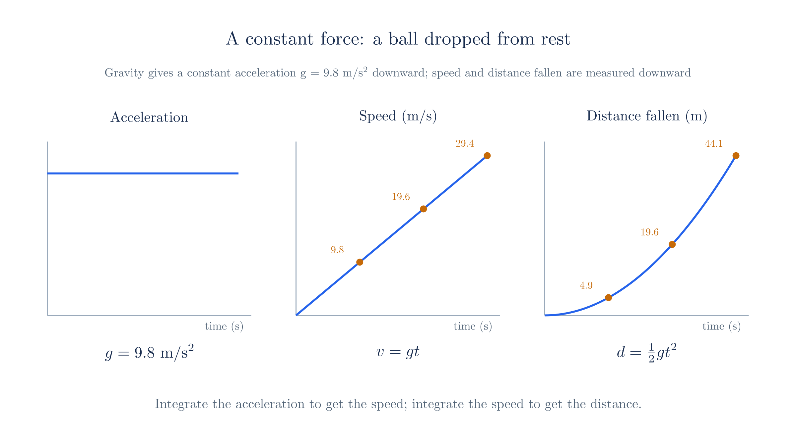
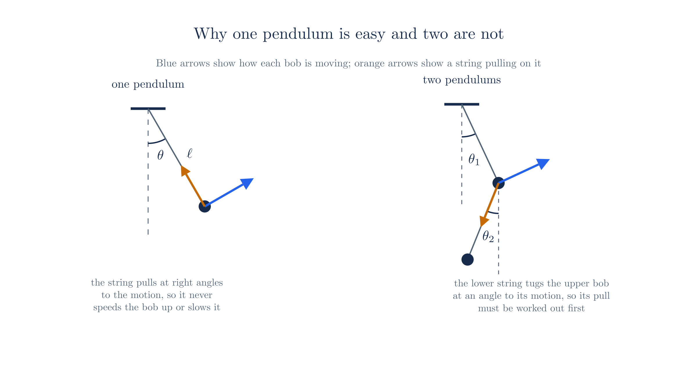
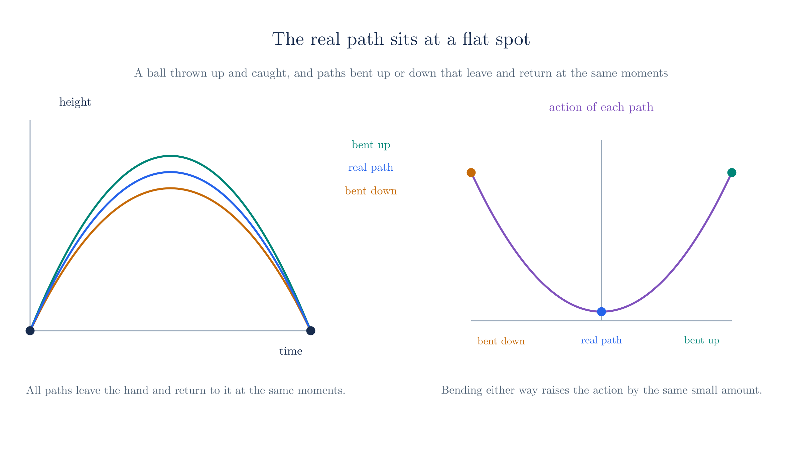
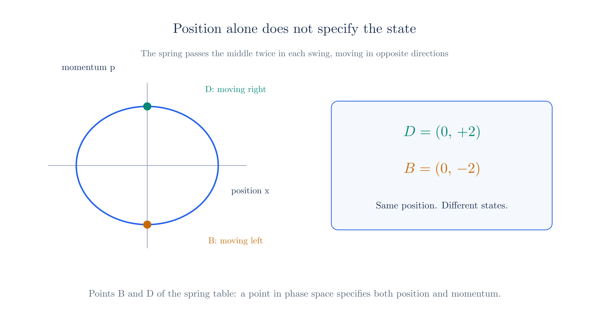

# Classical Mechanics

Quantum theory has no forces and no paths. A quantum particle doesn't follow a definite track, so there's nothing to put into $F = ma$. But one thing from ordinary mechanics survives the trip into quantum theory: a single function built from a system's energy, which tells the system how to move. This chapter rewrites ordinary mechanics around that function, using a ball, a pendulum and a spring, so that the next chapter can turn it into quantum mechanics.

We'll describe the same motion three ways, and all three give exactly the same answers. Newton starts from forces. Lagrange scores whole paths with one number built from energy. Hamilton describes the system at one instant and lets the energy carry it forward. The last step, a rule called the Poisson bracket, is the piece that quantum mechanics replaces.

| | Newton | Lagrange | Hamilton |
| --- | --- | --- | --- |
| You supply | The forces | Kinetic minus potential energy, $L = T - V$ | The energy $H$, written in position and momentum |
| You get | The acceleration at each moment | The path the body takes between two moments | Where position and momentum go next |
| Comes back in | Everyday mechanics | Fields and path integrals | Quantum mechanics, from the next chapter on |

## 1. Forces in, motion out

Newton's second law says that a force makes a body accelerate: $F = ma$. Acceleration is how fast the velocity changes, and velocity is how fast the position changes. So if you know where a body starts, how fast it's moving and what forces act on it, the law fixes everything that happens next.

**A dropped ball.** Near the ground, gravity pulls down with a constant force, $F = -mg$, where $g = 9.8\ \mathrm{m/s^2}$ and the minus sign means downward. So the ball's acceleration is a constant $-g$. Its speed grows by 9.8 m/s every second, and the distance it has fallen grows with the square of the time: 4.9 m after one second, 19.6 m after two, 44.1 m after three.

*The dropped ball. The acceleration is constant, the speed grows steadily, and the distance fallen grows with the square of the time.*

**Two kinds of energy.** The rest of the chapter works with energies rather than forces, so let's name them. A body of mass $m$ moving at speed $v$ has **kinetic energy** $T = \tfrac12 mv^2$, the energy of motion. A body can also store energy by where it is, called **potential energy** $V$. A ball at height $x$ has $V = mgx$, and a spring of stiffness $k$ stretched by $x$ has $V = \tfrac12 kx^2$.

The force always pushes a body toward lower potential energy, downhill in $V$, and the steeper the slope, the harder the push. In symbols, the force is minus the slope, $F = -dV/dx$. For the ball that gives $-mg$, and for the spring it gives $-kx$, a pull back toward the resting position.

More detail: the dropped ball's numbers

The acceleration is constant, so the speed after a time $t$ is $gt$ and the distance fallen from rest is $\tfrac12 gt^2$ (see [integrals](appendix-math-calculus.md#_4-integrals-and-integration-by-parts) in the Math Refresher).

| Time $t$ (s) | Speed $gt$ (m/s) | Distance fallen $\tfrac12 g t^2$ (m) |
| ---: | ---: | ---: |
| 0 | 0 | 0 |
| 1 | 9.8 | 4.9 |
| 2 | 19.6 | 19.6 |
| 3 | 29.4 | 44.1 |

For a spring or a pendulum the force changes as the body moves, so the law becomes an equation for an unknown path rather than a simple sum, but the logic is the same.

**Newton's law turns forces into motion, and the force is the downhill slope of the potential energy.**

## 2. Where forces get awkward

Newton's law needs every force on the body, including forces whose only job is to keep it on track. Take a pendulum, a weight called the bob on a string of length $\ell$. Gravity pulls on the bob, and so does the string. Gravity is easy. The string's pull, its tension, isn't known in advance, because it adjusts at every moment to whatever keeps the bob on its circle.

For one pendulum you can dodge the tension. The string always pulls straight along itself, at right angles to the bob's motion, so it doesn't speed the bob up or slow it down, and you can look only at forces along the circle. But hang a second pendulum from the first, and the dodge fails. The lower string now tugs the upper bob at an angle to its motion, so you have to work out that tension before you can do anything else.

*Blue arrows show how each bob moves, orange arrows how a string pulls on it. Each angle $\theta$ is measured from straight down, and $\ell$ is the string's length. With one pendulum the string's pull is at right angles to the motion. With two, the lower string's pull isn't.*

We'd like a method that works directly with the angle of each string and never mentions the strings' pulls at all. The next two sections build one, from energies alone.

**Forces are awkward when a body is held to a track or a string, so we look for a method built from energies.**

## 3. One number for a whole path

Energies alone have to pick out the motion somehow. Conservation of energy isn't enough, because it's one equation, and the double pendulum has two angles to find. What works is to change the question.

Instead of asking how the body accelerates at each moment, fix where it is at a start time and where it is at an end time, and ask which path it takes between them. Fixing both ends usually pins down the motion just as well as fixing the start and the speed. A ball that leaves your hand and comes back 2 seconds later, for example, can only have been thrown at one speed.

To compare paths, give each one a score. At each moment along the path, take the kinetic energy minus the potential energy,

$$L = T - V,$$

called the **Lagrangian**. Add it up over the whole trip, and you get the path's score, called the **action**:

$$S = \int L\, dt.$$

Every imaginable path gets an action, including paths the body would never take.

**The real path sits at a flat spot.** Here's the rule that picks the real path out. Bend a path a little, keeping its two ends fixed, and its action changes. On most paths the change is proportional to the bend, like taking a step on a slope. On the real path that part vanishes, and what's left grows only like the square of the bend: halve the bend, and the change drops to a quarter. So for small bends the action is flat, like the bottom of a valley, and that's the rule, called the **principle of stationary action**. (It's often called "least action", but the flat spot doesn't have to be a minimum. It can also be a hilltop or a saddle.)

**A ball thrown up and caught.** Throw a ball straight up and catch it a couple of seconds later. Now imagine other paths that leave your hand and come back at the same moments, but bulge higher or lower along the way, and work out the action of each one. Bulging the path up or down raises the action by the same small amount, and doubling the bulge makes that rise four times bigger. That's the flat spot: the real path sits at the bottom of the valley.

*The thrown ball. Left, the real path and two bent paths with the same ends. Right, the action of each path: flat at the real path.*

**The real path is the one where the action sits at a flat spot: bend it a little and the action doesn't change.**

## 4. Turning the rule into an equation

Comparing paths one at a time can check a guess, but it can't find the real path. For that we need an equation the real path obeys at every moment. We'll write $\dot x$ for the velocity and $\ddot x$ for the acceleration, one dot for each rate of change in time. Asking that every small bend leave the action flat gives the equation, called the **Euler–Lagrange equation**:

$$\frac{d}{dt}\left(\frac{\partial L}{\partial \dot q}\right) = \frac{\partial L}{\partial q}.$$

Here $q$ stands for whatever describes the system, a height or an angle, and $\dot q$ for its rate of change. The $\partial$ symbols mean "how much $L$ changes when you nudge just this one thing", treating position and speed as two separate knobs (a [partial derivative](appendix-math-calculus.md#_2-partial-derivatives)).

The equation reads as a balance. On the left, $\partial L/\partial\dot q$ is the momentum: for $L = \tfrac12 m\dot x^2 - V$, nudging the speed changes $L$ by $m\dot x$. So the left side is how fast the momentum changes. On the right, $\partial L/\partial q$ plays the role of the force. So it says what Newton said: **momentum changes at the rate the force sets**. The difference is that it works in whatever coordinate you choose.

**Newton comes back.** For a body with $L = \tfrac12 m\dot x^2 - V(x)$, the momentum is $m\dot x$ and the force term is $-dV/dx$, so the equation is $m\ddot x = -dV/dx$. That's $F = ma$. For the thrown ball, it gives $\ddot x = -g$.

**The pendulum, without the string.** Now describe the pendulum by its angle $\theta$. The bob moves along its circle at speed $\ell\dot\theta$, and its height depends only on the angle. So $L$ is written entirely in the angle and its rate of change, and the string's pull never appears in it. The Euler–Lagrange equation then gives the pendulum's motion with no tension anywhere. For the double pendulum, write $L$ in the two angles and get one equation for each, again with no tension. That's the method section 2 asked for.

**A missing coordinate gives something that never changes.** Suppose $L$ doesn't depend on some coordinate at all. For a body floating freely, $L = \tfrac12 m\dot x^2$ doesn't care where the body is, only how fast it moves. Then the force term is zero, and the equation says the momentum never changes. Shifting the system along that coordinate changes nothing, which we call a *symmetry*, and every such symmetry comes with a quantity that stays fixed. This link returns in general form as **Noether's theorem**: [Action and Lagrangians](qft-action.md) states it for fields, and [Quantum Electrodynamics](qed.md) uses it to get the conservation of electric charge.

The calculation: deriving the Euler–Lagrange equation

Write a nearby path as $q(t) + \epsilon\eta(t)$, where $\eta$ is zero at both ends. "Flat" means the slope of $S$ with respect to $\epsilon$ is zero at $\epsilon = 0$. Changing $\epsilon$ changes $L$ through $q$, by $(\partial L/\partial q)\,\eta$, and through $\dot q$, by $(\partial L/\partial\dot q)\,\dot\eta$, by the [chain rule](appendix-math-calculus.md#_3-the-chain-rule). So

$$0 = \int_{t_i}^{t_f}\left(\frac{\partial L}{\partial q}\eta + \frac{\partial L}{\partial\dot q}\dot\eta\right)dt.$$

Integrate the second term [by parts](appendix-math-calculus.md#_4-integrals-and-integration-by-parts):

$$0 = \left[\frac{\partial L}{\partial\dot q}\eta\right]_{t_i}^{t_f} + \int_{t_i}^{t_f}\left[\frac{\partial L}{\partial q} - \frac{d}{dt}\frac{\partial L}{\partial\dot q}\right]\eta\,dt.$$

The first term is zero because $\eta$ vanishes at the ends. The bracket must then be zero at every moment: if it weren't zero somewhere, a bump in $\eta$ placed just there would make the integral nonzero. That gives the Euler–Lagrange equation.

A coordinate chosen to fit the system, such as an angle, is called a **generalized coordinate**. A system with several of them gets one Euler–Lagrange equation for each.

The calculation: the pendulum and the double pendulum

**One pendulum.** The bob hangs $\ell\cos\theta$ below the pivot, so its height above the lowest point is $\ell(1 - \cos\theta)$, and it moves at speed $\ell\dot\theta$:

$$L = \tfrac12 m\ell^2\dot\theta^2 - mg\ell(1 - \cos\theta).$$

Then $\partial L/\partial\dot\theta = m\ell^2\dot\theta$ and $\partial L/\partial\theta = -mg\ell\sin\theta$, and the Euler–Lagrange equation gives

$$m\ell^2\ddot\theta + mg\ell\sin\theta = 0.$$

**Two pendulums.** Hang a bob of mass $m_2$ on a string of length $\ell_2$ from a bob of mass $m_1$ on a string of length $\ell_1$, with angles $\theta_1$ and $\theta_2$ from the vertical. Measuring heights from the pivot (a constant shift in $V$ changes no equation of motion), the energies are

$$T = \tfrac12(m_1+m_2)\ell_1^2\dot\theta_1^2 + \tfrac12 m_2\ell_2^2\dot\theta_2^2 + m_2\ell_1\ell_2\dot\theta_1\dot\theta_2\cos(\theta_1-\theta_2),$$

$$V = -(m_1+m_2)g\ell_1\cos\theta_1 - m_2 g\ell_2\cos\theta_2.$$

The cross term in $T$ comes from the second bob's squared speed, $\ell_1^2\dot\theta_1^2 + \ell_2^2\dot\theta_2^2 + 2\ell_1\ell_2\dot\theta_1\dot\theta_2\cos(\theta_1-\theta_2)$. The Euler–Lagrange equation for each angle gives the two equations of motion, and no tension appears in either.

**The Euler–Lagrange equation turns the flat-spot rule into "momentum changes at the rate the force sets", in any coordinates, with no string forces needed.**

## 5. A state is position plus momentum

So far we've compared whole paths between two fixed ends. Quantum mechanics works differently: it describes a system at one instant and gives a rule that carries it forward. So we need the classical version of "the system at one instant", called its **state**.

Position alone isn't enough. A spring passes through its middle twice in each swing, once going each way, and what happens next is different. So the state also has to say how the system is moving.

We use the momentum for that, the same $\partial L/\partial\dot q$ that appeared in the Euler–Lagrange equation, called the **conjugate momentum**. For a body moving along a line it's the ordinary momentum $m\dot x$. For the pendulum it's $m\ell^2\dot\theta$, an angular momentum. Why momentum and not plain velocity? Section 7 shows why.

The pair, position $q$ and momentum $p$, is the state. Picture it as a point on a map with position across and momentum up. That map of all possible states is called **phase space**, and as the system moves, its point traces a curve.

*Two moments of the spring in section 6: the same position, opposite momenta. On the phase-space map they're different points. The figure writes the position as $x$.*

**The state at one instant is a point: its position and its momentum.**

## 6. The energy moves the state

Now we want the rule that moves the state forward, written in position and momentum. It turns out to come from one function, the **Hamiltonian** $H$, which for everything in this chapter is simply the total energy, kinetic plus potential, written in terms of momentum. For a body of mass $m$, put $v = p/m$ into the kinetic energy $\tfrac12 mv^2$ and it becomes $p^2/2m$, so

$$H = \frac{p^2}{2m} + V(q).$$

The Hamiltonian moves the state through **Hamilton's equations**:

$$\dot q = \frac{\partial H}{\partial p}, \qquad \dot p = -\frac{\partial H}{\partial q}.$$

The first says position changes at a rate set by how the energy depends on momentum; for $H$ above, that's $p/m$, the velocity. The second says momentum changes at a rate set by how the energy depends on position; for $H$ above, that's $-dV/dq$, the force. Together they're Newton's law again. Each one only involves the rate of change, not the acceleration, so knowing the state now fixes the next small step, and the next, and the whole motion after it.

**The spring.** Take a spring with a 1 kg mass and stiffness $k = 4\ \mathrm{N/m}$, so $H = \tfrac12 p^2 + 2x^2$. Pull it out to 1 m and let go. Hamilton's equations give $\dot x = p$ and $\dot p = -4x$, and they're solved by

$$x = \cos 2t, \qquad p = -2\sin 2t.$$

The 2 here is the spring's **angular frequency**, $\omega = \sqrt{k/m}$, and the motion repeats every $2\pi/\omega = \pi$ seconds. At release the momentum is zero and $x = 1$, so the energy is $2 \times 1^2 = 2$ J, and it stays at 2 J the whole time. At the ends of the swing it's all potential, and in the middle it's all kinetic.

On the phase-space map, the point goes round and round a closed loop. Every state on the loop has the same energy, 2 J, and the point just travels around it while energy passes back and forth between kinetic and potential. Rescale the two axes to the right proportions, and the loop is a circle, a picture the [Harmonic Oscillator](harmonic-oscillator.md) chapter builds on.

*One orbit of the spring in phase space, with the axes rescaled so that the loop is a circle. At the turning points the energy is all potential, and in the middle it's all kinetic.*

The calculation: where the Hamiltonian comes from

We want a function of $q$ and $p$ whose slope with respect to $p$ is $\dot q$, so that $\dot q = \partial H/\partial p$ is an equation of motion. Start from $p\dot q - L$. When $p$ and $\dot q$ change a little, with $q$ fixed,

$$\Delta(p\dot q) = \dot q\,\Delta p + p\,\Delta\dot q, \qquad \Delta L = p\,\Delta\dot q,$$

because $p = \partial L/\partial\dot q$. Subtracting, $\Delta(p\dot q - L) = \dot q\,\Delta p$: the combination responds to $p$ with slope $\dot q$ and doesn't respond to $\dot q$ at all. So the **Hamiltonian** is

$$H = p\dot q - L,$$

with $\dot q$ rewritten in terms of $q$ and $p$. This swap of $\dot q$ for $p$ is called a **Legendre transform**. For $L = \tfrac12 m\dot q^2 - V(q)$, $p = m\dot q$, and

$$H = p\cdot\frac{p}{m} - \left(\frac{p^2}{2m} - V\right) = \frac{p^2}{2m} + V(q),$$

the total energy.

**Hamilton's equations.** The small change of $H = p\dot q - L$, when everything changes a little, is

$$dH = \dot q\,dp + p\,d\dot q - \frac{\partial L}{\partial q}dq - \frac{\partial L}{\partial\dot q}d\dot q - \frac{\partial L}{\partial t}dt.$$

The $d\dot q$ terms cancel, and the Euler–Lagrange equation gives $\partial L/\partial q = \dot p$, so $dH = \dot q\,dp - \dot p\,dq - (\partial L/\partial t)\,dt$. Reading off the coefficients of $dp$ and $dq$ gives Hamilton's equations. They're *first-order*: they involve only first rates of change, where the Euler–Lagrange equation has a second.

More detail: the spring at four moments

Check the solution: $\dot x = -2\sin 2t = p$ and $\dot p = -4\cos 2t = -4x$. The rows are a quarter of a period, $\pi/4$ s, apart.

| Point | Time $t$ (s) | State $(x, p)$ | Where the mass is | $\dot x = p$ | $\dot p = -4x$ | $H$ (J) |
| --- | ---: | --- | --- | ---: | ---: | ---: |
| A | 0 | $(1, 0)$ | stretched, at rest | 0 | −4 | 2 |
| B | $\pi/4 \approx 0.79$ | $(0, -2)$ | passing the middle, moving left | −2 | 0 | 2 |
| C | $\pi/2 \approx 1.57$ | $(-1, 0)$ | compressed, at rest | 0 | 4 | 2 |
| D | $3\pi/4 \approx 2.36$ | $(0, 2)$ | passing the middle, moving right | 2 | 0 | 2 |

The states with energy 2 J satisfy $x^2 + p^2/4 = 1$, an ellipse. In the rescaled coordinates $X = \sqrt{m\omega}\,x$ and $P = p/\sqrt{m\omega}$ it becomes a circle. The [Harmonic Oscillator](harmonic-oscillator.md) chapter quantizes exactly this spring.

**The Hamiltonian is the energy written in position and momentum, and Hamilton's equations let it move the state forward one step at a time.**

## 7. How anything changes: the Poisson bracket

Hamilton's equations tell us how position and momentum change. Often we want to know how something else changes, such as the energy or an angular momentum, without solving the whole motion first. Any such quantity $f$ depends on the state, so as the state moves, $f$ changes for two reasons: the position moves and the momentum moves. Adding the two effects, and using Hamilton's equations for the rates, gives one fixed recipe, called the **Poisson bracket** of $f$ with $H$:

$$\frac{df}{dt} = \{f, H\}.$$

For any two quantities $f$ and $g$, the bracket combines their slopes with respect to position and momentum:

$$\{f, g\} = \frac{\partial f}{\partial q}\frac{\partial g}{\partial p} - \frac{\partial f}{\partial p}\frac{\partial g}{\partial q}.$$

**What the bracket gives.** For $H = p^2/2m + V$, the bracket of position with $H$ is $p/m$ and the bracket of momentum with $H$ is $-dV/dq$: Hamilton's equations again. The bracket of $H$ with itself is zero, which says the energy never changes. In general, anything whose bracket with $H$ is zero stays constant.

**One bracket that never changes.** The bracket of position with momentum is

$$\{q, p\} = 1,$$

because position changes with position at rate 1 and momentum with momentum at rate 1, while neither changes with the other: $1 \times 1 - 0 \times 0 = 1$. It doesn't involve $H$ at all. So it's the same for every system: a ball, a pendulum, a spring. Velocity doesn't share this. The bracket of position with velocity is $1/m$, which depends on the mass, so there'd be no single rule shared by every system. That's why we use momentum.

Better still, every other bracket can be worked out from this one. Any quantity built by adding and multiplying position and momentum has a bracket that reduces, step by step, to $\{q, p\} = 1$. So when the next chapter builds quantum mechanics, it only has to replace this one relation. Everything else follows.

The calculation: the Poisson bracket

As the state moves, $f(q, p)$ changes through both variables, and the [chain rule](appendix-math-calculus.md#_3-the-chain-rule) adds the two effects. Then Hamilton's equations replace $\dot q$ and $\dot p$:

$$\frac{df}{dt} = \frac{\partial f}{\partial q}\dot q + \frac{\partial f}{\partial p}\dot p = \frac{\partial f}{\partial q}\frac{\partial H}{\partial p} - \frac{\partial f}{\partial p}\frac{\partial H}{\partial q}.$$

The **Poisson bracket** of any two quantities is

$$\{f, g\} = \frac{\partial f}{\partial q}\frac{\partial g}{\partial p} - \frac{\partial f}{\partial p}\frac{\partial g}{\partial q},$$

summed over each position–momentum pair when there are several. So $df/dt = \{f, H\}$, plus $\partial f/\partial t$ if $f$ also depends on time directly.

Examples, for $H = p^2/2m + V(q)$:

$$\{q, H\} = \frac{p}{m}, \qquad \{p, H\} = -\frac{dV}{dq}, \qquad \{H, H\} = 0, \qquad \{q, p\} = 1.$$

The two terms of $\{H, H\}$ are the same product with opposite signs, so they cancel. For the spring, with $H = \tfrac12 p^2 + 2x^2$, the bracket gives $\{x, H\} = p$ and $\{p, H\} = -4x$, the two rates in the spring table. Since $\dot q = p/m$, the bracket of position with velocity is $\{q, p/m\} = 1/m$, and for the pendulum it's $1/(m\ell^2)$.

The bracket obeys a product rule, $\{fg, h\} = f\{g, h\} + g\{f, h\}$, inherited from the product rule for derivatives. For example, $\{q^2, p\} = q\{q, p\} + q\{q, p\} = 2q$, using only $\{q, p\} = 1$. Repeating this, every bracket of quantities built from $q$ and $p$ by adding and multiplying reduces to $\{q, p\} = 1$, together with $\{q, q\} = \{p, p\} = 0$.

**The Poisson bracket with the energy gives the rate of change of anything, and the bracket of position with momentum is 1 for every system.**

## Where this comes back

The next chapter, [First Quantization](first-quantization.md), keeps the Hamiltonian $H = p^2/2m + V$ as the function that moves the state forward, and turns position and momentum into operators, a new kind of object that chapter explains. It replaces the bracket $\{q, p\} = 1$ with a quantum version, and the rest of quantum mechanics follows from that one change. The [Harmonic Oscillator](harmonic-oscillator.md) chapter then quantizes this chapter's spring.

The action comes back too. [Action and Lagrangians](qft-action.md) applies the Euler–Lagrange equation to fields, with one coordinate at every point of space, and builds their momentum and energy the same way as here. And [Path Integrals](path-integrals.md), later on, adds up *every* path, each weighted by its action, and explains why the flat-spot path is the one we see.

---

Next: [First Quantization](./first-quantization.md)
