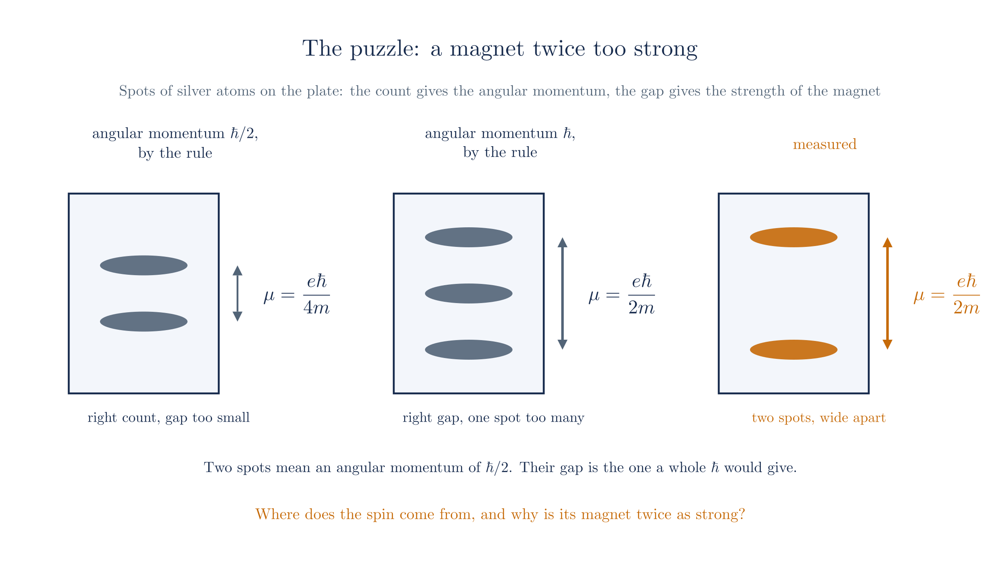
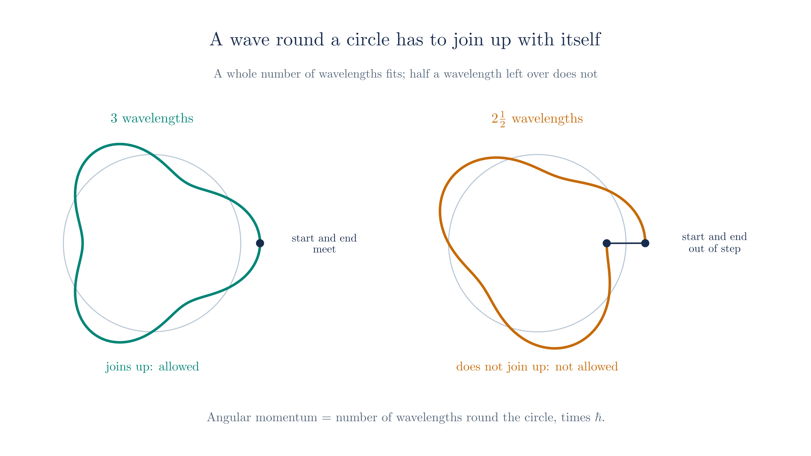
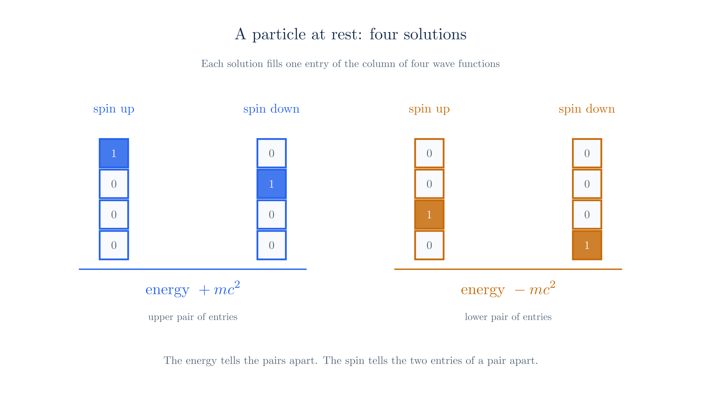

# The Dirac Equation

The last chapter ended with the Dirac equation and a state made of four wave functions. Two of them have positive energy and two have negative energy, and the chapter left a question open: what tells the two of each sign apart?

This chapter answers it. The answer is the electron's spin, which nobody put into the equation. Two more results come with it. The equation gives the strength of the electron's magnet, which had puzzled physicists for years. And it says that turning an electron once round doesn't bring its state back. The next chapter, 6b, follows a moving electron and finds what the negative-energy solutions describe.

Here is where we end up, for a particle at rest:

| Entry of the column | Energy | Spin |
| --- | --- | --- |
| $\psi_1$ | $+mc^2$ | up |
| $\psi_2$ | $+mc^2$ | down |
| $\psi_3$ | $-mc^2$ | up |
| $\psi_4$ | $-mc^2$ | down |

## 1. A puzzle: a magnet twice too strong

Chapter 2a opened with silver atoms flying through a magnet. Each atom is a tiny magnet itself, because of a property of one of its electrons called spin. That chapter used the spin without saying what it is, or how strong the electron's magnet is. Both questions have a history.

**A spinning charge is a magnet.** Charge going round a circle is an electric current in a loop, and a current in a loop is a magnet, as in an electromagnet. So anything charged that spins is a magnet. Anything with mass that spins also has **angular momentum**, the amount of turning motion it carries. For chapter 1's pendulum that was $m\ell^2\dot\theta$.

Spin the body twice as fast, and the magnet's strength and the angular momentum both double, which means their ratio is fixed. Write $\mu$ for the strength of the magnet, the number that says how hard a magnetic field pushes and twists it. For a body of charge $q$ and mass $m$, with the charge spread through it the same way as the mass,

$$\mu = \frac{q}{2m} \times \text{angular momentum}.$$

The box on the ring of charge works this out.

**What was measured.** Chapter 2a's experiment measures the magnet directly. The uneven field pushes a silver atom up or down with a force equal to the strength of the atom's magnet times how fast the field grows from one pole to the other. So the gap between the two spots on the plate gives the strength. Stern and Gerlach's gap gave a strength of $e\hbar/2m$, to within ten percent. Here $e$ is the size of the electron's charge and $m$ is the electron's mass, because the silver atom's magnet is that of one of its electrons.

**What the two spots say.** The plate also gives a count: two spots, and nothing between them. By 1925 physicists had learned from the light of atoms that angular momentum along a chosen direction comes in steps of $\hbar$ (the box on steps of $\hbar$ shows why). The steps fix the spacing between the results, not where they start. Nothing makes the up direction differ from the down direction, so the results must lie evenly either side of zero. Two results, one step apart and evenly either side of zero, have to be $+\hbar/2$ and $-\hbar/2$.

In 1925 George Uhlenbeck and Samuel Goudsmit proposed an angular momentum of that size, belonging to the electron itself, whether or not it moves round anything. They called it **spin**.

**What the gap says.** Put $\hbar/2$ into the rule above, with a charge of size $e$. The electron's magnet should have the strength $e\hbar/4m$. The measured strength is twice that. By the rule, a magnet of $e\hbar/2m$ goes with an angular momentum of a whole $\hbar$. But a whole $\hbar$ would give three results, $+\hbar$, 0 and $-\hbar$, and so three spots.

*The puzzle. Two spots mean an angular momentum of $\hbar/2$. Their gap is the one a whole $\hbar$ would give. The rule for a spinning charge can't produce both.*

In 1927 Wolfgang Pauli wrote an equation for a slow electron with spin, and both the spin and the factor of two went in as assumptions. Nobody could say where either came from.

**The puzzle.** Why does the electron have a spin of $\hbar/2$, and why is its magnet twice as strong as a spinning charge's? The Dirac equation answers both.

The calculation: the magnet of a ring of charge

Take a ring of radius $r$, with charge $q$ and mass $m$ spread round it, turning so that each bit moves at speed $v$.

**The current.** The whole charge passes a fixed point once per turn, and a turn takes $2\pi r/v$ seconds. So the current, the charge passing per second, is $qv/2\pi r$.

**The magnet.** A fact from the physics of electric currents: the strength of a loop's magnet is its current times its area.

$$\mu = \frac{qv}{2\pi r} \times \pi r^2 = \frac{qvr}{2}.$$

**The angular momentum.** A mass $m$ moving at speed $v$ at distance $r$ from the centre has the angular momentum $mvr$.

Divide one by the other, and the speed and the radius cancel:

$$\frac{\mu}{\text{angular momentum}} = \frac{qvr/2}{mvr} = \frac{q}{2m}.$$

A spinning ball whose charge is spread the same way as its mass is a stack of such rings, each with the same ratio, so the ball has it too.

**The numbers.** With $e = 1.602\times10^{-19}$ C, $\hbar = 1.0546\times10^{-34}$ J s and $m = 9.109\times10^{-31}$ kg, the measured strength $e\hbar/2m$ is $9.27\times10^{-24}$ joules per tesla, where the tesla is the unit of magnetic field strength. Lined up with a field of one tesla, the magnet has that many joules less energy than it has lying across the field. Physicists call the strength $e\hbar/2m$ the **Bohr magneton**.

More detail: why angular momentum comes in steps of ħ

**A wave on a line.** Chapter 2a found that a particle with momentum $p$ is a wave with wavelength $h/p$. That wave ran along a straight line.

**The same wave on a circle.** Now hold the particle on a circle of radius $r$, as an electron is held going round a nucleus. Its wave function has a value at each point of the circle. Follow the wave once round and you are back at the point you started from. The wave function has only one value there, so the wave has to join up with itself. That happens only if a whole number $n$ of wavelengths fits round the circle:

$$2\pi r = n\,\frac{h}{p} \qquad\Rightarrow\qquad p\,r = n\,\frac{h}{2\pi} = n\hbar.$$

The left side, momentum times radius, is the angular momentum, as for the ring in the box above. So the angular momentum of anything going round, measured about the axis of its circle, is a whole number of $\hbar$.

*Three wavelengths fit round the circle, so the angular momentum $3\hbar$ is allowed. Two and a half don't join up, so $2\tfrac12\hbar$ isn't.*

**Counting the results.** The circle can be tilted away from the direction we measure along, and then that direction gets only part of the angular momentum. Along a chosen direction, the possible results run from the largest value down to minus that value in steps of $\hbar$. We state this without proof. An angular momentum of zero gives one result. One of $\hbar$ gives three: $+\hbar$, 0 and $-\hbar$. One of $2\hbar$ gives five. The count is always odd.

**Two results.** Two would need $+\hbar/2$ and $-\hbar/2$. That is the case of half a wavelength left over, which a wave going round a circle can't have. So two spots say that the electron's angular momentum isn't that of anything going round. Section 6 comes back to the half wavelength.

More detail: the electron isn't a spinning ball

The name "spin" suggests a small ball turning on its axis. That picture fails before the factor of two comes up. Experiments that collide electrons with positrons find no size for the electron at all, down to about $10^{-18}$ m. A ring that small, with the electron's mass and an angular momentum of $\hbar/2$, would have to move at $\hbar/2mr$, which is about $6\times10^{13}$ metres per second, two hundred thousand times the speed of light. So spin is an angular momentum that isn't the turning of anything. Section 3 shows where it comes from.

**The electron's own angular momentum is $\hbar/2$, and its magnet is twice as strong as a spinning charge with that angular momentum would have.**

## 2. Four wave functions and one question

**The equation.** Chapter 5 found that in space the state is a column of four wave functions, and that the energy rule needs four matrices, one in front of each part of the momentum and one in front of the mass. Put through chapter 5's recipe, the rule becomes the Dirac equation:

$$i\hbar\,\frac{\partial\psi}{\partial t} = \hat H\psi, \qquad \hat H = c\left(\alpha_x\,\hat p_x + \alpha_y\,\hat p_y + \alpha_z\,\hat p_z\right) + \beta\,mc^2.$$

Here $\hat p_x = -i\hbar\,\partial/\partial x$ is the momentum operator along $x$, and likewise for $y$ and $z$. The energy operator $\hat H$ plays the same part as in chapter 2b.

**The four matrices.** Each is a four-by-four table, built from two-by-two blocks. The blocks are the three spin matrices of chapter 5, $\hat S$ for a sideways magnet, $\hat Y$ for a front-to-back one and $\hat Z$ for an up-and-down one:

$$\hat S = \begin{pmatrix} 0 & 1 \\ 1 & 0 \end{pmatrix}, \qquad \hat Y = \begin{pmatrix} 0 & -i \\ i & 0 \end{pmatrix}, \qquad \hat Z = \begin{pmatrix} 1 & 0 \\ 0 & -1 \end{pmatrix}.$$

The entries of $\hat Y$ are imaginary, but the results of its measurement, its eigenvalues, are still $+1$ and $-1$. The four matrices are

$$\alpha_x = \begin{pmatrix} 0 & \hat S \\ \hat S & 0 \end{pmatrix}, \qquad \alpha_y = \begin{pmatrix} 0 & \hat Y \\ \hat Y & 0 \end{pmatrix}, \qquad \alpha_z = \begin{pmatrix} 0 & \hat Z \\ \hat Z & 0 \end{pmatrix}, \qquad \beta = \begin{pmatrix} 1 & 0 \\ 0 & -1 \end{pmatrix}.$$

Each 0 stands for a two-by-two block of zeros. In $\beta$ each 1 stands for the two-by-two **identity matrix**, the matrix that leaves every column as it is:

$$\mathbb 1 = \begin{pmatrix} 1 & 0 \\ 0 & 1 \end{pmatrix}.$$

The four matrices meet chapter 5's conditions, each squaring to 1 and every pair anticommuting. Multiplying them block by block shows it, using the two-by-two products from chapter 5's box.

**Two pairs.** Think of the column as two pairs, an upper pair $(\psi_1, \psi_2)$ and a lower pair $(\psi_3, \psi_4)$. The matrix $\beta$ keeps each pair to itself. Each $\alpha$ has its blocks off the diagonal, so it sends the upper pair to the lower and the lower to the upper. For example,

$$\alpha_z\begin{pmatrix} \psi_1 \\ \psi_2 \\ \psi_3 \\ \psi_4 \end{pmatrix} = \begin{pmatrix} \psi_3 \\ -\psi_4 \\ \psi_1 \\ -\psi_2 \end{pmatrix}.$$

Section 5's box uses this.

**At rest.** A particle at rest has zero momentum, which means its wave function is the same at every point. So every slope is zero, the momentum operators give zero, and only $\beta\,mc^2$ is left. Written out in full, $\beta$ has 1, 1, $-1$, $-1$ down its diagonal, so

$$\hat H\psi = mc^2\begin{pmatrix} 1 & 0 & 0 & 0 \\ 0 & 1 & 0 & 0 \\ 0 & 0 & -1 & 0 \\ 0 & 0 & 0 & -1 \end{pmatrix}\begin{pmatrix} \psi_1 \\ \psi_2 \\ \psi_3 \\ \psi_4 \end{pmatrix} = \begin{pmatrix} +mc^2\,\psi_1 \\ +mc^2\,\psi_2 \\ -mc^2\,\psi_3 \\ -mc^2\,\psi_4 \end{pmatrix}.$$

The upper pair has the energy $+mc^2$ and the lower pair has $-mc^2$. On a line, chapter 5 found one entry with each sign of the energy. In space each sign appears twice.

**The question.** The entries $\psi_1$ and $\psi_2$ have the same energy and the same momentum, which means that measuring the energy and the momentum can't tell them apart. Chapter 2a had two states like that: up and down, which a vertical magnet sends to different spots. Is there a measurement that does the same for $\psi_1$ and $\psi_2$? The next two sections find it.

**At rest, the upper pair of the column has energy $+mc^2$ and the lower pair has $-mc^2$. Something else must tell the two entries of a pair apart.**

## 3. Angular momentum that isn't kept

The quantity that tells $\psi_1$ from $\psi_2$ turns up in a check: that a free particle's angular momentum never changes. This section runs the check on the Dirac equation. The check fails, and the term that repairs it is the missing quantity.

**What stays constant.** Chapter 2b gave the rule for how the average of any quantity $A$ changes in time:

$$\frac{d\langle A\rangle}{dt} = \frac{1}{i\hbar}\,\langle[\hat A, \hat H]\rangle.$$

So if $\hat A$ commutes with $\hat H$, the commutator is zero and the quantity never changes, whatever the state. We'll say such a quantity is **kept**. A free particle's momentum is kept, for example.

**Angular momentum.** For chapter 1's pendulum, the angular momentum was the bob's momentum times its distance from the pivot. A particle anywhere in space has the same thing about the vertical axis, $z$: its momentum round the axis, times its distance from the axis. Seen from above, there are two ways to go round.

- A particle out along $x$ and moving along $y$ goes round anticlockwise. Its motion counts as $x\,p_y$.
- A particle out along $y$ and moving along $x$ goes round clockwise. Its motion counts as $-y\,p_x$.

Add the two:

$$L_z = x\,p_y - y\,p_x.$$

*Seen from above, with the vertical axis at the centre. The two parts go round opposite ways, which is where the minus sign comes from.*

**Why it should be kept.** Nothing pushes a free particle, so its momentum stays the same. Nothing twists it either, so its angular momentum should stay the same too. A skater who spins with nothing to twist them keeps the same angular momentum, which is why pulling the arms in makes the spin faster.

**The Dirac equation fails the check.** Put hats on the positions and momenta in $L_z$ to make it an operator, as chapter 2b did, and work out its commutator with Dirac's $\hat H$ (box):

$$[\hat L_z, \hat H] = i\hbar c\left(\alpha_x\,\hat p_y - \alpha_y\,\hat p_x\right).$$

That isn't zero, which means that for a free electron, with nothing twisting it, the angular momentum of its motion changes in time.

**The missing piece.** Angular momentum can't come from nowhere. If the motion's share changes, the electron must carry more angular momentum than its motion accounts for, and the total should stay the same. So we need a second term, call it $\hat T$, whose commutator with $\hat H$ is minus the one above:

$$[\hat T, \hat H] = -i\hbar c\left(\alpha_x\,\hat p_y - \alpha_y\,\hat p_x\right).$$

The right-hand side says what kind of thing $\hat T$ is.

- **It can be a matrix.** The commutator of $\hat L_z$ came from the positions in it. The right-hand side has no position left, only matrices and momenta, so $\hat T$ needs no position either, and a matrix of plain numbers will do. Such a matrix commutes with the momenta, which means its commutator with $\hat H$ leaves each momentum alone and changes only the $\alpha$ beside it.
- **It has to swap $\alpha_x$ and $\alpha_y$.** Set $\hat H$ beside the right-hand side. Where $\hat H$ has $\alpha_x\,\hat p_x$, the right-hand side has $\alpha_y\,\hat p_x$. Where $\hat H$ has $\alpha_y\,\hat p_y$, it has $-\alpha_x\,\hat p_y$. The commutator with $\hat T$ must therefore turn $\alpha_x$ into $\alpha_y$, and $\alpha_y$ into minus $\alpha_x$.

Chapter 5's spin matrices do this to each other (box):

$$[\hat Z, \hat S] = 2i\,\hat Y, \qquad [\hat Z, \hat Y] = -2i\,\hat S.$$

And $\alpha_x$ is built from $\hat S$, $\alpha_y$ from $\hat Y$. So the matrix to try is built from $\hat Z$. It isn't $\alpha_z$, which swaps the two pairs. It has $\hat Z$ on the diagonal, once for each pair of the column:

$$\Sigma_z = \begin{pmatrix} \hat Z & 0 \\ 0 & \hat Z \end{pmatrix}.$$

It does the swap (box):

$$[\Sigma_z, \hat H] = -2ic\left(\alpha_x\,\hat p_y - \alpha_y\,\hat p_x\right).$$

That is what we need, apart from the number in front, which is $-2ic$ where we want $-i\hbar c$. Multiplying by $\hbar/2$ fixes it, which gives $\hat T = \tfrac{\hbar}{2}\Sigma_z$, and the sum is kept:

$$\left[\hat L_z + \frac{\hbar}{2}\,\Sigma_z,\ \hat H\right] = 0.$$

The $\hbar/2$ isn't a choice. It is the one number that makes the two cancel. The other two axes work the same way, with $\hat S$ and $\hat Y$ in place of $\hat Z$.

**What that means.** The new term adds to the angular momentum of the motion to give a total that never changes, so it is angular momentum too. It is a matrix, so it acts on the column of four wave functions and not on where the electron is or how it moves. The electron has it even at rest, where the momentum is zero and so is $L_z$. That is the spin. Dirac asked only for an equation that agrees with relativity and has one rate of change in time, and the spin came out of it without his putting it in.

The calculation: the two commutators

**The motion.** Chapter 2b found $[\hat x, \hat p_x] = i\hbar$, and the same holds for $y$. Operators for different directions commute. To see why, run chapter 2b's calculation for both cases. The product rule gives a slope of $x\psi$ as two pieces, one where the slope falls on $x$ and one where it falls on $\psi$.

Along $x$, the slope of $x$ itself is 1:

$$\frac{\partial}{\partial x}(x\psi) = \frac{\partial x}{\partial x}\,\psi + x\,\frac{\partial\psi}{\partial x} = 1\cdot\psi + x\,\frac{\partial\psi}{\partial x}.$$

Multiply by $-i\hbar$ to turn the slopes into $\hat p_x$:

$$\hat p_x\hat x\,\psi = -i\hbar\,\psi + \hat x\hat p_x\,\psi, \qquad\text{so}\qquad [\hat x, \hat p_x]\,\psi = \hat x\hat p_x\,\psi - \hat p_x\hat x\,\psi = i\hbar\,\psi.$$

Along $y$, the same rule applies, but $x$ doesn't change as $y$ does, so the slope of $x$ is 0:

$$\frac{\partial}{\partial y}(x\psi) = \frac{\partial x}{\partial y}\,\psi + x\,\frac{\partial\psi}{\partial y} = 0\cdot\psi + x\,\frac{\partial\psi}{\partial y}.$$

Multiply by $-i\hbar$ again:

$$\hat p_y\hat x\,\psi = \hat x\hat p_y\,\psi, \qquad\text{so}\qquad [\hat x, \hat p_y]\,\psi = \hat x\hat p_y\,\psi - \hat p_y\hat x\,\psi = 0.$$

The whole difference between the two cases is the 1 against the 0.

Two momenta commute as well, because you can take slopes along two directions in either order:

$$\hat p_x\hat p_y\,\psi = -\hbar^2\,\frac{\partial^2\psi}{\partial x\,\partial y} = -\hbar^2\,\frac{\partial^2\psi}{\partial y\,\partial x} = \hat p_y\hat p_x\,\psi.$$

**The first commutator.** In $\hat L_z = \hat x\hat p_y - \hat y\hat p_x$, the $\hat x$ fails to commute only with the $\alpha_x\hat p_x$ part of $\hat H$, and the $\hat y$ only with the $\alpha_y\hat p_y$ part. In each line below, the other factors commute with everything there, so they move out of the commutator:

$$[\hat x\hat p_y,\ c\,\alpha_x\hat p_x] = c\,\alpha_x\,[\hat x, \hat p_x]\,\hat p_y = i\hbar c\,\alpha_x\hat p_y,$$

$$[-\hat y\hat p_x,\ c\,\alpha_y\hat p_y] = -c\,\alpha_y\,[\hat y, \hat p_y]\,\hat p_x = -i\hbar c\,\alpha_y\hat p_x.$$

Add them: $[\hat L_z, \hat H] = i\hbar c\,(\alpha_x\hat p_y - \alpha_y\hat p_x)$.

For the free Schrödinger equation, $\hat H = (\hat p_x^2 + \hat p_y^2 + \hat p_z^2)/2m$, and the same steps give $i\hbar\,(\hat p_x\hat p_y - \hat p_y\hat p_x)/m$, which is zero.

**The column.** $\Sigma_z$ commutes with $\beta$ and with $\alpha_z$, because their blocks are built from $\hat Z$ and the matrix that changes nothing. For the other two, multiply block by block:

$$\Sigma_z\alpha_x - \alpha_x\Sigma_z = \begin{pmatrix} 0 & \hat Z\hat S - \hat S\hat Z \\ \hat Z\hat S - \hat S\hat Z & 0 \end{pmatrix}.$$

Chapter 5's box worked out the products. $\hat Z\hat S$ is minus $\hat S\hat Z$, and its entries are those of $i\hat Y$. So $\hat Z\hat S - \hat S\hat Z = 2i\hat Y$, and

$$[\Sigma_z, \alpha_x] = 2i\,\alpha_y.$$

In the same way, the entries of $\hat Z\hat Y$ are those of $-i\hat S$, which gives $[\Sigma_z, \alpha_y] = -2i\,\alpha_x$. So

$$[\Sigma_z, \hat H] = c\left(2i\,\alpha_y\hat p_x - 2i\,\alpha_x\hat p_y\right) = -2ic\left(\alpha_x\hat p_y - \alpha_y\hat p_x\right).$$

Multiply by $\hbar/2$ and it is exactly minus the first commutator. The factor $\hbar$ is there to match $[\hat x, \hat p_x] = i\hbar$, and the 2 is there because the spin matrices' commutators come with a 2.

**The angular momentum of a free electron's motion isn't kept. Adding $\hbar/2$ times a matrix that acts on the column gives a total that is kept, and that extra piece is the spin.**

## 4. Spin up and spin down

**Two results.** A measurement of a quantity gives one of the eigenvalues of its operator, and the spin's operator is $\tfrac{\hbar}{2}\Sigma_z$. Written out in full, $\Sigma_z$ has the entries of $\hat Z$ twice down its diagonal:

$$\frac{\hbar}{2}\,\Sigma_z\,\psi = \frac{\hbar}{2}\begin{pmatrix} 1 & 0 & 0 & 0 \\ 0 & -1 & 0 & 0 \\ 0 & 0 & 1 & 0 \\ 0 & 0 & 0 & -1 \end{pmatrix}\begin{pmatrix} \psi_1 \\ \psi_2 \\ \psi_3 \\ \psi_4 \end{pmatrix} = \begin{pmatrix} +\tfrac{\hbar}{2}\,\psi_1 \\ -\tfrac{\hbar}{2}\,\psi_2 \\ +\tfrac{\hbar}{2}\,\psi_3 \\ -\tfrac{\hbar}{2}\,\psi_4 \end{pmatrix}.$$

So the spin along the vertical axis has two possible results, $+\hbar/2$ and $-\hbar/2$, called **spin up** and **spin down**. Chapter 2b called these results $+1$ and $-1$, in units it left open, and the unit turns out to be $\hbar/2$. That's the size Uhlenbeck and Goudsmit had proposed. Section 5 shows that the electron's magnet lies along the same line as this spin, so the two results are the two spots on Stern and Gerlach's plate. Because the size is half of $\hbar$, physicists say the electron has **spin one half**.

**The answer to section 2.** Within each pair of the column, the first entry is spin up and the second is spin down:

*The four solutions for a particle at rest. Each has one entry of the column filled.*

**Any direction.** Nothing is special about the vertical. Measured along any other direction, the spin is again $+\hbar/2$ or $-\hbar/2$.

**The spin along any direction is $+\hbar/2$ or $-\hbar/2$. In each pair of the column, one entry is spin up and the other is spin down.**

## 5. The strength of the magnet

**The puzzle again.** By section 1's rule for a spinning charge, an angular momentum of $\hbar/2$ makes a magnet of strength $e\hbar/4m$. Stern and Gerlach measured $e\hbar/2m$, twice that. The equation has now given the spin its size, $\hbar/2$. This section asks it for the strength of the magnet.

**What to ask the equation.** In chapter 2b, an atom in a magnetic field was like a compass needle, with slightly different energies pointing up and pointing down. That difference in energy is what the strength of a magnet means. A magnet of strength $\mu$, lined up with a field of strength $B$, has its energy lowered by $\mu B$. Lined up against the field, its energy is raised by the same amount. So put the electron in a field that points up, and see what the equation gives for the energies of spin up and spin down.

**The answer.** A magnetic field goes into the equation of a charged particle in a standard way, which we state without deriving it (step 1 of the first box). For a slow particle of charge $q$ and positive energy, the lower pair of the column is tiny, and the equation reduces to one for the upper pair alone (step 2). That pair, $(\psi_1, \psi_2)$, is chapter 2a's list of two amplitudes, one for spin up and one for spin down. The equation gives the two their energies:

$$E_{\text{up}} = E_0 - \frac{q\hbar}{2m}\,B, \qquad E_{\text{down}} = E_0 + \frac{q\hbar}{2m}\,B,$$

where $E_0$ is the part of the energy that is the same for both. Compare with $-\mu B$ and $+\mu B$. The particle is a magnet that points along its spin, of strength

$$\mu = \frac{q\hbar}{2m}.$$

For the electron its size is $e\hbar/2m$, the measured value. The electron's charge is negative, $q = -e$, so its magnet points opposite to its spin, and for the electron, spin up has the higher energy in a field pointing up.

**Twice the rule.** Divide the strength by the angular momentum, which is $\hbar/2$:

$$\frac{\mu}{\text{spin}} = \frac{q\hbar}{2m} \div \frac{\hbar}{2} = \frac{q}{m}.$$

Section 1's rule for a spinning charge gave $q/2m$. The spin makes a magnet twice as strong as the rule allows, and that is the puzzle's answer. Nobody put the factor of two in. The equation came from the energy rule of relativity, and the field went in the same way it does for any charged particle.

The calculation: a slow electron in a magnetic field

The field points up, along $z$, and has strength $B$ everywhere.

**Step 1: put the field in.** Physicists describe a magnetic field with a field of arrows $\mathbf A$, one at each point, called the **vector potential**. For a particle of charge $q$, the field enters the equation by replacing the momentum $\hat{\mathbf p}$ with $\hat{\mathbf p} - q\mathbf A$. Classical physics uses the same replacement, and there it gives the known force on a moving charge. Later chapters call it **minimal substitution**. For our field, one choice of the arrows is $\mathbf A = (-By/2,\ Bx/2,\ 0)$, which circles the vertical axis.

The magnetic field is how much the arrows swirl. For a field pointing up, the swirl is the slope of $A_y$ along $x$ minus the slope of $A_x$ along $y$, and here each part gives half:

$$\frac{\partial A_y}{\partial x} - \frac{\partial A_x}{\partial y} = \frac{\partial}{\partial x}\!\left(\frac{Bx}{2}\right) - \frac{\partial}{\partial y}\!\left(-\frac{By}{2}\right) = \frac{B}{2} + \frac{B}{2} = B.$$

That is why the arrows carry a factor of $\tfrac12$. Write $\Pi$ for the momentum after the replacement:

$$\Pi_x = \hat p_x + \frac{qB}{2}\,y, \qquad \Pi_y = \hat p_y - \frac{qB}{2}\,x, \qquad \Pi_z = \hat p_z.$$

**Step 2: remove the lower pair.** Write the column as an upper pair $\phi$ and a lower pair $\chi$, and write $\hat D$ for the momentum term that acts on a pair:

$$\hat D = \hat S\,\Pi_x + \hat Y\,\Pi_y + \hat Z\,\Pi_z.$$

With section 2's block matrices, $\beta\,mc^2$ gives $+mc^2\phi$ in the upper pair and $-mc^2\chi$ in the lower, and the $\alpha$ terms send each pair to the other. So for a state of energy $E$, the Dirac equation $E\psi = \hat H\psi$ is two equations, one for each pair:

$$E\,\phi = mc^2\phi + c\,\hat D\,\chi, \qquad E\,\chi = -mc^2\chi + c\,\hat D\,\phi.$$

Move the $mc^2$ terms to the left:

$$(E - mc^2)\,\phi = c\,\hat D\,\chi, \qquad (E + mc^2)\,\chi = c\,\hat D\,\phi.$$

For a slow particle with positive energy, $E$ is close to $mc^2$, so $E + mc^2 \approx 2mc^2$. The second equation then gives the lower pair, $\chi \approx \hat D\phi/2mc$. Put that into the first:

$$(E - mc^2)\,\phi = \frac{\hat D^2}{2m}\,\phi.$$

**Step 3: multiply out the square.** $\hat D$ has three terms, so $\hat D^2$ has nine. Three of them are a term times itself. Each spin matrix squares to 1, so these give

$$\Pi_x^2 + \Pi_y^2 + \Pi_z^2.$$

The other six come in pairs. Take the pair with $z$ and $x$. The spin matrices anticommute, $\hat Z\hat S = -\hat S\hat Z$, so

$$\hat S\hat Z\,\Pi_x\Pi_z + \hat Z\hat S\,\Pi_z\Pi_x = \hat S\hat Z\,(\Pi_x\Pi_z - \Pi_z\Pi_x) = 0,$$

because $\Pi_z = \hat p_z$ commutes with everything in $\Pi_x$. The pair with $z$ and $y$ is zero in the same way. That leaves the pair with $x$ and $y$. Chapter 5's box worked out $\hat S\hat Y$ and $\hat Y\hat S$, and their entries are those of $i\hat Z$ and $-i\hat Z$, so

$$\hat S\hat Y\,\Pi_x\Pi_y + \hat Y\hat S\,\Pi_y\Pi_x = i\hat Z\,(\Pi_x\Pi_y - \Pi_y\Pi_x).$$

**Step 4: the two orders differ.** Without a field, $\Pi_x$ and $\Pi_y$ are $\hat p_x$ and $\hat p_y$, which commute, and this last pair is zero too. With the field, $\Pi_x$ contains $\hat p_x$ and $y$, and $\Pi_y$ contains $\hat p_y$ and $x$, and section 3's box showed that a position and its own momentum don't commute: $[\hat y, \hat p_y] = i\hbar$ and $[\hat p_x, \hat x] = -i\hbar$. Multiply out and keep the two pairs that don't commute:

$$\Pi_x\Pi_y - \Pi_y\Pi_x = -\frac{qB}{2}\,[\hat p_x, \hat x] + \frac{qB}{2}\,[\hat y, \hat p_y] = \frac{qB}{2}\,i\hbar + \frac{qB}{2}\,i\hbar = i\hbar\,qB.$$

So the last pair is $i\hat Z \times i\hbar\,qB = -\hbar\,qB\,\hat Z$, and the square is

$$\hat D^2 = \Pi_x^2 + \Pi_y^2 + \Pi_z^2 - \hbar\,qB\,\hat Z.$$

**The result.** Divide by $2m$. With $\hat Z$ standing for its value, $+1$ for spin up and $-1$ for spin down, the energy is

$$E = mc^2 + \frac{\Pi_x^2 + \Pi_y^2 + \Pi_z^2}{2m} - \frac{q\hbar}{2m}\,B\,\hat Z.$$

The first two terms don't contain the spin, and they are the main text's $E_0$. The last gives the two energies. This is the equation Pauli wrote down in 1927, now with its factor of two derived.

The factor is a whole $\hbar$, not $\hbar/2$, because of step 3: two different spin matrices multiply to one whole spin matrix, $\hat S\hat Y = i\hat Z$, with no $\tfrac12$.

Reference: the magnet of the motion, and the g factor

**The motion's magnet.** The term with $\Pi_x^2 + \Pi_y^2$ contains a second magnet. Multiply out the squares, using $\Pi_x$ and $\Pi_y$ from step 1 of the last box:

$$\Pi_x^2 + \Pi_y^2 = \hat p_x^2 + \hat p_y^2 - qB\,(\hat x\hat p_y - \hat y\hat p_x) + \frac{q^2B^2}{4}\,(x^2 + y^2).$$

The bracket in the middle is section 3's $\hat L_z$. Divided by $2m$, that term is $-(q/2m)\,\hat L_z B$, the energy of a magnet of strength $(q/2m)L_z$. So the motion round the axis makes a magnet too, with section 1's ratio.

**All the terms.** For a field pointing up, the energy is

$$E = mc^2 + \frac{\hat{\mathbf p}^2}{2m} - \frac{q}{2m}\,\hat L_z\,B - \frac{q\hbar}{2m}\,\hat Z\,B + \frac{q^2B^2}{8m}\,(x^2 + y^2).$$

In order, they are the rest energy, the energy of motion, the motion's magnet, the spin's magnet, and a term with the square of $B$. For an electron held in an atom, in the fields of a laboratory, the last is about a millionth of the two magnet terms.

**The usual name.** Physicists write $\mu = g\,\dfrac{q}{2m}\times$ spin and call $g$ the **gyromagnetic factor**. A spinning charge has $g = 1$, and the Dirac equation gives $g = 2$.

**The Dirac equation makes the electron a magnet twice as strong as a spinning charge with the same angular momentum, which is the strength Stern and Gerlach measured.**

## 6. One full turn flips the sign

Spin one half has one more consequence. It follows from something chapter 2a already used.

**Opposite in space, at right angles in the state.** Chapter 2a wrote a spin state as a list of two amplitudes, one for up and one for down. Spin up is the list $(1, 0)$, and spin down is $(0, 1)$. Draw each list as a single arrow on a page, across for the first amplitude and upward for the second. The two arrows are at right angles. Up and down are opposite in space, $180°$ apart, and yet they are $90°$ apart in the state.

That holds for every angle, not only this one. The box in that chapter gave the state of a spin tilted from the vertical toward the right by an angle $\theta$:

$$\left(\cos\frac{\theta}{2},\ \sin\frac{\theta}{2}\right).$$

So an angle in space shows up as half that angle in the state.

**Carry it once round.** Keep tilting past down, all the way round and back to up. At $\theta = 360°$ the formula gives

$$\left(\cos 180°,\ \sin 180°\right) = (-1,\ 0).$$

The spin points up as it did at the start, but the state is minus what it was. A full turn in space is only a half turn in the state. It takes two full turns, $720°$, to bring the state back to $(1, 0)$.

*The spin in space, and the arrow that stands for its state. The state's arrow turns half as fast, so one full turn in space leaves it pointing the opposite way.*

**Where the half comes from.** The half is the $\tfrac12$ in the spin's size, $\hbar/2$. The state turns by a fraction of the angle in space, and that fraction is the spin divided by $\hbar$. For the electron it is one half. For a particle with a whole $\hbar$ of spin it is one, so its state comes back after one turn. The box works the electron's case with a magnetic field.

**Seeing the sign.** After a full turn the spin points where it did, so a measurement of its direction finds nothing new. Chapter 2a said that multiplying a whole state by $-1$ changes no chance, so no measurement on the electron alone shows the sign.

But a phase counts as soon as a state is added to another. Split a beam in two, turn the spins in one half through a full turn, leave the other half alone, and bring the two together. If the turned half comes back with a minus sign, the two halves cancel where they added before.

**The experiment.** In 1975 two groups did this, one from Vienna led by Helmut Rauch and one in the United States led by Samuel Werner. They used neutrons, which have spin one half like the electron. A neutron has no charge, so a magnetic field turns its spin without bending its path. A crystal of silicon split each neutron's wave onto two paths and brought them together again, as chapter 2a's two slits did for an electron. One path ran through a magnetic field, which turned the spin by an angle set by the field's strength.

*The neutron experiment, sketched.*

As the field went up, the count of neutrons coming out rose and fell. With the spin turned by $360°$, the two paths cancelled. The count returned to its starting value only when the turn reached $720°$.

**The name.** Each pair of the Dirac column is such a list of two amplitudes (section 5), so the column's entries turn at half the angle too. Physicists call a column whose entries turn at half the angle, and so change sign under one full turn, a **spinor**. That is the name chapter 5 gave the Dirac column. [Chapter 6b's section 4](dirac-solutions.md#_4-the-notation-later-chapters-use) has the general rule for how the column changes when it is turned or set moving.

The calculation: a turn about the vertical, made by a magnetic field

The main text tilts the spin away from the vertical. A magnetic field pointing up makes a different kind of turn, round the vertical, and the same half appears.

**The phases.** A phase turns at a rate set by the energy. Chapter 2b found that a state of energy $E$ has the phase factor $e^{-iEt/\hbar}$ after a time $t$. In a magnetic field the energy depends on the spin. Section 5 gave it as $E_0 - \tfrac{q\hbar}{2m}B$ for up and $E_0 + \tfrac{q\hbar}{2m}B$ for down. So the two amplitudes turn at different rates. The shared part $E_0$ turns both alike and drops out of every comparison. What is left turns the up amplitude one way by $\tfrac{qB}{2m}t$ and the down amplitude the other way by the same angle. Write $\theta = \tfrac{qB}{m}t$ for twice that angle. With $c_{\text{up}}$ and $c_{\text{down}}$ for the two amplitudes,

$$c_{\text{up}} \to c_{\text{up}}\,e^{+i\theta/2}, \qquad c_{\text{down}} \to c_{\text{down}}\,e^{-i\theta/2}.$$

Each phase is $\tfrac{q}{m}Bt$ times the spin, $\pm\hbar/2$, divided by $\hbar$. That is where the main text's fraction, the spin divided by $\hbar$, comes from.

**Why $\theta$ is the angle of the turn in space.** The two phases turn opposite ways, each by $\theta/2$, so the angle between them has changed by $\theta$. This angle is the direction in which the spin leans round the vertical, as chapter 2a's box said. The lean has therefore swung round by $\theta$, whatever state the spin starts in. In space the spin has turned by $\theta$, and in the state each amplitude has turned by $\theta/2$.

**One full turn.** At $\theta = 360°$ both factors are $e^{\pm i\,180°} = -1$, so the whole state is multiplied by $-1$.

**What doesn't matter.** In the experiment $E_0$ is the same on both paths and cancels when they are compared. For a negative charge the turn goes the other way round, and nothing else changes. A neutron has no charge overall, but it is made of smaller charged particles, so it is still a small magnet, and the field turns its spin at a rate set by that magnet.

**An earlier hint.** Section 1's box on steps of $\hbar$ found that an angular momentum of $\hbar/2$ is the case of half a wavelength left over, where a wave going round a circle comes back pointing the opposite way. Here the amplitude does exactly that.

**An angle in space is half that angle in the state of a spin. One full turn in space multiplies the state by $-1$, and neutron experiments in 1975 saw it.**

## Where this comes back

- **[Solutions of the Dirac Equation](./dirac-solutions.md)**, the next chapter, gives the electron momentum, pairs each negative-energy solution with a positron, and collects the notation later chapters use.
- **[QED](./qed.md)** derives section 5's way of putting a field into the equation from a symmetry.
- **[Symmetries](./symmetries.md)** comes back to section 6's difference between a turn in space and a turn in the state, and gives the general rule for how turns act on a spin state.

---

Previous: [Relativistic Quantum Mechanics](./relativistic-qm.md)

Next: [Solutions of the Dirac Equation](./dirac-solutions.md)
