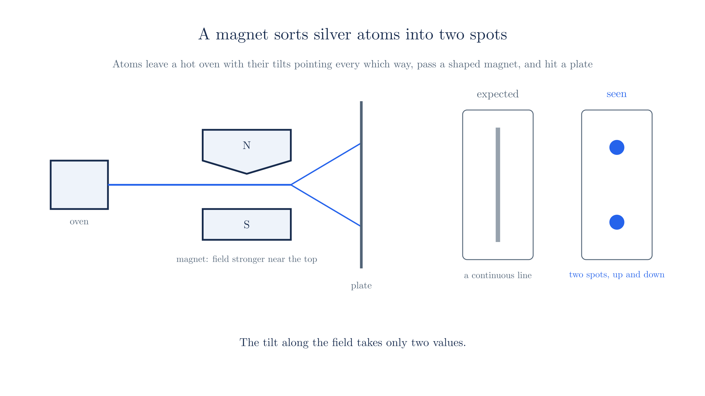
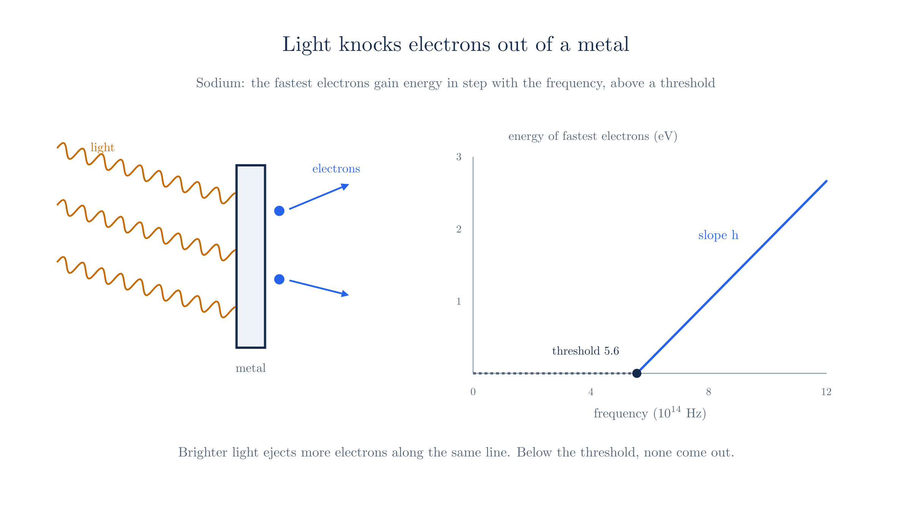

# First Quantization

[Classical Mechanics](./classical-mechanics.md) ended with two promises. The Hamiltonian, the energy written in position and momentum, would keep its job of moving the state forward in time. And the Poisson bracket of position with momentum would be replaced by a commutator, which measures how much the order of two operations matters. This chapter keeps both promises. To do it, the chapter first has to change what a state is, because a few experiments on atoms and electrons cannot be described by any point $(q, p)$.

## The chapter at a glance

Each classical idea from chapter 1 gets a quantum counterpart.

| | Classical (chapter 1) | Quantum (this chapter) |
| --- | --- | --- |
| The state at one instant | A point $(q, p)$ | A list of complex numbers called **amplitudes**, one for each possible outcome |
| A measurable quantity | A number computed from $(q, p)$ | An **operator**, a matrix whose eigenvalues are the possible results |
| What a measurement gives | The value, exactly | One of those results, at random, with probability equal to the squared size of its amplitude |
| What moves the state | Hamilton's equations, built from $H$ | The **Schrödinger equation**, built from the same $H$ with operators in it |
| How a quantity changes | At a rate set by its Poisson bracket with $H$ | Its average changes at a rate set by its **commutator** with $H$ |
| Position with momentum | Their bracket is 1 | Their commutator is $i\hbar$, where $\hbar$ is a constant introduced in section 6 |

Five experiments drive the changes, and each is described before it is used:

1. **Magnets sorting atoms (Stern–Gerlach):** outcomes are random, so the theory predicts probabilities.
2. **Electrons through two slits:** probabilities come from amplitudes that can cancel.
3. **Light knocking electrons out of a metal (the photoelectric effect):** light's energy comes in packets set by its frequency.
4. **X-rays bouncing off electrons (Compton scattering):** each packet also carries momentum set by its wavelength. De Broglie proposed the same two rules for matter.
5. **Electrons bouncing off a crystal (Davisson–Germer):** they confirm de Broglie's wavelength. That fixes the momentum operator, and with it the commutator, and de Broglie's frequency rule gives the Schrödinger equation.

Replacing classical quantities by operators in this way is called **first quantization**. It is "first" because it quantizes the motion of particles; [Field Quantization](./field-quantization.md) later applies the same rule to fields.

## 1. Experiments that force a new kind of state

**Magnets that sort atoms.** In 1922 Otto Stern and Walther Gerlach sent a beam of silver atoms, boiled off a hot oven, between the poles of a specially shaped magnet. Each silver atom is a tiny magnet itself, because of a property of its outermost electron called **spin**. The magnet's field is stronger near one pole than the other, so it pushes each atom up or down by an amount that depends on how the atom's own magnet is tilted. The atoms then hit a glass plate.

Atoms leave the oven with their tilts pointing every which way, so classically the beam should smear into a continuous line on the plate. Instead it lands in two separate spots, one up and one down, and nothing in between. The tilt along the field direction takes only two values.

*The Stern–Gerlach setup, and what the plate shows.*

Later experiments put magnets in a row, starting with Thomas Phipps and Otto Stern in 1932 and Otto Frisch and Emilio Segrè in 1933. The figure and table below are an idealized version of such sequences, as textbooks present them.

*The three sequences in the table below.*

| Setup | What happens | What it shows |
| --- | --- | --- |
| Keep the atoms from the upper spot. Send them through a second vertical magnet. | All of them go up again. | A measurement can leave a definite state that repeats. |
| Send those same atoms through a magnet turned sideways. | Half go left and half go right, with no way to predict which atom goes where. | Identical atoms give different results, so the theory can predict only probabilities. |
| Keep the atoms that went right. Send them through a vertical magnet again. | Half go up and half go down. | The sideways measurement erased the earlier "up". Measuring changes the state. |

**Electrons through two slits.** Now fire electrons, one at a time, at a barrier with two narrow slits, A and B, and count where they land on a screen behind it. Each electron arrives as a single dot. Run the experiment three ways: with only A open, with only B open, and with both open. Claus Jönsson first did this with electrons in 1961, and Akira Tonomura's group recorded the pattern building up one electron at a time in 1989, using an electron biprism, which acts like a pair of slits.

Before looking, consider what to expect. If each electron goes through one slit or the other, its chance of reaching a spot with both open is its chance via A plus its chance via B. Chances are never negative, so opening B can only add electrons to a spot, never remove them. The both-open count should be the sum of the two single-slit counts, the dashed curve in the figure.

*Electron counts with one slit or both open.*

That is not what happens. With both slits open, the counts form stripes, and at some spots they drop almost to zero, although each slit on its own delivers plenty of electrons there.

So the theory needs numbers that can cancel when added. Quantum mechanics gives each route an **amplitude**, a complex number. It adds the amplitudes for different routes to the same outcome first, then squares the size of the sum to get the probability. Two amplitudes of opposite sign cancel, which produces the dark stripes. This adding before squaring is called **interference**.

**Outcomes are random, and their probabilities come from amplitudes that can cancel.** The next section builds the state out of amplitudes, using the silver atom's spin as the running example.

## 2. A state is a list of amplitudes

Put a silver atom in a vertical magnetic field. Its spin has two possible orientations along the field, up and down. Just as a compass needle's energy depends on its angle to a magnetic field, the two orientations have slightly different energies, $E_0$ and $E_1$. Call the state that is "up" for certain $\lvert 0\rangle$, and the one that is "down" for certain $\lvert 1\rangle$. The symbol $\lvert\ \rangle$ marks a state, and the labels inside it are local to each example. A general state combines the two,

$$\lvert\psi\rangle = c_0\lvert 0\rangle + c_1\lvert 1\rangle,$$

and the complex numbers $c_0$ and $c_1$ are its amplitudes. Measuring with a vertical magnet gives "up", which means energy $E_0$, with probability $\lvert c_0\rvert^2$, and "down" with probability $\lvert c_1\rvert^2$. This is the **Born rule**. The two probabilities must add up to one, so a state has $\lvert c_0\rvert^2 + \lvert c_1\rvert^2 = 1$.

**Example.** Keep the atoms that went "up" in a first magnet tilted by an angle $\theta$ from vertical, and measure them with a vertical magnet. Experiment finds that they come out up with probability $\cos^2(\theta/2)$. We take the amplitudes to be $c_0 = \cos(\theta/2)$ and $c_1 = \sin(\theta/2)$, with $\theta$ counted positive toward the right and negative toward the left, so a leftward tilt flips the sign of $c_1$:

| First magnet tilted | Chance of up | $c_0$ | $c_1$ |
| --- | ---: | ---: | ---: |
| not at all | 100% | 1 | 0 |
| 60° to the right | 75% | $\sqrt3/2$ | $1/2$ |
| 90° to the right | 50% | $1/\sqrt2$ | $1/\sqrt2$ |
| 90° to the left | 50% | $1/\sqrt2$ | $-1/\sqrt2$ |
| 180° | 0% | 0 | 1 |

The 90° rows match the third row of the magnet table. The running example from here on is the 60° tilt, with $c_0 = \sqrt3/2$ and $c_1 = 1/2$:

| Vertical result | Amplitude | Probability |
| --- | ---: | ---: |
| Up, energy $E_0$ | $\sqrt3/2 \approx 0.866$ | 75% |
| Down, energy $E_1$ | $1/2$ | 25% |

*The state as an arrow. Its components along "up" and "down" are the amplitudes, and their squares are the probabilities.*

**The phase matters too.** The amplitudes can be complex, and a change of phase can leave the up and down probabilities alone while changing others. To see it, measure the same atoms with a sideways magnet. Its certain states are the two 90° rows of the tilt table: "right", with amplitudes $1/\sqrt2$ and $1/\sqrt2$, written $\lvert +\rangle$, and "left", with $1/\sqrt2$ and $-1/\sqrt2$, written $\lvert -\rangle$.

To get the sideways probabilities, rewrite the state in terms of $\lvert +\rangle$ and $\lvert -\rangle$. The box does the algebra, and the new amplitudes are

$$\text{right: } \frac{c_0 + c_1}{\sqrt2}, \qquad \text{left: } \frac{c_0 - c_1}{\sqrt2}.$$

Each probability is the squared size of its amplitude. Squaring a sum gives

$$\lvert c_0 \pm c_1\rvert^2 = \lvert c_0\rvert^2 + \lvert c_1\rvert^2 \pm 2\,\mathrm{Re}(c_0^*c_1).$$

The last part, the **cross term**, is where interference lives. For our atoms both amplitudes are real and positive, so the cross term is $2\cdot\tfrac{\sqrt3}{2}\cdot\tfrac12 = \sqrt3/2$. Dividing by 2, from the $\sqrt2$ in each amplitude, gives the probabilities $(1 \pm \sqrt3/2)/2$, which are 93.3% right and 6.7% left. That matches the tilt rule, since the two magnets are 30° apart and $\cos^2 15° = 93.3\%$.

Rewriting the state for the sideways magnet

The sideways states are $\lvert\pm\rangle = (\lvert 0\rangle \pm \lvert 1\rangle)/\sqrt2$. Adding and subtracting these gives $\lvert 0\rangle = (\lvert +\rangle + \lvert -\rangle)/\sqrt2$ and $\lvert 1\rangle = (\lvert +\rangle - \lvert -\rangle)/\sqrt2$. Substituting into the state,

$$c_0\lvert 0\rangle + c_1\lvert 1\rangle = \frac{c_0 + c_1}{\sqrt2}\,\lvert +\rangle + \frac{c_0 - c_1}{\sqrt2}\,\lvert -\rangle.$$

For our atoms, the right amplitude is $(\sqrt3 + 1)/(2\sqrt2) \approx 0.966$, whose square is $(2 + \sqrt3)/4 \approx 0.933$. The left amplitude is $(\sqrt3 - 1)/(2\sqrt2) \approx 0.259$, whose square is $(2 - \sqrt3)/4 \approx 0.067$.

As a check on the sign in "left", an atom certain to go left has right amplitude $(1/\sqrt2 - 1/\sqrt2)/\sqrt2 = 0$, so it never goes right, as the tilt rule says for magnets 180° apart.

**A second experiment.** Now tilt the first magnet 60° toward the front instead, at right angles to "right". A vertical magnet still gives 75% up, so $c_1$ still has size $1/2$. If amplitudes were real, $c_1$ would be $1/2$ or $-1/2$, and the sideways magnet would give 93.3% or 6.7% right. It gives 50% each way, which the tilt rule also predicts, since the front-tilted and sideways magnets are 90° apart and $\cos^2 45° = 50\%$:

| First magnet tilted 60° toward | Up / down | Right | Left |
| --- | --- | ---: | ---: |
| the right | 75% / 25% | 93.3% | 6.7% |
| the front | 75% / 25% | 50% | 50% |

An even split needs the cross term to vanish. Keeping $c_0 = \sqrt3/2$, that means $c_1$ has no real part, so $c_1 = \pm i/2$, at right angles to $c_0$ in the complex plane. Which sign goes with the front is a convention, and we take $c_1 = i/2$. Then each probability is $(\lvert c_0\rvert^2 + \lvert c_1\rvert^2)/2 = (3/4 + 1/4)/2 = 1/2$.

In the first state, $c_0$ and $c_1$ are both positive, so they add in the "right" amplitude and nearly cancel in the "left" one. That is the same cancellation as the dark stripes. In the second state, $c_1$ points at right angles to $c_0$, so they neither help nor cancel each other, and each side gets half. The vertical results cannot tell these two states apart, but the sideways results can. So the state is the list of amplitudes, phases included, not just the list of probabilities.

**The overlap.** The right amplitude can also be read off without rewriting the state. Multiply the complex conjugate of each amplitude of $\lvert +\rangle$ by the matching amplitude of the state, and add:

$$\langle +\vert\psi\rangle = \tfrac{1}{\sqrt2}\,c_0 + \tfrac{1}{\sqrt2}\,c_1 = \frac{\sqrt3/2 + 1/2}{\sqrt2} \approx 0.966,$$

the same right amplitude as before. This sum is the **inner product**, or overlap, of the two states. In the notation $\langle +\vert\psi\rangle$, the left half $\langle +\rvert$ stands for the conjugated amplitudes of $\lvert +\rangle$.

The conjugate makes the overlap of a state with itself equal to its squared length, $\lvert c_0\rvert^2 + \lvert c_1\rvert^2 = 1$. In general, the probability that a measurement gives the result whose certain state is $\lvert a\rangle$ is $\lvert\langle a\vert\psi\rangle\rvert^2$, which is the Born rule written with overlaps. The [Math Refresher](appendix-math-linear-algebra.md) develops this "bra-ket" notation further.

**A state is a list of complex amplitudes, and their phases matter.** The next section extends the idea from two outcomes to a particle that can be anywhere.

## 3. A particle on a line: the wave function

An electron hitting the screen in the two-slit experiment can land at any position $x$, so its state needs one amplitude for every $x$. That list is a complex function $\psi(x)$, called the **wave function**. At the screen, it is the sum of a part from each slit, and the stripes are where the two parts cancel.

The Born rule turns the wave function into a probability density $\lvert\psi(x)\rvert^2$. The chance of finding the particle between two points is the area under the density between them, and the whole area is one.

The overlap of two wave functions is the integral of $\phi^*(x)\,\psi(x)$. It is the same sum as before, with one term for each position.

**Example.** Take a particle confined between 0 and 1 metre, with wave function $\sqrt2\,\sin(\pi x)$ there and zero outside, chosen for illustration. The factor $\sqrt2$ makes the total area one. Its density, $2\sin^2(\pi x)$, is zero at the walls and largest in the middle. The probability for each quarter of the interval is the area under the density over that quarter:

| Quarter of the interval | Probability |
| --- | ---: |
| 0 to 0.25 m | 9.1% |
| 0.25 to 0.5 m | 40.9% |
| 0.5 to 0.75 m | 40.9% |
| 0.75 to 1 m | 9.1% |

*The wave function and its density. Each shaded area is the probability of finding the particle in that quarter.*

The four add up to one, so the particle is certainly somewhere in the interval.

Computing the quarters

The area under $2\sin^2(\pi x)$ from 0 to $a$ is $a - \sin(2\pi a)/(2\pi)$, using $2\sin^2 u = 1 - \cos 2u$. At $a = 1/4$ this is $1/4 - 1/(2\pi) \approx 0.091$. At $a = 1/2$ it is $1/2$, so the second quarter holds $0.5 - 0.091 = 0.409$. The other half mirrors the first, and at $a = 1$ the total is 1.

**A particle's state is a wave function.** Next, the measurable quantities get attached to states.

## 4. Measured quantities become operators

A measurable quantity now needs two pieces of information. One is its possible values, such as up and down. The other is, for each value, the state that gives it with certainty. A matrix holds both. Choose a matrix whose eigenvectors (also called eigenstates) are the certain states and whose eigenvalues are the matching values. Applying it to one of those states rescales the state by its value, $\hat A\lvert a\rangle = a\lvert a\rangle$. Such a matrix, or for a particle the matching operation on wave functions, is an **operator**. It is linear, which means it acts on a sum term by term.

**Example.** Write a spin state as the column of its two amplitudes. The energy operator, $\hat H$, has eigenvectors "up" and "down" with eigenvalues $E_0$ and $E_1$. The sideways magnet has eigenvectors "right" and "left", which we give the values $+1$ and $-1$. Its operator, which we call $\hat S$ for sideways, swaps the two amplitudes:

$$\hat H = \begin{pmatrix} E_0 & 0 \\ 0 & E_1 \end{pmatrix}, \qquad \hat S = \begin{pmatrix} 0 & 1 \\ 1 & 0 \end{pmatrix}.$$

Swapping leaves the "right" column $(1, 1)/\sqrt2$ unchanged, so its value is $+1$. It turns the "left" column $(1, -1)/\sqrt2$ into its negative, so its value is $-1$.

Two conditions make an operator usable for a measurement. Its eigenvalues must be real, because they are measured numbers. And its certain states must have zero overlap with each other, because a state that gives one value for certain can never give another. Matrices equal to their own conjugate transpose, called **Hermitian**, meet both conditions, and a quantity represented by one is called an **observable**. A Hermitian operator also has enough eigenvectors to write any state in them, and then the squared amplitudes are the probabilities of its values.

**The average and the spread.** Repeat a measurement on many identically prepared systems, and the results have an average, the **expectation value** $\langle A\rangle$, and a spread, the standard deviation $\Delta A$. For the tilted atoms, the sideways results are $+1$ with 93.3% and $-1$ with 6.7%:

| Quantity | Calculation | Value |
| --- | --- | ---: |
| Average $\langle S\rangle$ | $(+1)(0.933) + (-1)(0.067)$ | 0.866 |
| Average of the square $\langle S^2\rangle$ | every result squared is 1 | 1 |
| Spread $\Delta S = \sqrt{\langle S^2\rangle - \langle S\rangle^2}$ | $\sqrt{1 - 0.75}$ | 0.5 |

The average also comes straight from the operator, as the overlap of the state with $\hat S$ applied to the state, written $\langle\psi\vert\hat S\vert\psi\rangle$. Here $\hat S$ swaps the amplitudes to $(1/2,\ \sqrt3/2)$, and the overlap with $(\sqrt3/2,\ 1/2)$ is $\sqrt3/4 + \sqrt3/4 \approx 0.866$. This works for any observable, because written in its eigenvectors, the operator multiplies each amplitude by its value, and the overlap then adds up each value times its probability.

**Order matters.** With ordinary numbers, $ab = ba$. With operators the order can matter, and the **commutator** $[\hat A, \hat B] = \hat A\hat B - \hat B\hat A$ measures by how much. Here $\hat A\hat B$ means applying $\hat B$ first, then $\hat A$. For the spin,

$$[\hat H, \hat S] = \begin{pmatrix} 0 & E_0 - E_1 \\ E_1 - E_0 & 0 \end{pmatrix},$$

which is not zero, because the two energies differ. If two operators shared a full set of eigenstates, both orders would give the same result on each of them, so the commutator would be zero. So operators that do not commute cannot share a full set of certain states, and some state sharp in one is spread in the other. The third magnet row is an example: a state sharp sideways, "right", gave up and down 50% each.

Reference: Hermitian operators

A **Hermitian** operator satisfies $\hat A = \hat A^\dagger$, where the **adjoint** $\hat A^\dagger$ is defined by $\langle\phi\vert\hat A^\dagger\psi\rangle = \langle\hat A\phi\vert\psi\rangle$. For matrices, $\hat A^\dagger = (\hat A^*)^T$: conjugate the entries, then transpose. Both $\hat H$ and $\hat S$ above are Hermitian.

Its eigenvalues are real. If $\hat A\psi = \lambda\psi$, then $\lambda = \langle\psi\vert\hat A\psi\rangle/\langle\psi\vert\psi\rangle$. Hermiticity lets $\hat A$ move across, $\langle\psi\vert\hat A\psi\rangle = \langle\hat A\psi\vert\psi\rangle$, and swapping the two sides of an inner product conjugates it, so the numerator equals its own conjugate and is real. Eigenvectors with distinct eigenvalues are orthogonal. Computing $\langle\psi_2\vert\hat A\psi_1\rangle$ once by acting on $\psi_1$ and once by moving $\hat A$ onto $\psi_2$ gives $\lambda_1\langle\psi_2\vert\psi_1\rangle = \lambda_2\langle\psi_2\vert\psi_1\rangle$, so $\langle\psi_2\vert\psi_1\rangle = 0$.

The spectral theorem gives a complete orthonormal eigenbasis for a Hermitian matrix. Position and momentum can take any value, so sums over their eigenstates become integrals, and their certain states, a spike at one point or an endless wave, cannot be scaled to length one.

**Each quantity is an operator.** The next two sections find the operators for a particle's position and momentum, starting from three more experiments.

## 5. Matter waves

**Light knocking electrons out of a metal.** A particle's momentum operator needs three more experiments. The first is about light. Shine light on a clean metal surface, and it knocks electrons out. If light were a smooth wave, brighter light would shake the electrons harder and eject faster ones, and dim light of any colour would eventually eject some. Neither happens. Brighter light ejects more electrons but not faster ones. Below a certain frequency no electrons come out at all, however bright the light, and above it the fastest electrons' energy grows in step with the frequency.

*The photoelectric effect for sodium. Brighter light ejects more electrons on the same line.*

Einstein explained this in 1905. Light arrives in packets of energy $E = hf$, where $h$ is a constant Max Planck had introduced in 1900 to explain heat radiation. Each packet frees at most one electron, and the fastest electrons leave with the packet's energy minus the energy needed to free them. So a plot of their energy against frequency is a straight line of slope $h$. Robert Millikan measured that line in 1916 and found a slope within 1% of Planck's value; today $h = 6.63\times10^{-34}\ \mathrm{J\,s}$. The line reaches zero at the threshold frequency. For sodium:

| Step | Value |
| --- | --- |
| Threshold frequency, modern value | $5.6\times10^{14}$ Hz, green light |
| Energy needed to free an electron, $hf$ | $3.7\times10^{-19}$ J, about 2.3 eV (1 eV is $1.602\times10^{-19}$ J) |

Light also carries momentum. Electromagnetism gives light of energy $E$ a momentum $E/c$, which is why light pushes on what it hits. With $E = hf$ and $c = f\lambda$, a single packet would carry $p = h/\lambda$.

**X-rays bouncing off electrons.** In 1923 Arthur Compton scattered X-rays off the electrons in a block of carbon. A smooth wave would shake each electron at the wave's own frequency, and the electron would re-radiate the same wavelength. Instead, the scattered X-rays came out with a longer wavelength, and the shift grew with the scattering angle by exactly the amount a collision between an electron and a packet of momentum $h/\lambda$ predicts.

*Compton scattering. The scattered X-ray has a longer wavelength, more so at larger angles.*

In 1924 Louis de Broglie proposed that matter works the same way. A particle of momentum $p$ behaves as a wave of wavelength $\lambda = h/p$, and a particle of energy $E$ oscillates at the frequency $f = E/h$.

**Electrons bouncing off a crystal.** The third experiment tests de Broglie's wavelength. In 1927 Clinton Davisson and Lester Germer aimed a beam of electrons, all with the same energy, straight at the surface of a nickel crystal and counted how many bounced back at each angle $\theta$ from the beam. Particles bouncing off a rough surface would scatter over a smooth range of angles. Instead, the count showed a clear peak at one angle.

That is what a wave does when it bounces off evenly spaced rows of atoms. The beam arrives straight down, so waves reaching neighbouring rows of surface atoms, a distance $d$ apart, travel equally far in. On the way out at angle $\theta$, one of them travels $d\sin\theta$ farther. They reinforce when that difference is one wavelength and cancel at most other angles, so the peak angle measures the wavelength.

*The Davisson–Germer geometry, and the count against angle.*

The numbers:

| Step | Value |
| --- | --- |
| Electron energy | $54\ \mathrm{eV} = 8.65\times10^{-18}\ \mathrm{J}$ |
| Momentum $p = \sqrt{2mE}$, electron mass $m = 9.11\times10^{-31}$ kg | $3.97\times10^{-24}\ \mathrm{kg\,m/s}$ |
| de Broglie's prediction $h/p$ | $0.167\ \mathrm{nm}$ |
| Measured: peak at $\theta = 50°$, surface rows $d = 0.215$ nm apart (known from X-ray diffraction), wavelength $d\sin\theta$ | $0.165\ \mathrm{nm}$ |

**Matter has a wavelength $h/p$ and a frequency $E/h$.** The next section turns the wavelength into the momentum operator.

## 6. Position and momentum operators

**Position.** The certain states of position are the ones concentrated at a single point. So the position operator $\hat x$ multiplies the wave function by $x$: on a state concentrated at a point $a$, that is the same as multiplying by $a$, which is the value.

**A wave of definite momentum.** By de Broglie's rule, a particle with a definite momentum $p$ has a wave function shaped like a wave of wavelength $h/p$. A real wave such as a cosine has crests and troughs in its density, which would make the particle prefer some places over others, and nothing about a free particle of given momentum favours one place. So the wave is complex instead:

$$\psi_p(x) = e^{ipx/\hbar}, \qquad \hbar = \frac{h}{2\pi} = 1.055\times10^{-34}\ \mathrm{J\,s}.$$

It has size one everywhere, and it repeats over a distance $2\pi\hbar/p = h/p$, the wavelength. The constant $\hbar$ is read "h-bar".

**The momentum operator.** Acting on this wave, the momentum operator has to give back the same wave multiplied by $p$, and one operator has to do this for every $p$. Differentiating does it. The derivative of $e^{ipx/\hbar}$ is $ip/\hbar$ times the wave, so multiplying the derivative by $-i\hbar$ returns exactly $p$ times the wave:

$$\hat p = -i\hbar\,\frac{d}{dx}, \qquad \hat p\,e^{ipx/\hbar} = p\,e^{ipx/\hbar}.$$

Any wave function is a sum of such waves (its [Fourier transform](appendix-math-complex.md)), and $\hat p$ is linear, so $\hat p$ acts this way on every wave function.[^pos-rep]

**The commutator of position and momentum.** Apply $\hat x$ and $\hat p$ in both orders to a test function, $\psi = x^2$:

| Order | Steps | Result |
| --- | --- | --- |
| $\hat p$ first, then $\hat x$ | $\hat p\,x^2 = -2i\hbar x$, then multiply by $x$ | $-2i\hbar\,x^2$ |
| $\hat x$ first, then $\hat p$ | $\hat x\,x^2 = x^3$, then $-i\hbar\,d/dx$ | $-3i\hbar\,x^2$ |
| Difference, first row minus second | | $i\hbar\,x^2$ |

The difference is $i\hbar$ times the function we started with, and the box shows the same for every function. So the commutator of position with momentum is

$$[\hat x, \hat p] = i\hbar.$$

The commutator for any wave function

Apply both orders to a differentiable $\psi(x)$. The product rule gives

$$[\hat x,\hat p]\psi = x(-i\hbar\,\psi') + i\hbar\,(x\psi)' = -i\hbar\,x\psi' + i\hbar\,(\psi + x\psi') = i\hbar\,\psi.$$

The terms with $\psi'$ cancel, and what survives comes from differentiating the factor $x$.

Compare this with chapter 1. There, the Poisson bracket of position with momentum was 1 for every system, and every other bracket followed from it. Here the commutator is that same 1, multiplied by $i\hbar$. That suggests a rule for quantizing any classical relation: replace each Poisson bracket by a commutator divided by $i\hbar$,

$$\{f, g\} \;\to\; \frac{1}{i\hbar}\,[\hat f, \hat g].$$

The $i$ and the $\hbar$ each have a job. Dividing by $i$ makes the result Hermitian, so its values are real like a Poisson bracket's; the box shows why. And $\hbar$ supplies the units, because $[\hat x, \hat p]$ has units of position times momentum, the units of $\hbar$, while the bracket $\{q, p\} = 1$ has none.

Why a commutator of Hermitian operators is i times a Hermitian one

Taking the adjoint of a product reverses the order, $(\hat A\hat B)^\dagger = \hat B^\dagger\hat A^\dagger = \hat B\hat A$ for Hermitian $\hat A$ and $\hat B$. So $[\hat A,\hat B]^\dagger = [\hat B,\hat A] = -[\hat A,\hat B]$. An operator equal to minus its own adjoint becomes Hermitian when divided by $i$, because $(\hat C/i)^\dagger = \hat C^\dagger/(-i) = \hat C/i$.

**Position and momentum are operators that do not commute.** The next section uses de Broglie's frequency rule and the energy operator to move the state.

## 7. The energy moves the state: the Schrödinger equation

**A definite energy turns the phase.** Section 4 stated that any state can be written as a sum of states of definite energy, so to move a state it is enough to learn how each of those changes in time. De Broglie's second rule says it oscillates at the frequency $f = E/h$. Its phase turns by a full circle $f$ times per second, which is $2\pi f t = Et/\hbar$ in a time $t$, so the state carries the factor

$$e^{-iEt/\hbar},$$

just as a state of definite momentum carries $e^{ipx/\hbar}$ in space. The overall sign is a convention, but the relative sign of the two exponents is not, as the box shows. For a free particle with momentum $p$ and energy $E = p^2/2m$, the two factors combine into the wave

$$e^{i(px - Et)/\hbar}.$$

Which way the wave travels

A crest is a place where the phase $px - Et$ has a fixed value. Solving for its position gives $x = (E/p)\,t + \text{const}$, which moves toward $+x$ as $t$ grows when $p > 0$. With the same sign on both terms, the crest would move toward $-x$, against the momentum. So the time factor $e^{-iEt/\hbar}$ is the one that matches $e^{ipx/\hbar}$.

A state of definite energy changes only by this overall phase, so its density and every probability stay fixed. Such states are called **stationary states**, and finding them means solving $\hat H\psi = E\psi$ with the energy operator below.

**The energy operator.** In chapter 1, the Hamiltonian $H = p^2/2m + V(x)$ moved the point $(q, p)$ forward in time. Quantum mechanics keeps the same function and puts the momentum operator into it. Applying $\hat p$ twice differentiates twice, and the two factors of $-i\hbar$ multiply to $-\hbar^2$, so

$$\hat H = -\frac{\hbar^2}{2m}\frac{d^2}{dx^2} + V(x).$$

**The Schrödinger equation.** We want an equation that, like Hamilton's, involves one time derivative, so that the state now fixes its future. It should also be linear, so that sums of solutions are solutions. Differentiating the free wave once in time and multiplying by $i\hbar$ gives $E$ times the wave. Applying $\hat H$, which for a free particle differentiates twice in space, gives $p^2/2m$ times the wave. The two sides agree because $E = p^2/2m$. Writing $\Psi(x,t)$ for the wave function at time $t$, the equation that sets them equal is the **Schrödinger equation**,

$$i\hbar\,\frac{\partial\Psi}{\partial t} = \hat H\,\Psi.$$

With a potential, we keep the same equation and include $V(x)$ in $\hat H$. That extension is an assumption, which experiment has confirmed ever since.

**Three properties.**

1. **It is linear.** A sum of solutions is again a solution. So a state can be split into states of definite energy, each part evolved on its own, and the results added back.
2. **It keeps the total probability at one.** Each state of definite energy $E$ only picks up the factor $e^{-iEt/\hbar}$, which has size one. So no amplitude grows or shrinks, and a state whose probabilities add to one keeps that property. Collect these factors into one operator $\hat U(t)$, which multiplies each state of definite energy $E$ by $e^{-iEt/\hbar}$, so that $\lvert\Psi(t)\rangle = \hat U(t)\lvert\Psi(0)\rangle$. It is written $e^{-i\hat Ht/\hbar}$, because on those states $\hat H$ acts as the number $E$. It is **unitary**, meaning it leaves every length and overlap unchanged.
3. **Averages follow chapter 1's bracket rule.** The average of any observable changes at the rate $\tfrac{1}{i\hbar}\langle[\hat A, \hat H]\rangle$, which is chapter 1's rule $df/dt = \{f, H\}$ with the bracket replaced by the commutator. For position and momentum, it gives Hamilton's equations for the averages, with the force averaged over the spread-out state; the box shows how. Section 8 shows why this matches chapter 1 for a heavy object.

Reference: unitary operators and generators

A **unitary** operator satisfies $\hat U^\dagger\hat U = \hat U\hat U^\dagger = \hat I$. It preserves inner products, because $\langle\hat U\phi\vert\hat U\psi\rangle = \langle\phi\vert\hat U^\dagger\hat U\psi\rangle = \langle\phi\vert\psi\rangle$, so a normalized state stays normalized.

Exponentiating a Hermitian operator gives a unitary one, $e^{i\hat A}$. Conversely, a family of unitary transformations $\hat U(\theta)$ that depends smoothly on $\theta$ and satisfies $\hat U(a)\hat U(b) = \hat U(a + b)$ can be written $e^{-i\theta\hat G}$ with $\hat G$ Hermitian, and $\hat G$ is called its **generator**. The Hamiltonian divided by $\hbar$ is the generator of $\hat U(t)$.

Deriving the rate of change of an average

Write $\langle A\rangle = \langle\Psi\vert\hat A\vert\Psi\rangle$ and differentiate both copies of $\Psi$. The Schrödinger equation gives $\partial_t\lvert\Psi\rangle = \tfrac{1}{i\hbar}\hat H\lvert\Psi\rangle$, and its adjoint gives $\partial_t\langle\Psi\rvert = -\tfrac{1}{i\hbar}\langle\Psi\rvert\hat H$, because $\hat H$ is Hermitian. Equivalently, the bra evolves as $\langle\Psi(t)\rvert = \langle\Psi(0)\rvert\,e^{+i\hat Ht/\hbar}$, the adjoint of $\hat U(t)$. So

$$\frac{d\langle A\rangle}{dt} = -\frac{1}{i\hbar}\langle\hat H\hat A\rangle + \frac{1}{i\hbar}\langle\hat A\hat H\rangle = \frac{1}{i\hbar}\langle[\hat A,\hat H]\rangle.$$

For position, only the kinetic term fails to commute with $\hat x$. Using $[\hat x,\hat p] = i\hbar$ twice, $[\hat x,\hat p^2] = \hat p[\hat x,\hat p] + [\hat x,\hat p]\hat p = 2i\hbar\,\hat p$, so $d\langle x\rangle/dt = \langle p\rangle/m$: the average position changes at the average momentum over the mass.

For momentum, only the potential fails to commute with $\hat p$. On a test function, $[\hat p, V]\psi = -i\hbar(V\psi)' + i\hbar V\psi' = -i\hbar\,V'\psi$, so $d\langle p\rangle/dt = -\langle V'\rangle$: the average momentum changes at minus the average slope of $V$, the force averaged over the state. This equals $-V'(\langle x\rangle)$ when $V'$ barely changes across the state, and exactly for a spring or a constant force.

**Example: the tilted spin in time.** Leave the tilted silver atom from section 2 in the vertical field. Its "up" part turns its phase at a rate set by $E_0$, and its "down" part at a rate set by $E_1$. Turning every amplitude by the same phase changes no probability, so only the difference matters, and the down amplitude turns relative to the up one, completing a turn in the time $\tau = 2\pi\hbar/(E_1 - E_0)$, taking $E_1 > E_0$:

| Time | Down amplitude (up held at $\sqrt3/2$) | Up / down | Right | $\langle S\rangle$ |
| --- | --- | --- | ---: | ---: |
| $0$ | $1/2$ | 75% / 25% | 93.3% | 0.866 |
| $\tau/4$ | $-i/2$ | 75% / 25% | 50% | 0 |
| $\tau/2$ | $-1/2$ | 75% / 25% | 6.7% | $-0.866$ |
| $3\tau/4$ | $i/2$ | 75% / 25% | 50% | 0 |
| $\tau$ | $1/2$ | 75% / 25% | 93.3% | 0.866 |

The up and down probabilities never change, because they depend only on the sizes of the amplitudes. The sideways results swing back and forth, because they depend on the relative phase. Physically, the spin's tilt swings around the field direction like a spinning top. At $3\tau/4$ it points toward the front, and the state is exactly the $c_1 = i/2$ state of section 2.

This turning is also why amplitudes have to be complex: a real amplitude of fixed size can only flip between $+c$ and $-c$, while a complex one can keep its size and still turn.

Computing the table

With the shared phase removed, the state at time $t$ is $c_0\lvert 0\rangle + c_1 e^{-i\varphi}\lvert 1\rangle$, with $\varphi = (E_1 - E_0)t/\hbar$, $c_0 = \sqrt3/2$ and $c_1 = 1/2$. The probability of "right" is

$$\Big\lvert\frac{c_0 + c_1 e^{-i\varphi}}{\sqrt2}\Big\rvert^2 = \frac{c_0^2 + c_1^2 + 2c_0c_1\cos\varphi}{2} = \frac12 + \frac{\sqrt3}{4}\cos\varphi,$$

which is $0.933,\ 0.5,\ 0.067,\ 0.5$ at $\varphi = 0,\ \pi/2,\ \pi,\ 3\pi/2$. The average is $\langle S\rangle = 2P(\text{right}) - 1 = \tfrac{\sqrt3}{2}\cos\varphi$.

It agrees with property 3. Write $\epsilon = E_1 - E_0$. From section 4, $[\hat S,\hat H] = -[\hat H,\hat S]$ has $\epsilon$ at top right and $-\epsilon$ at bottom left. Sandwiching it with the state $(c_0,\ c_1e^{-i\varphi})$ gives

$$\langle[\hat S,\hat H]\rangle = \epsilon\,c_0c_1\big(e^{-i\varphi} - e^{i\varphi}\big) = -2i\epsilon\,c_0c_1\sin\varphi,$$

so $\tfrac{1}{i\hbar}\langle[\hat S,\hat H]\rangle = -\tfrac{\sqrt3}{2}\tfrac{\epsilon}{\hbar}\sin\varphi$, the time derivative of $\tfrac{\sqrt3}{2}\cos\varphi$.

**The Hamiltonian keeps its job.** It now moves a list of amplitudes instead of a point. The next section shows what the commutator of position and momentum rules out.

## 8. Why position and momentum cannot both be sharp

Suppose some state had a sharp position $a$ and a sharp momentum $b$ at once. Applying the two operators in either order would then give $ab$ times the state, so their commutator would give zero. But the commutator gives $i\hbar$ times the state, which is not zero. So no such state exists. The best a state can do is keep both spreads small, and the commutator sets how small. The **Heisenberg uncertainty relation** says

$$\Delta x\,\Delta p \ \ge\ \frac{\hbar}{2},$$

where $\Delta x$ and $\Delta p$ are the spreads of section 4, measured on identically prepared systems. Narrowing one spread forces the other to widen.

**Example: an electron and a ball.** The bound is tiny in everyday units, which is why chapter 1 never needed it. The smallest momentum spread is $\hbar/(2\Delta x)$, and the velocity spread is that divided by the mass.

| System | Position spread | Smallest momentum spread | Smallest velocity spread |
| --- | --- | --- | --- |
| Electron held within an atom, mass $9.11\times10^{-31}$ kg | $0.1\ \mathrm{nm}$ | $5.3\times10^{-25}\ \mathrm{kg\,m/s}$ | $5.8\times10^{5}\ \mathrm{m/s}$, about 580 km/s |
| The 1 kg ball from chapter 1, located to a micrometre | $10^{-6}\ \mathrm{m}$ | $5.3\times10^{-29}\ \mathrm{kg\,m/s}$ | $5.3\times10^{-29}\ \mathrm{m/s}$ |

For the electron, the velocity spread is enormous, so it cannot be pictured as a small ball on a path. For the ball, it is far below anything measurable, so its state stays narrow as it moves. The slope of $V$ then barely changes across the state, the averaged force of section 7 equals the force at its center, and the averages obey chapter 1's equations.

*Two bell-shaped (Gaussian) wave functions. The momentum density is the Born rule applied to the amount of each momentum wave $e^{ipx/\hbar}$ in the state. Squeezing the position density widens the momentum density, and this shape makes the product of the spreads exactly $\hbar/2$, the smallest allowed.*

A similar bound holds for any two observables: the product of their spreads is at least half the size of the average of their commutator. The box checks it on the spin.

A check on the spin, and why the commutator bounds the spreads

**The spin check.** Write $\epsilon = E_1 - E_0$ and compare the spin at time $0$ and at $\tau/4$:

| State | Energy spread | Sideways spread | Product | Bound |
| --- | --- | --- | --- | --- |
| At time $0$ | $\tfrac{\sqrt3}{4}\epsilon$ | $0.5$ | $\tfrac{\sqrt3}{8}\epsilon$ | $0$ |
| At $\tau/4$ | $\tfrac{\sqrt3}{4}\epsilon$ | $1$ | $\tfrac{\sqrt3}{4}\epsilon$ | $\tfrac{\sqrt3}{4}\epsilon$ |

At $\tau/4$ the product meets the bound exactly. The energy is $E_0$ with 75% and $E_1$ with 25% at both times, so its variance is $\tfrac34\cdot\tfrac14\,\epsilon^2$ and its spread $\tfrac{\sqrt3}{4}\epsilon$. The sideways spread is $\sqrt{1 - \langle S\rangle^2}$, with $\langle S\rangle = 0.866$ and $0$ from the time table. The bound is half the size of $\langle[\hat H,\hat S]\rangle = 2i\epsilon\,c_0c_1\sin\varphi$, the negative of the value in the time-table box, which is $0$ at $\varphi = 0$ and $\tfrac{\sqrt3}{2}\epsilon$ at $\varphi = \pi/2$.

**The bound.** Define $\lvert u\rangle = (\hat A - \langle A\rangle)\lvert\psi\rangle$ and $\lvert v\rangle = (\hat B - \langle B\rangle)\lvert\psi\rangle$. Their squared lengths are the squared spreads. The Cauchy–Schwarz inequality gives

$$(\Delta A)^2(\Delta B)^2 \ \ge\ \lvert\langle u\vert v\rangle\rvert^2 \ \ge\ \big(\operatorname{Im}\langle u\vert v\rangle\big)^2.$$

Because $\hat A$ and $\hat B$ are Hermitian, $\langle u\vert v\rangle = \langle\psi\vert(\hat A - \langle A\rangle)(\hat B - \langle B\rangle)\vert\psi\rangle$, and $\langle v\vert u\rangle$, its complex conjugate, is the same with the order reversed. Subtracting, the constants cancel:

$$2i\operatorname{Im}\langle u\vert v\rangle = \langle u\vert v\rangle - \langle v\vert u\rangle = \langle[\hat A,\hat B]\rangle.$$

Taking square roots gives $\Delta A\,\Delta B \ge \tfrac12\lvert\langle[\hat A,\hat B]\rangle\rvert$, and inserting $[\hat x,\hat p] = i\hbar$ gives $\Delta x\,\Delta p \ge \hbar/2$. The bound is about the spreads within one state, independent of any disturbance caused by a measuring device.

**Non-commuting observables cannot both be sharp.** The last section returns to the third Stern–Gerlach row: what a measurement does to the state.

## 9. What a measurement does to the state

The rules so far give the probability of each outcome. One more rule says what happens afterwards, and the magnets in a row already showed it. After an ideal measurement, the state is the certain state of the outcome found, so repeating the measurement at once gives the same result. This update is called **collapse**.

**Example.** Measure the tilted atoms with a sideways magnet. With probability 93.3% the result is "right", and the state becomes $\lvert +\rangle$, an even mix of up and down. A vertical magnet then gives up and down 50% each, not the 75% and 25% the atoms had before. The sideways measurement changed the state.

Unlike the Schrödinger evolution, collapse is not unitary and loses information. From $\lvert +\rangle$ alone, you cannot recover the amplitudes the atom had before.

**Measurement picks an outcome and resets the state to match it.**

Interpretation

The rules above are enough to calculate every prediction in this book, and physicists who agree on them still disagree about what they mean. The **Copenhagen interpretation**, associated with Bohr and his collaborators, treats the Born probabilities as fundamental. It does not assign an unmeasured observable a definite value unless the state is an eigenstate of that observable. Bohr's **complementarity** says one apparatus can show a sharp position and another a sharp momentum, but no apparatus shows both.

It is tempting to read the probabilities as ignorance of hidden details that do fix each outcome. A **hidden-variable theory** adds such variables to the quantum state. Bell's theorem (J. S. Bell, *On the Einstein–Podolsky–Rosen paradox*, Physics 1, 195 (1964)) derives inequalities that any theory satisfying certain locality and independence assumptions must obey. Quantum mechanics predicts violations, and experiments by Clauser and Freedman (1972), Aspect (1982), and later experiments closing the major loopholes observed them. The 2022 Nobel Prize recognized Aspect, Clauser and Zeilinger for this work. These results exclude local hidden variables under Bell's assumptions. They do not exclude every hidden-variable theory, and nonlocal theories remain part of the interpretation debate.

## What later chapters do with these tools

| Tool from this chapter | Where it returns |
| --- | --- |
| The Schrödinger equation, stationary states and $[\hat x,\hat p] = i\hbar$ | [The Harmonic Oscillator](./harmonic-oscillator.md) finds the stationary states of chapter 1's spring from the commutator alone. Their energies are evenly spaced by $\hbar\omega$, which for chapter 1's spring, with $\omega = 2\ \mathrm{s^{-1}}$, is $2.1\times10^{-34}$ J against a total energy of 2 J. That is why the spring looks classical |
| Bracket to commutator | [Field Quantization](./field-quantization.md) applies the same replacement to a field, with one pair of operators at every point of space |
| Unitary evolution and Hermitian generators | [Symmetries](./symmetries.md) builds symmetry groups from Hermitian generators, [Action and Lagrangians](./qft-action.md) links symmetries to conservation laws, and [Quantum Field Theory](./qft.md) builds its time evolution from $e^{-i\hat Ht/\hbar}$ |

---

Previous: [Classical Mechanics](./classical-mechanics.md)

Next: [The Harmonic Oscillator](./harmonic-oscillator.md)

[^pos-rep]: A state does not depend on a choice of basis. A **representation** writes it in one basis. In the position representation, the components are the amplitudes $\psi(x)$, $\hat x$ multiplies by $x$, and $\hat p$ acts as $-i\hbar\,d/dx$. In the momentum representation, $\hat p$ multiplies by $p$ and $\hat x$ acts as $i\hbar\,d/dp$. A Fourier transform relates the two.
