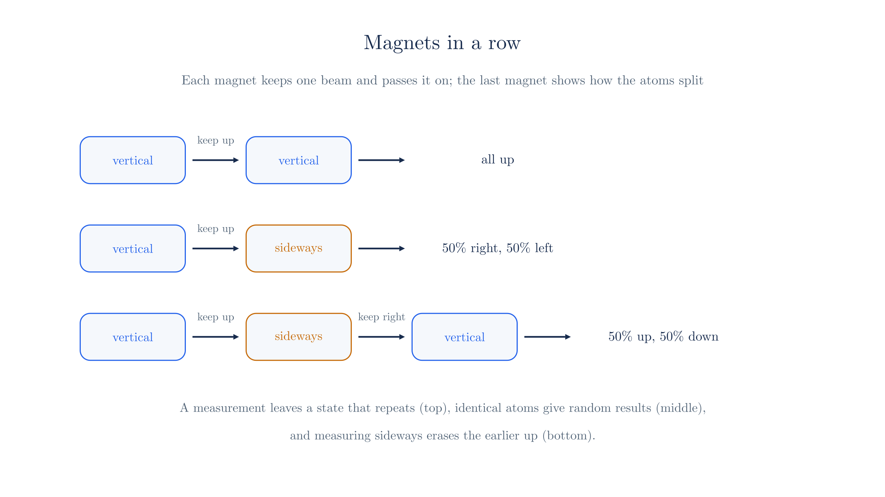
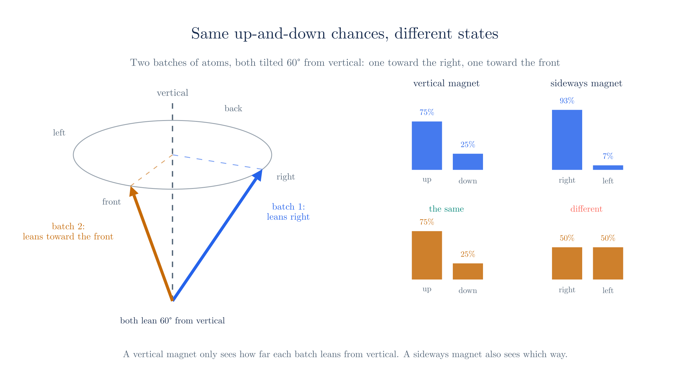
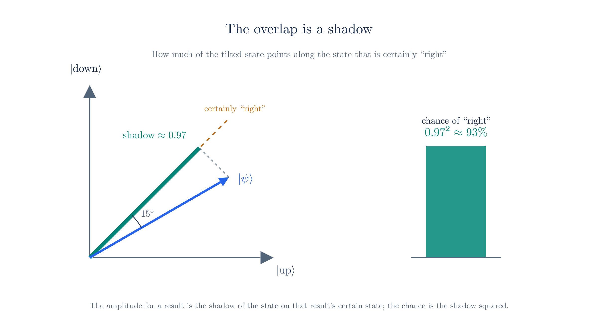
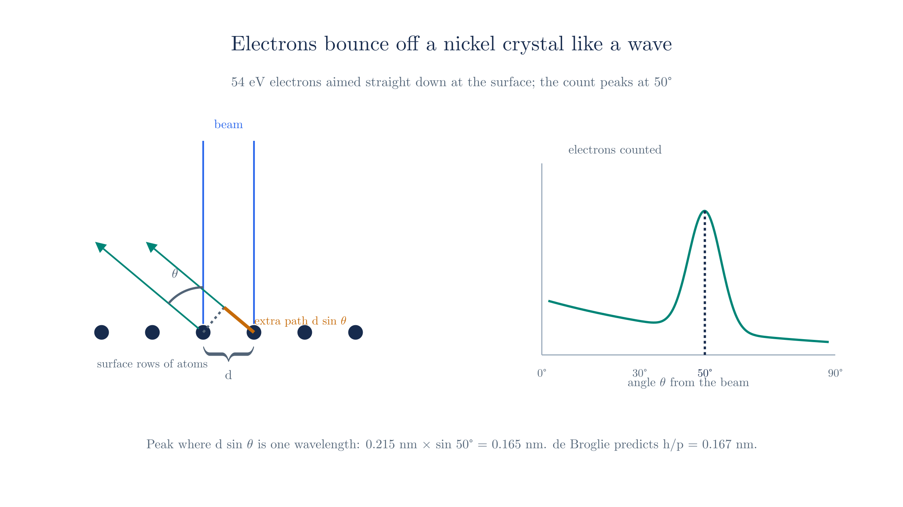

# First Quantization

[Classical Mechanics](./classical-mechanics.md) ended with two promises. The Hamiltonian, the energy written in position and momentum, would keep its job of moving the state forward in time. And the Poisson bracket of position with momentum would be replaced by a quantum version. This chapter keeps both promises. But first it has to change what a state is, because a handful of experiments on atoms and electrons can't be described by any point of position and momentum.

Here's where we end up. Each idea from chapter 1 gets a quantum counterpart:

| | Classical (chapter 1) | Quantum (this chapter) |
| --- | --- | --- |
| The state | A point: position and momentum | A list of complex numbers called **amplitudes**, one for each possible outcome |
| A measurable quantity | A number worked out from the state | An **operator** (section 4) |
| A measurement gives | The value, exactly | One of the possible results, at random |
| What moves the state | Hamilton's equations, from $H$ | The **Schrödinger equation**, from the same $H$ |
| Position with momentum | Their bracket is 1 | Their **commutator** is $i\hbar$, with $\hbar$ a tiny constant (section 6) |

Turning classical quantities into operators like this is called **first quantization**. It's "first" because it quantizes the motion of particles; [Field Quantization](./field-quantization.md) later does the same to fields.

## 1. Experiments that force a new kind of state

**Magnets that sort atoms.** In 1922 Otto Stern and Walther Gerlach sent a beam of silver atoms between the poles of a specially shaped magnet. Each silver atom is a tiny magnet itself, because of a property of its outer electron called **spin**. The field is stronger near one pole than the other, so it pushes each atom up or down by an amount that depends on how the atom's own magnet is tilted. Then the atoms hit a glass plate.

The atoms leave the oven tilted every which way, so you'd expect the beam to smear into a continuous line on the plate. It doesn't. It lands in two separate spots, one up and one down, and nothing in between. The tilt along the field takes only two values.

*The Stern–Gerlach setup, and what the plate shows.*

**Magnets in a row.** Later experiments put magnets one after another. Keep only the atoms that went up, and send them through a second vertical magnet: they all go up again. Now send them through a magnet turned sideways instead: half go left and half go right, and nothing tells you in advance which atom goes which way. Keep the ones that went right, and send them through a vertical magnet again: half go up and half go down. The "up" they had before is gone.

*Three sequences of magnets, as textbooks present them.*

So identical atoms can give different results, which means the theory can only predict chances. And measuring something can change it.

**Electrons through two slits.** Now fire electrons, one at a time, at a barrier with two narrow slits, and count where they land on a screen behind it. Each electron arrives as a single dot. Do it three times: with only the first slit open, with only the second open, and with both open.

Here's what you'd expect. If each electron goes through one slit or the other, its chance of reaching a spot with both open is its chance through the first plus its chance through the second. Chances are never negative, so opening a second slit can only add electrons to a spot, never take them away.

That's not what happens. With both slits open, the counts form stripes. At some spots they drop almost to zero, even though each slit on its own sends plenty of electrons there.

*Electron counts with one slit or both open. The dashed curve is what adding chances would give.*

So the theory needs numbers that can cancel when you add them. Quantum mechanics gives each route an **amplitude**, a complex number, which you can picture as a little arrow with a length and a direction. It adds the amplitudes for the different routes first, then squares the length of the total to get the chance. Two amplitudes pointing opposite ways cancel, and that makes the dark stripes. This adding before squaring is called **interference**.

More detail: who did these experiments

The magnets-in-a-row sequences shown here are idealized, as textbooks present them, from experiments starting with Thomas Phipps and Otto Stern in 1932 and Otto Frisch and Emilio Segrè in 1933. Claus Jönsson first did the two-slit experiment with electrons in 1961, and Akira Tonomura's group recorded the pattern building up one electron at a time in 1989, using an electron biprism, which acts like a pair of slits.

**Outcomes are random, and their chances come from amplitudes that can cancel.**

## 2. A state is a list of amplitudes

Take the silver atom's spin as the running example. Along a vertical magnet it has two possible results, up and down. Call the state that's certainly up $\lvert\text{up}\rangle$ and the one that's certainly down $\lvert\text{down}\rangle$. (The $\lvert\ \rangle$ just marks a state.) Any state of the spin is a mix of the two,

$$\lvert\psi\rangle = c_0\lvert\text{up}\rangle + c_1\lvert\text{down}\rangle,$$

where $c_0$ and $c_1$ are its amplitudes. A vertical magnet gives up with chance $\lvert c_0\rvert^2$ and down with chance $\lvert c_1\rvert^2$. This is the **Born rule**, and since the two chances add to one, $\lvert c_0\rvert^2 + \lvert c_1\rvert^2 = 1$.

**The tilted atoms.** Keep the atoms that went up in a first magnet tilted 60° to the right, and send them through a vertical magnet. Three out of four come out up and one in four down. So their amplitudes have sizes $\sqrt3/2$ for up and $1/2$ for down, whose squares are 75% and 25%.

*The tilted state as an arrow. Its components along "up" and "down" are the amplitudes, and their squares are the chances.*

**The phase matters too.** Each amplitude is an arrow, so it has a size and a direction in the complex plane. The direction is called its **phase**. The vertical chances only see the sizes. Other measurements see the phases as well.

Here's an experiment that shows it. Prepare two batches of atoms. The first is tilted 60° to the right, as before. The second is tilted by the same 60°, but toward the front instead, a quarter-turn round from the first.

*Both batches lean the same amount from vertical, in different directions.*

A vertical magnet can't tell the batches apart: both come out up three times in four, so their amplitudes have the same sizes. A sideways magnet can. The batch leaning right goes right almost every time (93%). The batch leaning toward the front leans neither right nor left, and splits half and half.

The difference is how the two amplitudes line up. A sideways result combines the up and down amplitudes, the way the two slits did: "right" adds them, and "left" subtracts one from the other. For the right-tilted atoms both amplitudes point the same way, so they reinforce for "right" and mostly cancel for "left". For the front-tilted atoms the down amplitude points at right angles to the up one in the complex plane, so they neither help nor cancel, and each side gets half. No plain positive or negative number can point at right angles, which is why amplitudes have to be complex. Two states with the same up-and-down chances can still be different states. **A state is its list of amplitudes, phases included, not just a list of chances.**

**The overlap.** So far we've read chances off along up and down. To get the chance of any other result, like "right", picture both states as arrows. The state that's certainly "right" points halfway between up and down. The amplitude for "right" is how much of our state's arrow points along it: its shadow on that direction. Our tilted state is 15° away from "right", so its shadow is about 0.97 of its length, and the chance is the shadow squared, about 93%. This shadow is called the **overlap** of the two states, written $\langle a\vert\psi\rangle$, and the chance of result $a$ is $\lvert\langle a\vert\psi\rangle\rvert^2$.

*The overlap is the state's shadow on the certain state of the result. Its square is the chance.*

The calculation: the sideways chances and the complex amplitude

A tilt of $\theta$ from vertical gives amplitudes $\cos(\theta/2)$ for up and $\sin(\theta/2)$ for down, with $\theta$ positive to the right and negative to the left:

| First magnet tilted | Chance of up | $c_0$ | $c_1$ |
| --- | ---: | ---: | ---: |
| not at all | 100% | 1 | 0 |
| 60° to the right | 75% | $\sqrt3/2$ | $1/2$ |
| 90° to the right | 50% | $1/\sqrt2$ | $1/\sqrt2$ |
| 90° to the left | 50% | $1/\sqrt2$ | $-1/\sqrt2$ |
| 180° | 0% | 0 | 1 |

The 90° rows are the sideways magnet's certain states: "right" is $\lvert +\rangle = (\lvert\text{up}\rangle + \lvert\text{down}\rangle)/\sqrt2$ and "left" is $\lvert -\rangle = (\lvert\text{up}\rangle - \lvert\text{down}\rangle)/\sqrt2$. Rewriting the state in these,

$$c_0\lvert\text{up}\rangle + c_1\lvert\text{down}\rangle = \frac{c_0 + c_1}{\sqrt2}\,\lvert +\rangle + \frac{c_0 - c_1}{\sqrt2}\,\lvert -\rangle.$$

Squaring a sum gives $\lvert c_0 \pm c_1\rvert^2 = \lvert c_0\rvert^2 + \lvert c_1\rvert^2 \pm 2\,\mathrm{Re}(c_0^*c_1)$. The last part, the cross term, is where interference lives. For the right-tilted atoms it's $2\cdot\tfrac{\sqrt3}{2}\cdot\tfrac12 = \sqrt3/2$, so the chances are $(1 \pm \sqrt3/2)/2$: 93.3% right and 6.7% left.

For the front-tilted atoms the sideways chances are 50% each, so the cross term must vanish. With $c_0 = \sqrt3/2$, that means $c_1$ has no real part: $c_1 = \pm i/2$. Which sign goes with "front" is a convention, and we take $c_1 = i/2$. No real amplitudes could do this, which is one reason amplitudes are complex.

**The overlap as a calculation.** The overlap is the complex inner product of the two lists of amplitudes, $\langle a\vert\psi\rangle = \sum_k a_k^*\,\psi_k$ (see [conjugation](appendix-math-complex.md#_5-conjugation-and-the-adjoint) in the Math Refresher). The overlap with "right" is $\langle +\vert\psi\rangle = \tfrac{1}{\sqrt2}c_0 + \tfrac{1}{\sqrt2}c_1 \approx 0.966$ for the right-tilted atoms, the same right amplitude. The conjugate in the recipe makes the overlap of a state with itself its squared length, $\lvert c_0\rvert^2 + \lvert c_1\rvert^2 = 1$. The [Math Refresher](appendix-math-linear-algebra.md) develops this "bra-ket" notation further.

**A state is a list of complex amplitudes, and their phases matter.**

## 3. A particle on a line: the wave function

An electron hitting the two-slit screen can land at any position $x$, so its state needs an amplitude for every position. That's a complex function $\psi(x)$, called the **wave function**. On the screen, it's the sum of a part from each slit, and the dark stripes are where the two parts cancel.

With infinitely many positions, no single point has a chance of its own. Instead the Born rule turns the wave function into a chance per metre, a **probability density**, $\lvert\psi(x)\rvert^2$. The chance of finding the particle between two points is the area under the density between them, and the total area is one.

For a simple example, take a particle trapped between two walls a metre apart.

*A particle confined between two walls. The density is zero at the walls and largest in the middle, and each shaded area is the chance of finding the particle in that quarter.*

The calculation: the quarters

The wave function is $\sqrt2\,\sin(\pi x)$ between 0 and 1 m, chosen for illustration, and the $\sqrt2$ makes the total area one. The area under the density $2\sin^2(\pi x)$ from 0 to $a$ is $a - \sin(2\pi a)/(2\pi)$, using $2\sin^2 u = 1 - \cos 2u$. At $a = 1/4$ that's $1/4 - 1/(2\pi) \approx 0.091$. At $a = 1/2$ it's $1/2$, so the second quarter holds $0.5 - 0.091 = 0.409$. The other half mirrors the first. The overlap of two wave functions $\phi$ and $\psi$ is $\int\phi^*(x)\,\psi(x)\,dx$.

**A particle's state is a wave function, and its squared size is where the particle is likely to be.**

## 4. Measured quantities become operators

A measurable quantity now needs two things: its possible values, and for each value the state that gives it for certain. An **operator** packages both. Applied to one of its certain states, it just multiplies the state by its value:

$$\hat A\lvert a\rangle = a\lvert a\rangle.$$

Any other state is a mix of these certain states, the way the tilted spin was a mix of up and down. And an operator is **linear**: it acts on each part of a mix separately and adds the results. So on a mix it multiplies each part by that part's own value,

$$\hat A\big(c_1\lvert a_1\rangle + c_2\lvert a_2\rangle\big) = c_1 a_1\lvert a_1\rangle + c_2 a_2\lvert a_2\rangle.$$

The certain states are called **eigenstates**, and the values **eigenvalues**. For the spin, take its energy in a vertical magnetic field. Like a compass needle, the atom's little magnet has slightly different energies pointing along the field and against it, so the energy operator has the eigenstates up and down, with those two energies. The sideways magnet has the eigenstates right and left, which we give the values $+1$ and $-1$.

Not every operator will do. Measured values are real numbers. And a state that gives one value for certain can never give another, so different certain states must have zero overlap, since the overlap is the amplitude for getting the other value. Operators that meet both conditions are called **Hermitian**, and a quantity described by one is called an **observable**. (Applying an operator isn't doing the measurement. It's bookkeeping. Section 9 covers what a measurement does to the state.)

**The average.** Repeat a measurement on many identically prepared atoms, and the results have an average, called the **expectation value** $\langle A\rangle$, and a spread around it, $\Delta A$ (which section 8 uses). For the right-tilted atoms measured sideways, the results are $+1$ 93.3% of the time and $-1$ 6.7% of the time, so the average is about 0.87. The operator gives the same number directly. Since it multiplies each certain-state part by its value, the overlap of the state with the operator applied to the state, written $\langle\psi\vert\hat A\vert\psi\rangle$, adds up each value times its chance.

**Order matters.** With ordinary numbers, $ab = ba$. With operators, the order you apply them in can change the answer. The **commutator** measures by how much:

$$[\hat A, \hat B] = \hat A\hat B - \hat B\hat A.$$

If two operators shared all their certain states, the order wouldn't matter, and their commutator would be zero. So when the commutator isn't zero, there are states that are sharp for one quantity and spread out for the other. The magnets in a row showed exactly that: up-and-down and right-and-left don't commute, and atoms that were certainly "right" came out up and down half and half.

The calculation: the spin's operators

Write a spin state as the column of its two amplitudes. The energy operator, with energies $E_0$ for up and $E_1$ for down, and the sideways operator $\hat S$ are

$$\hat H = \begin{pmatrix} E_0 & 0 \\ 0 & E_1 \end{pmatrix}, \qquad \hat S = \begin{pmatrix} 0 & 1 \\ 1 & 0 \end{pmatrix}.$$

$\hat S$ swaps the two amplitudes. It leaves "right", $(1, 1)/\sqrt2$, unchanged, so its value is $+1$, and turns "left", $(1, -1)/\sqrt2$, into its negative, so its value is $-1$.

**The average and the spread.** For the right-tilted atoms, $\langle S\rangle = (+1)(0.933) + (-1)(0.067) = 0.866$. From the operator, $\hat S$ swaps $(\sqrt3/2,\ 1/2)$ to $(1/2,\ \sqrt3/2)$, and the overlap with the state is $\sqrt3/4 + \sqrt3/4 \approx 0.866$. Every result squared is 1, so $\langle S^2\rangle = 1$, and the spread is $\Delta S = \sqrt{\langle S^2\rangle - \langle S\rangle^2} = \sqrt{1 - 0.75} = 0.5$.

**The commutator.**

$$[\hat H, \hat S] = \begin{pmatrix} 0 & E_0 - E_1 \\ E_1 - E_0 & 0 \end{pmatrix},$$

which isn't zero, because the two energies differ.

Reference: Hermitian operators

A **Hermitian** operator satisfies $\hat A = \hat A^\dagger$, where the **adjoint** $\hat A^\dagger$ is defined by $\langle\phi\vert\hat A^\dagger\psi\rangle = \langle\hat A\phi\vert\psi\rangle$. For matrices, $\hat A^\dagger = (\hat A^*)^T$: conjugate the entries, then transpose. Both $\hat H$ and $\hat S$ above are Hermitian.

Its eigenvalues are real. If $\hat A\psi = \lambda\psi$, then $\lambda = \langle\psi\vert\hat A\psi\rangle/\langle\psi\vert\psi\rangle$, and Hermiticity makes the numerator equal its own conjugate. Eigenvectors with different eigenvalues are orthogonal: computing $\langle\psi_2\vert\hat A\psi_1\rangle$ two ways gives $\lambda_1\langle\psi_2\vert\psi_1\rangle = \lambda_2\langle\psi_2\vert\psi_1\rangle$. The spectral theorem says a Hermitian operator has enough eigenvectors to write any state in them; written that way, the squared amplitudes are the chances of each value, and $\langle\psi\vert\hat A\vert\psi\rangle$ adds up each value times its chance. Position and momentum can take any value, so their sums become integrals, and their certain states, a spike at one point or an endless wave, can't be scaled to length one.

**Each measurable quantity is an operator, and the order of two operators can matter.**

## 5. De Broglie's two rules

Two rules link a particle's energy and momentum to a wave. The first will check the momentum operator of section 6, and the second gives the Schrödinger equation in section 7.

They start with light. Light turns out to come in packets, and a packet of light with frequency $f$ and wavelength $\lambda$ carries

$$E = hf, \qquad p = \frac{h}{\lambda},$$

where $h$ is **Planck's constant**, $6.63\times10^{-34}$ joule-seconds. Two experiments showed it, in the first two boxes below.

In 1924 Louis de Broglie turned this around. If waves of light behave like particles, maybe particles of matter behave like waves, with the same two rules read the other way:

$$\lambda = \frac{h}{p}, \qquad f = \frac{E}{h}.$$

A particle with momentum $p$ has a wavelength $h/p$, and a particle with energy $E$ oscillates at the frequency $E/h$. Electrons bouncing off a crystal confirmed it a few years later (third box).

Experiment: light knocking electrons out of a metal

Shine light on a clean metal surface, and it knocks electrons out. If light were a smooth wave, brighter light would shake the electrons harder and throw out faster ones, and dim light of any colour would eventually free some. Neither happens. Brighter light throws out more electrons, but not faster ones. Below a certain frequency no electrons come out at all, however bright the light. Above it, the fastest electrons' energy grows in step with the frequency.

*The photoelectric effect for sodium. Brighter light ejects more electrons on the same line.*

Einstein explained this in 1905: light comes in packets of energy $E = hf$. Each packet frees at most one electron, so brightness only changes how many come out, and a packet below the threshold frequency can't free one at all. An electron leaves with the packet's energy minus a fixed cost to escape, so the line rises with slope $h$. Robert Millikan measured that line in 1916 and found a slope within 1% of Planck's value; Planck had introduced $h$ in 1900 to explain heat radiation. For sodium the threshold is $5.6\times10^{14}$ Hz, green light, so freeing an electron takes $hf = 3.7\times10^{-19}$ J, about 2.3 eV (1 eV is $1.602\times10^{-19}$ J).

Experiment: X-rays bouncing off electrons

Light pushes on what it hits, and electromagnetism says a packet of energy $E$ carries momentum $E/c$, where $c$ is the speed of light. With $E = hf$ and $c = f\lambda$, that's $p = hf/(f\lambda) = h/\lambda$.

In 1923 Arthur Compton bounced X-rays off electrons. A smooth wave would shake each electron at the wave's own frequency, and the electron would send out the same wavelength. Instead the X-rays came back with a longer wavelength. Each packet hands some momentum to the electron it hits, and less momentum means a longer wavelength, by exactly the amount $p = h/\lambda$ predicts, more so at larger angles.

*Compton scattering. The scattered X-ray has a longer wavelength, more so at larger angles.*

Experiment: electrons bouncing off a crystal

In 1927 Clinton Davisson and Lester Germer fired electrons at a nickel crystal and counted how many bounced back at each angle. Particles bouncing off a surface would scatter over a smooth range of angles. Instead the count had a sharp peak at 50°, exactly what a wave does when it reflects off evenly spaced rows of atoms. The beam comes straight down, so waves reaching neighbouring rows of surface atoms, a distance $d$ apart, travel equally far in. On the way out at angle $\theta$, one travels $d\sin\theta$ farther, and they reinforce when that difference is one wavelength.

*The Davisson–Germer geometry, and the count against angle.*

| Step | Value |
| --- | --- |
| Electron energy | $54\ \mathrm{eV} = 8.65\times10^{-18}\ \mathrm{J}$ |
| Momentum $p = \sqrt{2mE}$, electron mass $m = 9.11\times10^{-31}$ kg | $3.97\times10^{-24}\ \mathrm{kg\,m/s}$ |
| de Broglie's prediction $h/p$ | $0.167\ \mathrm{nm}$ |
| Measured: peak at $\theta = 50°$, rows $d = 0.215$ nm apart (from X-ray diffraction), wavelength $d\sin\theta$ | $0.165\ \mathrm{nm}$ |

**De Broglie's rules link a particle to a wave: wavelength $h/p$, frequency $E/h$.**

## 6. Position and momentum operators

**Position.** The certain states of position are wave functions squeezed onto a single point. On a state squeezed onto the point $a$, multiplying by $x$ is the same as multiplying by $a$, its value. So the position operator, $\hat x$, just multiplies the wave function by $x$.

**What momentum does in chapter 1.** For momentum, start from classical mechanics. Chapter 1's Poisson bracket tells us what momentum's job is. Take any quantity $f$ that depends on position, and bracket it with momentum. Chapter 1's bracket has two terms:

$$\{f, p\} = \frac{\partial f}{\partial q}\,\frac{\partial p}{\partial p} - \frac{\partial f}{\partial p}\,\frac{\partial p}{\partial q}.$$

Momentum changes with momentum at rate 1, so $\partial p/\partial p = 1$. Momentum doesn't change with position, so $\partial p/\partial q = 0$, and $f$ depends only on position, so $\partial f/\partial p = 0$ too. The second term is zero, and the first is just the slope of $f$ along position:

$$\{f, p\} = \frac{\partial f}{\partial q}\cdot 1 - 0\cdot 0 = \frac{\partial f}{\partial q}.$$

So, classically, bracketing with momentum takes slopes along position. That fits chapter 1's link between momentum and shifting: a slope says how a quantity changes when you shift it along. For $f = q$, it's the familiar $\{q, p\} = 1$, because the slope of position along position is 1.

**The quantum rule.** Chapter 1 promised the bracket a quantum version, and here it is. Replace each Poisson bracket by a commutator divided by $i\hbar$:

$$\{f, g\} \;\to\; \frac{1}{i\hbar}\,[\hat f, \hat g].$$

The constant $\hbar$, read "h-bar", is $h/2\pi = 1.055\times10^{-34}$ J s. It supplies the units, and the $i$ makes the result a real quantity, like a bracket (the box shows why). This rule is the heart of first quantization. It's a guess, and experiment has to test it, which we'll do in a moment.

**The momentum operator.** The rule says the commutator of any $f(x)$ with $\hat p$, divided by $i\hbar$, must be the slope of $f$. One operator does exactly that: $-i\hbar$ times the slope. Apply it to $f$ times a wave function, and the product rule produces an extra term from the slope of $f$; that extra term is all the commutator leaves (the box shows it). So

$$\hat p = -i\hbar\,\frac{d}{dx}, \qquad [\hat x, \hat p] = i\hbar.$$

The second is the case $f = x$: chapter 1's $\{q, p\} = 1$, times $i\hbar$. Position and momentum don't commute.

**The check: de Broglie's waves.** Which states have a definite momentum under this operator? Ones whose slope is just the state times a fixed number. Those are exponentials:

$$\psi_p(x) = e^{ipx/\hbar}, \qquad \hat p\,\psi_p = p\,\psi_p.$$

This wave has size 1 everywhere, and its phase turns steadily as you move along (see [Euler's formula](appendix-math-complex.md#_2-the-complex-plane-and-euler-s-formula) in the Math Refresher), making a full turn every $2\pi\hbar/p = h/p$. That's de Broglie's wavelength. So the operator built from chapter 1's bracket predicts that a particle with momentum $p$ behaves like a wave of wavelength $h/p$, and Davisson and Germer's electrons confirmed it. (Like the spike for position, this wave is an idealization: it spreads over all space, so its total area isn't one. Real states are sums of such waves, which is also why $\hat p$, being linear, works on every wave function.)

The calculation: the commutator, and why the i and the ħ

**The commutator.** Apply both orders to a wave function $\psi(x)$, using the product rule:

$$[f, \hat p]\psi = f\,(-i\hbar\,\psi') + i\hbar\,(f\psi)' = -i\hbar\,f\psi' + i\hbar\,(f'\psi + f\psi') = i\hbar\,f'\psi.$$

The terms with $\psi'$ cancel, and what survives comes from the slope of $f$. So $[f, \hat p]/i\hbar = f'$, the quantum version of $\{f, p\} = \partial f/\partial q$. With $f = x$, $[\hat x,\hat p] = i\hbar$. For example, with $\psi = x^2$: $\hat x\hat p\,x^2 = -2i\hbar\,x^2$ and $\hat p\hat x\,x^2 = -3i\hbar\,x^2$, a difference of $i\hbar\,x^2$.

**Why $i$.** The commutator of two Hermitian operators is minus its own adjoint, because $(\hat A\hat B)^\dagger = \hat B\hat A$. Dividing it by $i$ makes it Hermitian, so its values are real, like a Poisson bracket's.

**Why $\hbar$.** $[\hat x, \hat p]$ has units of position times momentum, the units of $\hbar$, while $\{q, p\} = 1$ has none. The $\hbar$ supplies the units, and its size is fixed by experiment: de Broglie's $h/p$ only comes out if $\hbar = h/2\pi$.

**Representations.** A state doesn't depend on a choice of basis. In the position representation used here, the amplitudes are $\psi(x)$, $\hat x$ multiplies by $x$ and $\hat p$ acts as $-i\hbar\,d/dx$. In the momentum representation, $\hat p$ multiplies by $p$ and $\hat x$ acts as $i\hbar\,d/dp$. A [Fourier transform](appendix-math-complex.md) relates the two.

**Position multiplies by $x$, momentum takes the slope, as chapter 1's bracket demands, and the two don't commute: $[\hat x, \hat p] = i\hbar$.**

## 7. The energy moves the state: the Schrödinger equation

**The energy operator.** In chapter 1, the Hamiltonian $H = p^2/2m + V(x)$ moved the state forward. Quantum mechanics keeps the same function and puts the momentum operator into it. Taking the slope twice brings two factors of $-i\hbar$, which multiply to $-\hbar^2$, so

$$\hat H = -\frac{\hbar^2}{2m}\frac{d^2}{dx^2} + V(x).$$

Its certain states are the **states of definite energy**, and any state can be written as a mix of them. So to move a state forward in time, it's enough to know how each of those moves.

**A definite energy turns the phase.** De Broglie's second rule says a state of energy $E$ oscillates at the frequency $E/h$. So its phase turns steadily, and after a time $t$ it has picked up the factor

$$e^{-iEt/\hbar}.$$

That's the time version of the momentum wave $e^{ipx/\hbar}$. De Broglie proposed the rule for free particles; taking it for every system is an assumption, and experiment has confirmed it ever since. Every amplitude of the state picks up the same factor, so the whole state turns together and no relative phase changes. So no chance changes, and a state of definite energy looks exactly the same at every moment. These are called **stationary states**.

**The Schrödinger equation.** Now put the two together. The rate of change of $e^{-iEt/\hbar}$ in time brings down $-iE/\hbar$, so $i\hbar$ times the rate of change of a state of definite energy is $E$ times the state. And $\hat H$ applied to that state also gives $E$ times the state, since it's one of $\hat H$'s certain states. So every state of definite energy obeys

$$i\hbar\,\frac{\partial\Psi}{\partial t} = \hat H\,\Psi.$$

Any state is a mix of states of definite energy, and both sides are linear, so every state obeys it. This is the **Schrödinger equation**. Like Hamilton's equations, it has one rate of change in time, so the state now fixes its future. In other words, a rate of change in time, times $i\hbar$, stands for the energy, just as a slope times $-i\hbar$ stands for the momentum.

**What the equation does.** Three things follow:

1. **It's linear.** A sum of solutions is again a solution, which is what let us split a state into states of definite energy and add them back up.
2. **It keeps the total chance at one.** Each piece only turns its phase, so no amplitude grows or shrinks. The step that moves the state forward is called **unitary**: it keeps the total chance, and every overlap, the same.
3. **Averages follow chapter 1's rule.** The average of any quantity changes at a rate set by its commutator with $\hat H$, divided by $i\hbar$. That's chapter 1's rule, rate of change equals the bracket with $H$, with the bracket replaced by the commutator. For position and momentum it gives Hamilton's equations for the averages.

**The tilted spin in time.** Leave the right-tilted atoms in a vertical magnetic field. Up and down have slightly different energies there, so their phases turn at slightly different rates, and the gap between them grows steadily. The up-and-down chances never change, since they only see the sizes. The sideways chances follow the gap: the atom's tilt swings round the field like a spinning top, passing right, back, left and front in turn.

*The tilt swings round the field. Up and down stay 75% and 25% throughout, while the chance of "right" rises and falls.*

The calculation: the spin in time

With the shared phase removed, the state at time $t$ is $c_0\lvert\text{up}\rangle + c_1 e^{-i\varphi}\lvert\text{down}\rangle$, with $\varphi = (E_1 - E_0)t/\hbar$, $c_0 = \sqrt3/2$ and $c_1 = 1/2$. It makes a full turn in $\tau = 2\pi\hbar/(E_1 - E_0)$. The chance of "right" is

$$\Big\lvert\frac{c_0 + c_1 e^{-i\varphi}}{\sqrt2}\Big\rvert^2 = \frac12 + \frac{\sqrt3}{4}\cos\varphi.$$

| Time | Down amplitude (up held at $\sqrt3/2$) | Up / down | Right | $\langle S\rangle$ |
| --- | --- | --- | ---: | ---: |
| $0$ | $1/2$ | 75% / 25% | 93.3% | 0.866 |
| $\tau/4$ | $-i/2$ | 75% / 25% | 50% | 0 |
| $\tau/2$ | $-1/2$ | 75% / 25% | 6.7% | $-0.866$ |
| $3\tau/4$ | $i/2$ | 75% / 25% | 50% | 0 |
| $\tau$ | $1/2$ | 75% / 25% | 93.3% | 0.866 |

At $3\tau/4$ the down amplitude is $i/2$, the front-tilted state of section 2.

The calculation: why the averages follow chapter 1

Write $\langle A\rangle = \langle\Psi\vert\hat A\vert\Psi\rangle$ and differentiate both copies of $\Psi$. The Schrödinger equation gives $\partial_t\lvert\Psi\rangle = \tfrac{1}{i\hbar}\hat H\lvert\Psi\rangle$, and its adjoint gives $\partial_t\langle\Psi\rvert = -\tfrac{1}{i\hbar}\langle\Psi\rvert\hat H$, because $\hat H$ is Hermitian. So

$$\frac{d\langle A\rangle}{dt} = \frac{1}{i\hbar}\langle[\hat A,\hat H]\rangle.$$

For position, $[\hat x,\hat p^2] = 2i\hbar\,\hat p$, so $d\langle x\rangle/dt = \langle p\rangle/m$. For momentum, $[\hat p, V]\psi = -i\hbar\,V'\psi$, so $d\langle p\rangle/dt = -\langle V'\rangle$: the force averaged over the state. That equals the force at the average position when the force barely changes across the state, and exactly for a spring or a constant force.

For the spin, $\tfrac{1}{i\hbar}\langle[\hat S,\hat H]\rangle = -\tfrac{\sqrt3}{2}\tfrac{E_1 - E_0}{\hbar}\sin\varphi$, the rate of change of $\langle S\rangle = \tfrac{\sqrt3}{2}\cos\varphi$ in the table above.

Reference: unitary operators and generators

Collect the phase factors into one operator $\hat U(t)$, which multiplies each state of definite energy $E$ by $e^{-iEt/\hbar}$, so that $\lvert\Psi(t)\rangle = \hat U(t)\lvert\Psi(0)\rangle$. It's written $e^{-i\hat Ht/\hbar}$, because on those states $\hat H$ acts as the number $E$.

A **unitary** operator satisfies $\hat U^\dagger\hat U = \hat U\hat U^\dagger = \hat I$, so it preserves overlaps: $\langle\hat U\phi\vert\hat U\psi\rangle = \langle\phi\vert\psi\rangle$. For Hermitian $\hat G$, $e^{-i\theta\hat G}$ is unitary. Conversely, a smooth family of unitary transformations with $\hat U(a)\hat U(b) = \hat U(a + b)$ can be written $\hat U(\theta) = e^{-i\theta\hat G}$ with $\hat G$ Hermitian, called its **generator**. The Hamiltonian divided by $\hbar$ is the generator of time evolution.

A crest of $e^{i(px - Et)/\hbar}$, where $px - Et$ is fixed, moves at $x = (E/p)\,t + \text{const}$, toward $+x$ when $p > 0$. That's why the time factor is $e^{-iEt/\hbar}$ with a minus sign, opposite to the plus in $e^{ipx/\hbar}$.

**The Hamiltonian keeps its job: it now moves a list of amplitudes instead of a point.**

## 8. Why position and momentum cannot both be sharp

Suppose some state had a sharp position and a sharp momentum at once. Each operator would just multiply it by a number, and numbers don't care about order, so their commutator would give zero. But the commutator gives $i\hbar$ times the state, which isn't zero. So no such state exists. The best a state can do is keep both spreads small, and the commutator sets how small. This is the **Heisenberg uncertainty relation**:

$$\Delta x\,\Delta p \ \ge\ \frac{\hbar}{2}.$$

Squeeze the position, and the momentum has to spread out, and the other way round. Here's a way to see it. A wave function is a sum of momentum waves, and the share of each wave gives the chance of that momentum, its momentum density. A narrow bump needs many different wavelengths, which cancel everywhere except near the bump, so its momentum density is wide.

*Squeezing the position density widens the momentum density. For these bell-shaped states, the product of the two spreads is exactly $\hbar/2$, the smallest allowed.*

**An electron and a ball.** The bound is tiny in everyday units, which is why chapter 1 never needed it. Pin an electron down to the size of an atom, and its speed has to be uncertain by about 580 km/s. It can't be pictured as a little ball on a path. Pin down chapter 1's 1 kg ball to a micrometre, and its speed only has to be uncertain by about $5\times10^{-29}$ m/s, far below anything measurable. So the ball's spread grows far too slowly to ever notice, and it behaves like a point following chapter 1's equations.

The calculation: the electron, the ball, and the general bound

The smallest momentum spread is $\hbar/(2\Delta x)$, and the velocity spread is that divided by the mass.

| System | Position spread | Smallest momentum spread | Smallest velocity spread |
| --- | --- | --- | --- |
| Electron within an atom, mass $9.11\times10^{-31}$ kg | $0.1\ \mathrm{nm}$ | $5.3\times10^{-25}\ \mathrm{kg\,m/s}$ | $5.8\times10^{5}\ \mathrm{m/s}$ |
| The 1 kg ball from chapter 1 | $10^{-6}\ \mathrm{m}$ | $5.3\times10^{-29}\ \mathrm{kg\,m/s}$ | $5.3\times10^{-29}\ \mathrm{m/s}$ |

**Any two observables.** The product of their spreads is at least half the size of the average of their commutator, $\Delta A\,\Delta B \ge \tfrac12\lvert\langle[\hat A,\hat B]\rangle\rvert$. To show it, define $\lvert u\rangle = (\hat A - \langle A\rangle)\lvert\psi\rangle$ and $\lvert v\rangle = (\hat B - \langle B\rangle)\lvert\psi\rangle$, whose squared lengths are the squared spreads. The Cauchy–Schwarz inequality gives $(\Delta A)^2(\Delta B)^2 \ge \lvert\langle u\vert v\rangle\rvert^2 \ge (\operatorname{Im}\langle u\vert v\rangle)^2$, and $2i\operatorname{Im}\langle u\vert v\rangle = \langle u\vert v\rangle - \langle v\vert u\rangle = \langle[\hat A,\hat B]\rangle$. With $[\hat x,\hat p] = i\hbar$ this gives $\Delta x\,\Delta p \ge \hbar/2$. The bound is about the spreads within one state, not about disturbance by a measuring device.

**A check on the spin.** For the tilted spin at time $\tau/4$, the energy spread is $\tfrac{\sqrt3}{4}(E_1 - E_0)$ and the sideways spread is 1, so the product is $\tfrac{\sqrt3}{4}(E_1 - E_0)$. Half the size of $\langle[\hat H,\hat S]\rangle$ is the same, so the bound is met exactly.

**Position and momentum can't both be sharp: $\Delta x\,\Delta p \ge \hbar/2$, which matters for an electron and not for a ball.**

## 9. What a measurement does to the state

The rules so far give the chance of each result. One more rule says what happens afterwards, and the magnets in a row already showed it. After a measurement, the state becomes the certain state of the result found. That's why measuring again straight away gives the same result. This update is called **collapse**.

Measure the right-tilted atoms with a sideways magnet. With a 93% chance the result is "right", and the state becomes "right", an even mix of up and down. A vertical magnet then gives up and down 50% each, not the 75% and 25% the atoms had before. The sideways measurement changed the state.

Unlike the Schrödinger equation, collapse isn't unitary, and it loses information. From "right" alone, you can't recover the amplitudes the atom had before.

More detail: what it all means

These rules are enough to calculate every prediction in this book, and physicists who agree on them still disagree about what they mean. The **Copenhagen interpretation**, associated with Bohr and his collaborators, treats the Born probabilities as fundamental, and doesn't give an unmeasured quantity a definite value unless the state is one of its certain states. Bohr's **complementarity** says one apparatus can show a sharp position and another a sharp momentum, but no apparatus shows both.

It's tempting to read the chances as ignorance of hidden details that do fix each outcome. A **hidden-variable theory** adds such details to the quantum state. Bell's theorem (J. S. Bell, *On the Einstein–Podolsky–Rosen paradox*, Physics 1, 195 (1964)) derives inequalities that any theory satisfying certain locality and independence assumptions must obey. Quantum mechanics predicts violations, and experiments by Clauser and Freedman (1972), Aspect (1982), and later experiments closing the major loopholes observed them. The 2022 Nobel Prize recognized Aspect, Clauser and Zeilinger for this work. These results rule out local hidden variables under Bell's assumptions, but not every hidden-variable theory.

**A measurement picks a result and resets the state to match it.**

## Where this comes back

The next chapter, [The Harmonic Oscillator](./harmonic-oscillator.md), runs these rules on chapter 1's spring, from start to finish. It finds the spring's energies from the commutator $[\hat x, \hat p] = i\hbar$ alone, and they come in evenly spaced steps.

Further on, [Field Quantization](./field-quantization.md) applies the same bracket-to-commutator rule to a field, with a pair of operators at every point of space. And the unitary step that moves a state forward in time returns in [Symmetries](./symmetries.md) and [Quantum Field Theory](./qft.md).

---

Previous: [Classical Mechanics](./classical-mechanics.md)

Next: [The Harmonic Oscillator](./harmonic-oscillator.md)
