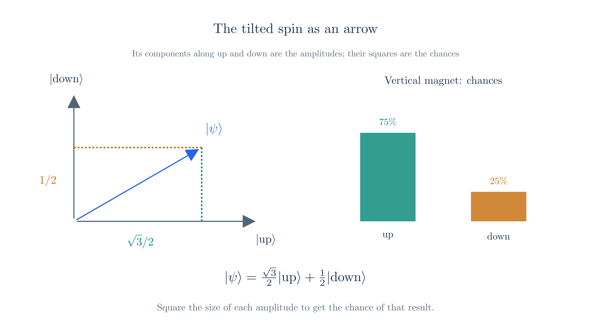
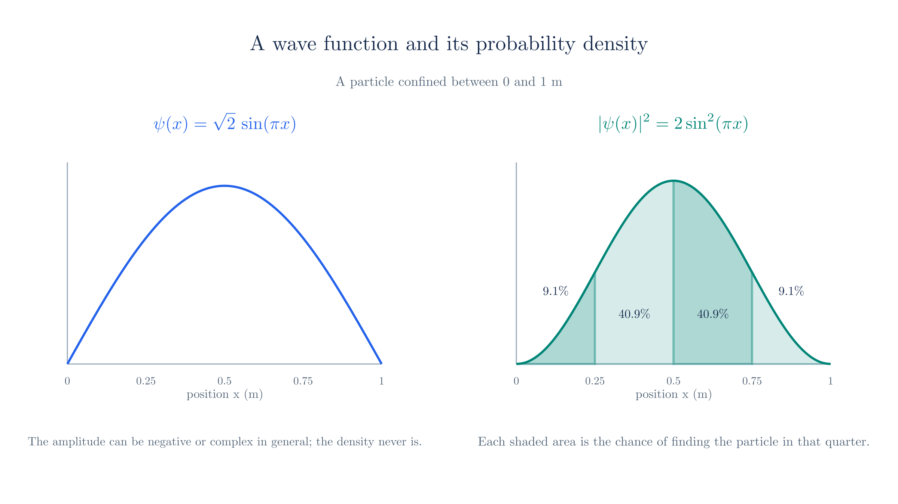
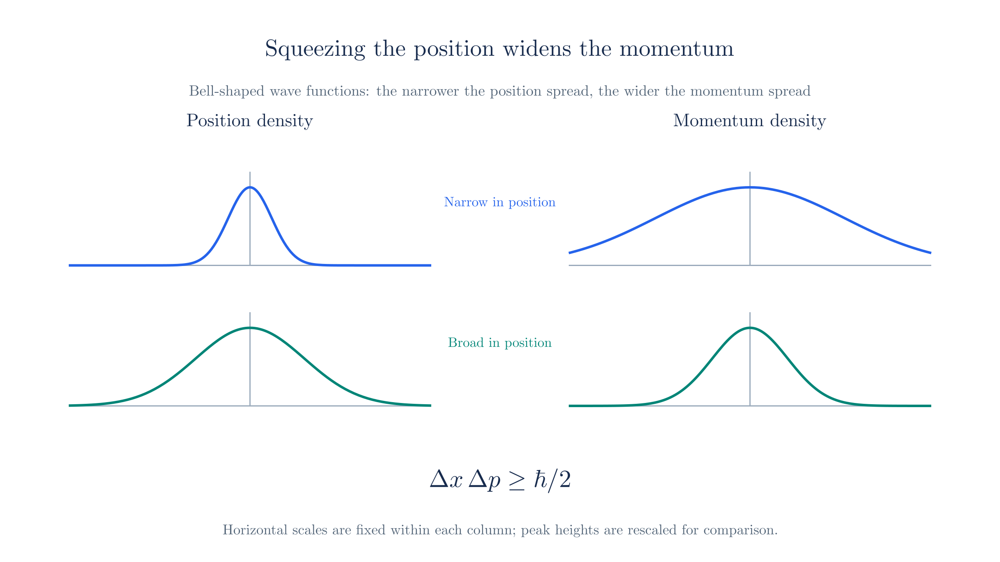

# First Quantization

[Classical Mechanics](./classical-mechanics.md) ended with two promises. The Hamiltonian, the energy written in position and momentum, would keep its job of moving the state forward in time. And the Poisson bracket of position with momentum would be replaced by a commutator. This chapter carries out both. Along the way it has to change what a state is, because experiments on electrons and atoms show that a measurement on a carefully prepared system does not always give the same answer. In the Stern–Gerlach experiment of 1922, for example, silver atoms prepared identically and sent through a magnetic field land in one of two spots, and no one can predict which. The theory therefore predicts probabilities, and it needs a rule for computing them as well as a rule for evolving the state.

## The chapter at a glance

Each classical idea from chapter 1 gets a quantum counterpart. The table lines them up. In its last rows, $\hbar \approx 1.055\times10^{-34}\ \mathrm{J\,s}$ is the reduced Planck constant, $[\hat A, \hat B] = \hat A\hat B - \hat B\hat A$ is the commutator, and $\langle\cdots\rangle$ is an average over many runs. Sections 2 to 4 introduce each one.

| | Classical (chapter 1) | Quantum (this chapter) |
| --- | --- | --- |
| The state at one instant | A point $(q, p)$ | A vector of complex **amplitudes** $\lvert\psi\rangle$, one for each possible outcome |
| A measurable quantity | A number computed from $(q, p)$ | An **operator**; its eigenvalues are the possible results |
| What a measurement gives | The value, exactly | One eigenvalue, at random, with probability $\lvert\text{amplitude}\rvert^2$ |
| What moves the state | Hamilton's equations, built from $H$ | The **Schrödinger equation**, built from the operator $\hat H$ |
| How a quantity changes | $df/dt = \{f, H\}$ | Its average changes at the rate $\tfrac{1}{i\hbar}\langle[\hat A, \hat H]\rangle$ |
| Position with momentum | $\{q, p\} = 1$ | $[\hat x, \hat p] = i\hbar$ |

Each change has a reason:

1. **Why amplitudes.** A single outcome is random, but the statistics over many runs are stable. And with two slits open, some spots on a screen receive fewer electrons than with only one slit open. If each electron went through one slit or the other, its chance of reaching a spot would be the chance via the first slit plus the chance via the second. Probabilities are never negative, so opening the second slit could only raise that chance, never lower it. So the state holds numbers that can cancel when added, and a probability is the squared size of such a number.
2. **Why operators.** For each quantity we need its possible values and, for each value, the state that gives it with certainty. A matrix stores both, as its eigenvalues and eigenvectors.
3. **Why the commutator.** Electron diffraction fixes the momentum operator (section 3), and its commutator with position, $\hat x\hat p - \hat p\hat x$, turns out to be $i\hbar$ times chapter 1's bracket $\{q, p\} = 1$. In chapter 1 every bracket followed from that one, so replacing each bracket by a commutator divided by $i\hbar$ gives the quantum version of every bracket used here.
4. **Why the Schrödinger equation.** Putting those operators into chapter 1's $H = p^2/2m + V$ gives $\hat H$, which carries the state forward. Averages then change by the same rule the bracket gave in chapter 1.
5. **Why uncertainty.** Because position and momentum do not commute, no state gives both a sharp value.

Replacing classical quantities by operators in this way is called **first quantization**. It is a rule that experiment confirms, not something derived from Newton's law. It is "first" because it quantizes the motion of particles; [Field Quantization](./field-quantization.md) later applies the same rule to fields.

## 1. A state is a list of amplitudes

Start with the smallest system that shows the new rules, one with only two energy levels, $E_0$ and $E_1$. An electron's spin in a magnetic field behaves like this, because its two possible orientations have different energies in the field. Spin is a built-in magnetic orientation of a particle, and the two spots in the Stern–Gerlach experiment are the two values of a silver atom's spin, which comes from its one unpaired electron. Call the state with energy $E_0$ for certain $\lvert 0\rangle$ (a label for the state, read "ket zero"), and the one with energy $E_1$ for certain $\lvert 1\rangle$. A general state is a combination of the two,

$$\lvert\psi\rangle = c_0\lvert 0\rangle + c_1\lvert 1\rangle,$$

and the numbers $c_0$ and $c_1$ are its **amplitudes**. Measuring the energy gives $E_0$ with probability $\lvert c_0\rvert^2$ and $E_1$ with probability $\lvert c_1\rvert^2$. This is the **Born rule**. For the probabilities to add up to one, a state must satisfy $\lvert c_0\rvert^2 + \lvert c_1\rvert^2 = 1$, which says the vector has length one.

**Example.** Take $c_0 = \sqrt3/2$ and $c_1 = 1/2$. Then $\lvert c_0\rvert^2 = 3/4$ and $\lvert c_1\rvert^2 = 1/4$, which add to one.

| Outcome | Amplitude | Probability |
| --- | ---: | ---: |
| $E_0$ | $\sqrt3/2 \approx 0.866$ | 75% |
| $E_1$ | $1/2$ | 25% |

*The state as an arrow. Its components along the two energy states are the amplitudes, and their squares are the probabilities.*

The amplitudes can be complex numbers, and their phases matter even when they leave these two probabilities alone. To see this, measure a different quantity, one whose two certain states are the even mixtures

$$\lvert\pm\rangle = \tfrac{1}{\sqrt2}\big(\lvert 0\rangle \pm \lvert 1\rangle\big).$$

For the spin, this is the spin along a sideways direction, with $\pm1$ counting the spin in units of $\hbar/2$ ($\hbar$ is the constant that section 3 introduces). To get the probabilities for this measurement, rewrite the state in terms of $\lvert +\rangle$ and $\lvert -\rangle$. Adding and subtracting the two definitions gives $\lvert 0\rangle = (\lvert +\rangle + \lvert -\rangle)/\sqrt2$ and $\lvert 1\rangle = (\lvert +\rangle - \lvert -\rangle)/\sqrt2$. Substituting these into the state gives

$$c_0\lvert 0\rangle + c_1\lvert 1\rangle = \frac{c_0 + c_1}{\sqrt2}\,\lvert +\rangle + \frac{c_0 - c_1}{\sqrt2}\,\lvert -\rangle,$$

and the Born rule applies to these new amplitudes. Now compare two states whose $c_1$ has the same size but a different phase, with $c_1 = 1/2$ in one and $c_1 = i/2$ in the other. Since $\lvert i/2\rvert^2 = 1/4$, both give the energy $E_0$ 75% of the time. For the sideways measurement they differ:

| State | Amplitude for $+$ | Amplitude for $-$ | Probability of $+$ | Probability of $-$ |
| --- | --- | --- | ---: | ---: |
| $\tfrac{\sqrt3}{2}\lvert 0\rangle + \tfrac12\lvert 1\rangle$ | $\tfrac{1}{\sqrt2}\big(\tfrac{\sqrt3}{2} + \tfrac12\big)$ | $\tfrac{1}{\sqrt2}\big(\tfrac{\sqrt3}{2} - \tfrac12\big)$ | 93.3% | 6.7% |
| $\tfrac{\sqrt3}{2}\lvert 0\rangle + \tfrac{i}{2}\lvert 1\rangle$ | $\tfrac{1}{\sqrt2}\big(\tfrac{\sqrt3}{2} + \tfrac{i}{2}\big)$ | $\tfrac{1}{\sqrt2}\big(\tfrac{\sqrt3}{2} - \tfrac{i}{2}\big)$ | 50% | 50% |

In the first state, $c_0$ and $c_1$ are both positive real numbers, so they add in the amplitude for $+$ and nearly cancel in the amplitude for $-$, leaving only 6.7%. In the second state, $c_1$ is at right angles to $c_0$ in the complex plane. Then the cross term, the part of $\lvert c_0 \pm c_1\rvert^2$ that mixes the two amplitudes, is zero, so each probability is $(\lvert c_0\rvert^2 + \lvert c_1\rvert^2)/2 = 1/2$. This adding of amplitudes before squaring is **interference**. It is what makes some spots darker with two slits open than with one, and it is why a state is a list of amplitudes rather than a list of probabilities. Multiplying every amplitude by the same phase $e^{i\theta}$, by contrast, changes nothing, because every new amplitude is multiplied by $e^{i\theta}$ and its squared size stays the same.

Computing the two rows

First row: the amplitude for $+$ is $(\sqrt3/2 + 1/2)/\sqrt2 = (\sqrt3 + 1)/(2\sqrt2) \approx 0.966$, whose square is $(2 + \sqrt3)/4 \approx 0.933$. The amplitude for $-$ is $(\sqrt3 - 1)/(2\sqrt2) \approx 0.259$, whose square is $(2 - \sqrt3)/4 \approx 0.067$.

Second row: the amplitude for $+$ is $(\sqrt3/2 + i/2)/\sqrt2$. Its squared size is the real part squared plus the imaginary part squared, $(3/4 + 1/4)/2 = 1/2$. The same holds for $-$.

In general, $\lvert a + b\rvert^2 = \lvert a\rvert^2 + \lvert b\rvert^2 + 2\,\mathrm{Re}(a^*b)$. The last part is the cross term. For $a = \sqrt3/2$ and $b = 1/2$ it is $\sqrt3/2$, and for $b = i/2$ it is zero.

**A shortcut: the overlap.** The new amplitude can be found without substituting. Multiply the complex conjugate of each amplitude of $\lvert +\rangle$, here $1/\sqrt2$ and $1/\sqrt2$, by the matching amplitude of the state, and add. That gives $(c_0 + c_1)/\sqrt2$, the same as before. This sum is the **inner product**, or overlap, of the two states, and it gives the amplitude that a system prepared in $\lvert\psi\rangle$ is found in $\lvert +\rangle$. Taking the conjugate makes the overlap of a state with itself equal to $\lvert c_0\rvert^2 + \lvert c_1\rvert^2 = 1$, its squared length. Without it, a complex state would give $c_0^2 + c_1^2$, which need not even be real.

**Notation.** A state vector is written $\lvert\psi\rangle$ and called a "ket". The overlap of $\lvert\phi\rangle$ with $\lvert\psi\rangle$ is written $\langle\phi\vert\psi\rangle$, and $\langle\phi\rvert$ alone is called a "bra". The amplitude to find $\lvert\psi\rangle$ in a state $\lvert a\rangle$ is $\langle a\vert\psi\rangle$, so the Born rule reads $P(a) = \lvert\langle a\vert\psi\rangle\rvert^2$. A vector space with such an inner product is called a **Hilbert space**. The [Math Refresher](appendix-math-linear-algebra.md) develops the notation.

**A particle on a line.** A particle can be found at any position $x$, so its state has one amplitude for each $x$. That list is a complex function $\psi(x)$, the **wave function**, and the Born rule turns it into a probability density $\lvert\psi(x)\rvert^2$. The probability of finding the particle between $a$ and $b$ is the area under the density over that interval, $\int_a^b \lvert\psi(x)\rvert^2\,dx$, and the total area is one. The overlap of two wave functions is $\int \phi^*(x)\,\psi(x)\,dx$, the sum over the two-level case turned into an integral.

*A wave function and its density. The amplitude can be negative, but the density never is, and the shaded area is the probability of finding the particle in that interval.*

**A state lists amplitudes, not values.** The next section attaches the measurable quantities to it.

## 2. Measured quantities become operators

A quantity such as energy now needs two pieces of information: its possible values, and for each value the state that gives it with certainty. A matrix holds both. Choose a matrix whose eigenvectors (also called eigenstates) are the certain states and whose eigenvalues are the matching values. Applying it to one of those states only rescales the state by its value,

$$\hat A\lvert a\rangle = a\lvert a\rangle.$$

Such a matrix, or for a particle the corresponding operation on wave functions, is an **operator**. An operator is **linear**: acting on a sum, it acts on each term separately.

**Example.** For the two-level system, the energy operator is $\hat H = \begin{pmatrix} E_0 & 0 \\ 0 & E_1 \end{pmatrix}$, with eigenvectors $\lvert 0\rangle$ and $\lvert 1\rangle$. The sideways quantity from section 1, with values $+1$ and $-1$, is

$$\hat X = \begin{pmatrix} 0 & 1 \\ 1 & 0 \end{pmatrix}, \qquad \hat X\begin{pmatrix} 1 \\ 1 \end{pmatrix} = \begin{pmatrix} 1 \\ 1 \end{pmatrix}, \qquad \hat X\begin{pmatrix} 1 \\ -1 \end{pmatrix} = -\begin{pmatrix} 1 \\ -1 \end{pmatrix}.$$

Writing a state as the column of its amplitudes $(c_0, c_1)$, these columns are $\lvert +\rangle$ and $\lvert -\rangle$ without their factor $1/\sqrt2$, which scales both sides of each equation equally. So $\lvert +\rangle$ has eigenvalue $+1$ and $\lvert -\rangle$ has eigenvalue $-1$.

Two conditions make an operator usable for a measurement. Its eigenvalues must be real, because they are measured numbers. And its certain states must have zero overlap with each other, because a state that gives $a$ for certain cannot also sometimes give a different value $b$. Operators that are equal to their own conjugate transpose, called **Hermitian**, meet both conditions, and a quantity represented by one is called an **observable**. Energy, position, momentum and spin are all observables. A Hermitian operator also has enough eigenvectors to expand any state in them, which is what the Born rule needs: write the state in the operator's eigenvectors, and the squared amplitudes are the probabilities of its eigenvalues.

**The average and the spread.** Repeat a measurement on many identically prepared systems, and the results have an average, the **expectation value** $\langle A\rangle = \sum_a a\,P(a)$. For the state $\tfrac{\sqrt3}{2}\lvert 0\rangle + \tfrac12\lvert 1\rangle$, the probabilities from section 1 give

$$\langle X\rangle = (+1)(0.933) + (-1)(0.067) = 0.866.$$

The same number comes straight from the operator as $\langle\psi\vert\hat X\vert\psi\rangle$, the overlap of $\lvert\psi\rangle$ with $\hat X\lvert\psi\rangle$. This holds for any observable. Written in the operator's eigenvectors, the state has amplitudes $c_a$, and applying $\hat A$ multiplies each by its eigenvalue $a$. The overlap with the state then adds up $a\,\lvert c_a\rvert^2$, which is the average. For this example, applying $\hat X$ swaps the two amplitudes, giving $(1/2,\ \sqrt3/2)$, and the overlap with the state is $\tfrac{\sqrt3}{2}\cdot\tfrac12 + \tfrac12\cdot\tfrac{\sqrt3}{2} = \sqrt3/2 \approx 0.866$. The spread of the results is the standard deviation, $\Delta A = \sqrt{\langle A^2\rangle - \langle A\rangle^2}$. Here every result is $\pm1$, so $\langle X^2\rangle = 1$ and $\Delta X = \sqrt{1 - 3/4} = 0.5$.

**Order matters.** Two operators applied in different orders can give different results, which never happens with ordinary numbers. The **commutator** measures the difference,

$$[\hat A, \hat B] = \hat A\hat B - \hat B\hat A.$$

For the two-level system,

$$\hat H\hat X = \begin{pmatrix} 0 & E_0 \\ E_1 & 0 \end{pmatrix}, \qquad \hat X\hat H = \begin{pmatrix} 0 & E_1 \\ E_0 & 0 \end{pmatrix}, \qquad [\hat H, \hat X] = \begin{pmatrix} 0 & E_0 - E_1 \\ E_1 - E_0 & 0 \end{pmatrix},$$

which is not zero when the two energies differ. On a state that is an eigenstate of both operators, both orders give the product of the two values. So if two operators shared a complete set of eigenstates, $\hat A\hat B$ and $\hat B\hat A$ would agree on every basis vector, and the commutator would be zero. A nonzero commutator therefore means no such shared set exists, so a state sharp in one is generally spread in the other. Here the state $\lvert 0\rangle$ has a sharp energy, but its $X$ result is $\pm1$ with 50% each. Observables that commute can share a set of eigenstates, in which both values are sharp at once.

Reference: Hermitian and unitary operators

Two classes of operators appear repeatedly. Hermitian operators describe observables, and unitary operators describe changes that keep probabilities intact.

A **Hermitian** operator satisfies $\hat A = \hat A^\dagger$. The adjoint is defined by $\langle\phi\vert\hat A^\dagger\psi\rangle = \langle\hat A\phi\vert\psi\rangle$. For matrices, $\hat A^\dagger = (\hat A^*)^T$: conjugate the entries, then transpose. Both $\hat H$ and $\hat X$ above are Hermitian.

Its eigenvalues are real. If $\hat A\psi = \lambda\psi$, then $\lambda = \langle\psi\vert\hat A\psi\rangle/\langle\psi\vert\psi\rangle$, and Hermiticity lets $\hat A$ move across, $\langle\psi\vert\hat A\psi\rangle = \langle\hat A\psi\vert\psi\rangle$. Swapping the two sides of an inner product conjugates it, so the numerator equals its own complex conjugate and is real. Eigenvectors with distinct eigenvalues are orthogonal. Computing $\langle\psi_2\vert\hat A\psi_1\rangle$ once by acting on $\psi_1$ and once by moving $\hat A$ onto $\psi_2$ gives $\lambda_1\langle\psi_2\vert\psi_1\rangle = \lambda_2\langle\psi_2\vert\psi_1\rangle$, so $(\lambda_1 - \lambda_2)\langle\psi_2\vert\psi_1\rangle = 0$.

The spectral theorem gives a complete orthonormal eigenbasis for a Hermitian matrix. Because position and momentum can take any value, sums over their eigenstates become integrals, and their certain states, a spike at one point or an endless wave, cannot be scaled to length one. In such infinite-dimensional spaces, whether an operator is Hermitian also depends on which functions it is allowed to act on.

A **unitary** operator satisfies $\hat U^\dagger\hat U = \hat U\hat U^\dagger = \hat I$, so $\hat U^\dagger = \hat U^{-1}$. It preserves inner products, because $\langle\hat U\phi\vert\hat U\psi\rangle = \langle\phi\vert\hat U^\dagger\hat U\psi\rangle = \langle\phi\vert\psi\rangle$. In particular a normalized state stays normalized.

Exponentiating a Hermitian operator gives a unitary one, $e^{i\hat A}$. Conversely, a unitary transformation that depends smoothly on a parameter $\theta$ can be written $e^{-i\theta\hat G}$ with $\hat G$ Hermitian, and $\hat G$ is called its **generator**. The Hamiltonian, divided by $\hbar$, generates time translations, momentum generates spatial translations, and angular momentum generates rotations.

**Each quantity is now an operator.** The next section finds the operators for position and momentum from experiment and compares their commutator with the bracket from chapter 1.

## 3. Position and momentum as operators

For a particle on a line, start with position. The certain states are the ones concentrated at a single point, and the operator $\hat x$ multiplies the wave function by $x$. On a state concentrated at $a$, multiplying by $x$ is the same as multiplying by $a$, so $a$ is the value it gives.

Momentum comes from an experiment. In 1927 Davisson and Germer fired electrons at a nickel crystal and saw them scatter into the angles a wave would, with a wavelength $\lambda = h/p$, where $p$ is the electron's momentum and $h = 6.63\times10^{-34}\ \mathrm{J\,s}$ is Planck's constant. Louis de Broglie had proposed this relation three years earlier.

So a particle with a definite momentum $p$ has the wave function of a wave with that wavelength. A real wave such as $\cos(2\pi x/\lambda)$ does not work. Its density $\cos^2$ peaks at the crests, so a particle of sharp momentum would prefer some positions over others, although nothing in empty space singles out one position. Also, since $\cos\theta = (e^{i\theta} + e^{-i\theta})/2$, it is an equal mix of two waves, which section 4 shows travel in opposite directions. The [complex wave](appendix-math-complex.md) $e^{i\theta} = \cos\theta + i\sin\theta$ has neither problem. Its size is one everywhere, and it travels in one direction:

$$\psi_p(x) = e^{ipx/\hbar},$$

where $\hbar = h/2\pi = 1.055\times10^{-34}\ \mathrm{J\,s}$, read "h-bar". The wave repeats each time $px/\hbar$ grows by $2\pi$, which happens over a distance $2\pi\hbar/p = h/p$, the observed wavelength.

| Step | Value for a 54 eV electron, as in the experiment |
| --- | --- |
| Kinetic energy $E$ | $54\ \mathrm{eV} = 54 \times 1.602\times10^{-19}\ \mathrm{J} = 8.65\times10^{-18}\ \mathrm{J}$ |
| Momentum $p = \sqrt{2mE}$, with electron mass $m = 9.11\times10^{-31}\ \mathrm{kg}$ | $3.97\times10^{-24}\ \mathrm{kg\,m/s}$ |
| Wavelength $h/p$ | $1.67\times10^{-10}\ \mathrm{m} = 0.167\ \mathrm{nm}$ |

The wavelength is comparable to the 0.215 nm spacing between rows of atoms on the nickel surface, which is why the crystal can diffract the electrons.

Acting on this wave, the momentum operator has to give back the same wave multiplied by $p$, and a single operator has to do this for every $p$. Differentiating brings down a factor $ip/\hbar$, so multiplying the derivative by $-i\hbar$ returns exactly $p$:

$$-i\hbar\,\frac{d}{dx}\,e^{ipx/\hbar} = -i\hbar\cdot\frac{ip}{\hbar}\,e^{ipx/\hbar} = p\,e^{ipx/\hbar}.$$

So the momentum operator is $\hat p = -i\hbar\,d/dx$, and the waves $e^{ipx/\hbar}$ are its certain states. Because any wave function is a sum of such waves (its [Fourier transform](appendix-math-complex.md)) and $\hat p$ is linear, $\hat p$ acts as $-i\hbar\,d/dx$ on every wave function.[^pos-rep]

**The commutator of position and momentum.** Apply $\hat x$ and $\hat p$ in both orders to a test function, say $\psi = x^2$:

| Order | Steps | Result |
| --- | --- | --- |
| $\hat x\hat p\psi$ ($\hat p$ acts first) | $\hat p\,x^2 = -2i\hbar x$, then multiply by $x$ | $-2i\hbar\,x^2$ |
| $\hat p\hat x\psi$ ($\hat x$ acts first) | $\hat x\,x^2 = x^3$, then $-i\hbar\,d/dx$ | $-3i\hbar\,x^2$ |
| Difference $\hat x\hat p\psi - \hat p\hat x\psi$ | | $i\hbar\,x^2 = i\hbar\,\psi$ |

The difference is $i\hbar$ times the function we started with. The same happens for every function, so

$$[\hat x, \hat p] = i\hbar.$$

The commutator for any wave function

Apply both orders to a differentiable $\psi(x)$. The product rule gives

$$[\hat x,\hat p]\psi = x(-i\hbar\,\psi') + i\hbar\,(x\psi)' = -i\hbar\,x\psi' + i\hbar\,(\psi + x\psi') = i\hbar\,\psi.$$

The terms with $\psi'$ cancel, and what survives comes from differentiating the factor $x$. So $[\hat x,\hat p] = i\hbar\hat I$, with the identity operator $\hat I$ usually left implicit.

Compare this with chapter 1, where the bracket of position with momentum was $\{q, p\} = 1$ for every system, and every other bracket followed from it. The commutator gives the same relation multiplied by $i\hbar$. This one case suggests a rule for every quantity: replace each Poisson bracket by a commutator divided by $i\hbar$,

$$\{f, g\} \;\to\; \frac{1}{i\hbar}\,[\hat f, \hat g].$$

Both the $i$ and the $\hbar$ in this rule have a reason. Taking the adjoint (the conjugate transpose, written $\dagger$) of a commutator of two Hermitian operators reverses the order, so $[\hat A,\hat B]^\dagger = [\hat B,\hat A] = -[\hat A,\hat B]$. An operator equal to minus its own adjoint is $i$ times a Hermitian operator. So dividing the commutator by $i$ leaves a Hermitian operator, whose averages are real, as a Poisson bracket is. And $[\hat x,\hat p]$ carries the units of position times momentum, which are the units of $\hbar$, while $\{q, p\} = 1$ has none, so dividing by $\hbar$ gives both sides of the rule the same units.

**Position and momentum are now operators that do not commute.** The next section builds the energy operator from them.

## 4. The energy moves the state: the Schrödinger equation

A state at one instant is not enough to predict a later measurement; we also need a rule that carries it forward. In chapter 1, the Hamiltonian $H = p^2/2m + V(x)$ did this for the point $(q, p)$. Quantum mechanics keeps the same function and replaces $p$ by its operator. Applying $\hat p$ twice differentiates twice, and the two factors of $-i\hbar$ multiply to $-\hbar^2$:

$$\hat p^2 = \Big(-i\hbar\frac{d}{dx}\Big)\Big(-i\hbar\frac{d}{dx}\Big) = -\hbar^2\frac{d^2}{dx^2}, \qquad \hat H = -\frac{\hbar^2}{2m}\frac{d^2}{dx^2} + V(x).$$

To move the state, we also need to know how a state of definite energy changes in time, and that comes from a second experimental fact. Light of frequency $f$ comes in packets of energy $E = hf$, as the photoelectric effect shows, and de Broglie assumed the same for matter. A frequency $f = E/h$ means the phase turns by $2\pi f t = Et/\hbar$ in a time $t$. The frequency fixes how fast the phase turns but not which way. Choosing $e^{-iEt/\hbar}$, with the opposite sign to the space wave $e^{ipx/\hbar}$, puts a crest, where $px - Et$ stays fixed, at $x = (E/p)\,t + \text{const}$. The crest then moves toward $+x$ as $t$ grows, in the direction of the momentum, which is the single direction of travel promised in section 3. For a free particle with momentum $p$, the energy is $E = p^2/2m$, and the matching wave is $e^{i(px - Et)/\hbar}$.

We need an equation that, for this wave, returns $E$ from the time side and $p^2/2m$ from $\hat H$. Differentiating the wave in time and multiplying by $i\hbar$ gives $E$ times the wave. Applying $\hat H$, which for a free particle differentiates twice in space, gives $p^2/2m$ times the wave. Setting the two sides equal, and writing $\Psi(x,t)$ for the wave function at time $t$, gives the **Schrödinger equation**,

$$i\hbar\,\frac{\partial\Psi(x,t)}{\partial t} = \hat H\,\Psi(x,t) = \left[-\frac{\hbar^2}{2m}\frac{\partial^2}{\partial x^2} + V(x)\right]\Psi(x,t).$$

For the free wave it says $E = p^2/2m$. With a potential, we keep the same equation and include $V(x)$ in $\hat H$. The free wave fixed the form, and nothing above derives this extension, so it rests on experiment, like the rest of first quantization. Like Hamilton's equations, it involves only the first derivative in time, so the state at one instant fixes its whole future.

Three properties follow from its form:

1. **It is linear.** A sum of solutions is again a solution, so a state can be split into simple parts, each part evolved on its own, and the results added back.
2. **It keeps the total probability at one.** For an $\hat H$ that does not change in time, the state at time $t$ is $\lvert\Psi(t)\rangle = \hat U(t)\lvert\Psi(0)\rangle$ with $\hat U(t) = e^{-i\hat Ht/\hbar}$. On a state of definite energy $E$, this operator multiplies by $e^{-iEt/\hbar}$, and by linearity it acts on any sum of such states term by term. Each factor $e^{-iEt/\hbar}$ has size one, so the length of the state vector never changes, and a normalized state stays normalized. An evolution that preserves lengths and overlaps is called **unitary** (see the reference box in section 2).
3. **Averages follow chapter 1's bracket rule.** The average of any observable changes at the rate

$$\frac{d\langle A\rangle}{dt} = \frac{1}{i\hbar}\,\big\langle[\hat A, \hat H]\big\rangle,$$

which is chapter 1's $df/dt = \{f, H\}$ with the bracket replaced by the commutator. For position and momentum it gives $d\langle x\rangle/dt = \langle p\rangle/m$ and $d\langle p\rangle/dt = -\langle dV/dx\rangle$. These are Hamilton's equations for the averages, except that the force is averaged over the state rather than taken at the average position. The two agree when $\langle dV/dx\rangle$ equals the slope of $V$ at $\langle x\rangle$, which holds for a spring or a constant force, and approximately for a state concentrated in a region where the slope of $V$ barely changes. That is why large objects follow classical paths. A large object's state can be narrow in position while its velocity spread stays negligible, so the state stays narrow as it moves, and the averaged force stays equal to the force at $\langle x\rangle$. Section 5 puts numbers on this.

Deriving the rate of change of an average

Write $\langle A\rangle = \langle\Psi\vert\hat A\vert\Psi\rangle$ and differentiate the two copies of $\Psi$. The Schrödinger equation gives $\partial_t\lvert\Psi\rangle = \tfrac{1}{i\hbar}\hat H\lvert\Psi\rangle$, and taking the adjoint gives $\partial_t\langle\Psi\rvert = -\tfrac{1}{i\hbar}\langle\Psi\rvert\hat H$, because $\hat H$ is Hermitian. Equivalently, the bra evolves as $\langle\Psi(t)\rvert = \langle\Psi(0)\rvert\, e^{+i\hat Ht/\hbar}$, the adjoint of $\hat U(t)$. So

$$\frac{d\langle A\rangle}{dt} = -\frac{1}{i\hbar}\langle\Psi\vert\hat H\hat A\vert\Psi\rangle + \frac{1}{i\hbar}\langle\Psi\vert\hat A\hat H\vert\Psi\rangle = \frac{1}{i\hbar}\langle[\hat A,\hat H]\rangle.$$

For position, only the kinetic term fails to commute with $\hat x$. Using $[\hat x,\hat p] = i\hbar$ twice, $[\hat x,\hat p^2] = \hat p[\hat x,\hat p] + [\hat x,\hat p]\hat p = 2i\hbar\,\hat p$, so $[\hat x,\hat H] = i\hbar\,\hat p/m$ and $d\langle x\rangle/dt = \langle p\rangle/m$.

For momentum, only the potential fails to commute with $\hat p$. Acting on a test function, $[\hat p, V]\psi = -i\hbar(V\psi)' + i\hbar V\psi' = -i\hbar\,V'\psi$, so $d\langle p\rangle/dt = -\langle V'\rangle$.

**States of definite energy.** If the state is an eigenstate of $\hat H$ with energy $E$, the equation gives $\Psi(x,t) = \psi_E(x)\,e^{-iEt/\hbar}$. Only an overall phase turns, so the density $\lvert\psi_E(x)\rvert^2$ and every probability stay fixed. Such states are called **stationary states**. Finding them means solving $\hat H\psi = E\psi$, and the energies $E$ that admit a solution are the possible results of measuring the energy.

**Example: the two-level system in time.** Each energy state turns its own phase, $\lvert 0\rangle$ at a rate set by $E_0$ and $\lvert 1\rangle$ at a rate set by $E_1$. Start from $\tfrac{\sqrt3}{2}\lvert 0\rangle + \tfrac12\lvert 1\rangle$. Factor out $e^{-iE_0t/\hbar}$, which changes no probability. The second amplitude then carries $e^{-i(E_1 - E_0)t/\hbar}$, which completes a turn after $T = 2\pi\hbar/(E_1 - E_0)$:

| Time | Second amplitude, relative to the first | Energy probabilities | Probability of $X = +1$ | $\langle X\rangle$ |
| --- | --- | --- | ---: | ---: |
| $0$ | $1/2$ | 75% / 25% | 93.3% | 0.866 |
| $T/4$ | $-i/2$ | 75% / 25% | 50% | 0 |
| $T/2$ | $-1/2$ | 75% / 25% | 6.7% | $-0.866$ |
| $3T/4$ | $i/2$ | 75% / 25% | 50% | 0 |
| $T$ | $1/2$ | 75% / 25% | 93.3% | 0.866 |

The energy probabilities never change, because they depend only on the sizes of the amplitudes. The $X$ results swing back and forth, because they depend on the relative phase. This is why amplitudes need to be complex. A real amplitude of fixed size can only be $+c$ or $-c$ and cannot move smoothly between them, so a state with fixed energy probabilities could never change. A complex amplitude can keep its size and still turn. At $T/4$ the second amplitude is $-i/2$. Like $i/2$ in section 1, it sits at right angles to the first amplitude, so the state has the same probabilities as that example.

Computing the table

With the shared phase removed, the state at time $t$ is $c_0\lvert 0\rangle + c_1 e^{-i\varphi}\lvert 1\rangle$ with $\varphi = (E_1 - E_0)t/\hbar$, $c_0 = \sqrt3/2$ and $c_1 = 1/2$. The probability of $X = +1$ is

$$\Big\lvert\frac{c_0 + c_1 e^{-i\varphi}}{\sqrt2}\Big\rvert^2 = \frac{c_0^2 + c_1^2 + 2c_0c_1\cos\varphi}{2} = \frac12 + \frac{\sqrt3}{4}\cos\varphi.$$

At $\varphi = 0, \pi/2, \pi, 3\pi/2$ this is $0.933, 0.5, 0.067, 0.5$. The average is $\langle X\rangle = P(+) - P(-) = 2P(+) - 1 = \tfrac{\sqrt3}{2}\cos\varphi$. This average agrees with the rate rule from property 3. From section 2, $[\hat X,\hat H] = -[\hat H,\hat X]$ has $\epsilon = E_1 - E_0$ in the top right and $-\epsilon$ in the bottom left. Sandwiching it between the state $(c_0,\ c_1e^{-i\varphi})$ gives $c_0\cdot\epsilon c_1e^{-i\varphi} + c_1e^{i\varphi}\cdot(-\epsilon c_0)$, so

$$\langle[\hat X,\hat H]\rangle = \epsilon\,c_0c_1\big(e^{-i\varphi} - e^{i\varphi}\big) = -2i\epsilon\,c_0c_1\sin\varphi,$$

So $\tfrac{1}{i\hbar}\langle[\hat X,\hat H]\rangle = -\tfrac{\sqrt3}{2}\tfrac{\epsilon}{\hbar}\sin\varphi$, which is the time derivative of $\tfrac{\sqrt3}{2}\cos\varphi$.

**The Hamiltonian keeps its job.** It now moves a list of amplitudes instead of a point, and for a narrow state the averages follow the classical equations. The next section shows what non-commuting position and momentum rule out.

## 5. Why position and momentum cannot both be sharp

Suppose some state had a sharp position $a$ and a sharp momentum $b$ at once. Then $\hat x\psi = a\psi$ and $\hat p\psi = b\psi$, so applying the two operators in either order would give $ab\,\psi$, and the commutator would give zero. But the commutator gives $i\hbar\,\psi$, which is not zero. So no such state exists. The best a state can do is keep both spreads small, and the commutator sets how small. The **Heisenberg uncertainty relation** says

$$\Delta x\,\Delta p \ \ge\ \frac{\hbar}{2},$$

where $\Delta x$ and $\Delta p$ are the spreads of section 2, measured on identically prepared systems in the same state. Narrowing one spread forces the other to widen.

**Example: an electron and a ball.** The bound is tiny in everyday units, which is why chapter 1 never needed it.

| System | Position spread $\Delta x$ | Smallest momentum spread $\hbar/(2\Delta x)$ | Smallest velocity spread |
| --- | --- | --- | --- |
| Electron held within an atom | $0.1\ \mathrm{nm}$ | $5.3\times10^{-25}\ \mathrm{kg\,m/s}$ | $5.8\times10^{5}\ \mathrm{m/s}$, about 580 km/s |
| The 1 kg ball from chapter 1, located to a micrometre | $10^{-6}\ \mathrm{m}$ | $5.3\times10^{-29}\ \mathrm{kg\,m/s}$ | $5.3\times10^{-29}\ \mathrm{m/s}$ |

The velocity spread is the momentum spread divided by the mass, $9.11\times10^{-31}$ kg for the electron. For the electron the spread is huge, so it cannot be pictured as a small ball on a path. For the ball it is far below anything measurable.

*Two bell-shaped (Gaussian) wave functions. Squeezing the position density widens the momentum density, and this shape makes the product of the spreads exactly $\hbar/2$, the smallest allowed.*

A similar bound holds for any two observables, $\Delta A\,\Delta B \ge \tfrac12\lvert\langle[\hat A,\hat B]\rangle\rvert$. Unlike $i\hbar$, the right side can depend on the state. For the two-level system, with $\epsilon = E_1 - E_0$ for the gap between the levels, compare the starting state with the state a quarter turn later:

| State | $\Delta H$ | $\Delta X$ | $\Delta H\,\Delta X$ | Bound $\tfrac12\lvert\langle[\hat H,\hat X]\rangle\rvert$ |
| --- | --- | --- | --- | --- |
| $\tfrac{\sqrt3}{2}\lvert 0\rangle + \tfrac12\lvert 1\rangle$ | $\tfrac{\sqrt3}{4}\epsilon$ | $0.5$ | $\tfrac{\sqrt3}{8}\epsilon$ | $0$ |
| $\tfrac{\sqrt3}{2}\lvert 0\rangle - \tfrac{i}{2}\lvert 1\rangle$ | $\tfrac{\sqrt3}{4}\epsilon$ | $1$ | $\tfrac{\sqrt3}{4}\epsilon$ | $\tfrac{\sqrt3}{4}\epsilon$ |

The energy spread comes from the 75/25 split, $\Delta H^2 = \tfrac34\cdot\tfrac14\,\epsilon^2$. The $X$ spreads use $\langle X\rangle = 0.866$ and $0$ from the time table. For the bound, the box under the time table gives $\langle[\hat X,\hat H]\rangle = -2i\epsilon\,c_0c_1\sin\varphi$, and $[\hat H,\hat X]$ is its negative. Its size is $0$ at $\varphi = 0$ and $\tfrac{\sqrt3}{2}\epsilon$ at $\varphi = \pi/2$, so half of it is $0$ and $\tfrac{\sqrt3}{4}\epsilon$. In the second state the product meets the bound exactly.

Why the commutator bounds the spreads

Define $\lvert u\rangle = (\hat A - \langle A\rangle)\lvert\psi\rangle$ and $\lvert v\rangle = (\hat B - \langle B\rangle)\lvert\psi\rangle$. Their squared lengths are the squared spreads. The Cauchy–Schwarz inequality for inner products gives

$$(\Delta A)^2(\Delta B)^2 \ \ge\ \lvert\langle u\vert v\rangle\rvert^2 \ \ge\ \big(\operatorname{Im}\langle u\vert v\rangle\big)^2.$$

Because $\hat A$ and $\hat B$ are Hermitian, $\langle u\vert v\rangle = \langle\psi\vert(\hat A - \langle A\rangle)(\hat B - \langle B\rangle)\vert\psi\rangle$, and $\langle v\vert u\rangle$ is the same with the order reversed. It is also the complex conjugate of $\langle u\vert v\rangle$. Subtracting, the constants cancel:

$$2i\operatorname{Im}\langle u\vert v\rangle = \langle u\vert v\rangle - \langle v\vert u\rangle = \langle[\hat A,\hat B]\rangle.$$

Taking square roots gives the stated bound. For position and momentum, insert $[\hat x,\hat p] = i\hbar$ to obtain $\Delta x\,\Delta p \ge \hbar/2$. The bound is about the spreads within one state, independent of any extra disturbance caused by a measuring device.

**Non-commuting observables cannot both be sharp.** The last section says what a measurement does to the state.

## 6. What a measurement does to the state

The rules so far give the probability of each outcome. One more rule says what happens afterwards. In an ideal measurement, the state is left in the eigenstate of the outcome that was found, so repeating the same measurement at once gives the same result. If several eigenstates share that value, the state keeps only its components along those eigenstates, rescaled to length one. This update is called **collapse**.

**Example.** Measure $X$ on $\tfrac{\sqrt3}{2}\lvert 0\rangle + \tfrac12\lvert 1\rangle$. With probability 93.3% the result is $+1$, and the state becomes $\lvert +\rangle = (\lvert 0\rangle + \lvert 1\rangle)/\sqrt2$. Measuring the energy next gives $E_0$ and $E_1$ with 50% each, not the 75% and 25% the original state gave. The first measurement changed the state, which is possible because $\hat H$ and $\hat X$ do not commute.

Unlike the Schrödinger evolution, collapse is not unitary and loses information. From $\lvert +\rangle$ alone, you cannot recover the amplitudes the state had before.

**Measurement picks an outcome and resets the state to match it.**

Interpretation

The rules above are enough to calculate every prediction in this book, and physicists who agree on them still disagree about what they mean. The **Copenhagen interpretation**, associated with Bohr and his collaborators, treats the Born probabilities as fundamental. It does not assign an unmeasured observable a definite value unless the state is an eigenstate of that observable. Bohr's **complementarity** says one apparatus can show a sharp position and another a sharp momentum, but no apparatus shows both.

It is tempting to read the probabilities as ignorance of hidden details that do fix each outcome. A **hidden-variable theory** adds such variables to the quantum state. Bell's theorem (J. S. Bell, *On the Einstein–Podolsky–Rosen paradox*, Physics 1, 195 (1964)) derives inequalities that any theory satisfying certain locality and independence assumptions must obey. Quantum mechanics predicts violations, and experiments by Clauser and Freedman (1972), Aspect (1982), and later experiments closing the major loopholes observed them. The 2022 Nobel Prize recognized Aspect, Clauser and Zeilinger for this work. These results exclude local hidden variables under Bell's assumptions. They do not exclude every hidden-variable theory, and nonlocal theories remain part of the interpretation debate.

## What later chapters do with these tools

| Tool from this chapter | Where it returns |
| --- | --- |
| The Schrödinger equation and stationary states | [The Harmonic Oscillator](./harmonic-oscillator.md) solves $\hat H\psi = E\psi$ for chapter 1's spring and finds evenly spaced energy levels |
| The commutator $[\hat x,\hat p] = i\hbar$ | The same chapter builds the levels from it alone. Their spacing is $\hbar\omega$; for chapter 1's spring, with $\omega = 2\ \mathrm{s^{-1}}$, that is $2.1\times10^{-34}$ J, against a total energy of 2 J, which is why the spring looks classical |
| Bracket to commutator | [Field Quantization](./field-quantization.md) applies the same replacement to a field, with one pair of operators at every point of space |
| Unitary evolution and Hermitian generators | [Symmetries](./symmetries.md) links generators to conservation laws, and [Quantum Field Theory](./qft.md) builds its time evolution from $e^{-i\hat Ht/\hbar}$ |

---

Previous: [Classical Mechanics](./classical-mechanics.md)

Next: [The Harmonic Oscillator](./harmonic-oscillator.md)

[^pos-rep]: A state vector does not depend on any choice of basis. A **representation** chooses a basis for writing its components. In the position representation, the components are the amplitudes $\psi(x)$ for position eigenstates, $\hat x$ multiplies by $x$, and $\hat p$ acts as $-i\hbar\,d/dx$. In the momentum representation, $\hat p$ multiplies by $p$ and $\hat x$ acts as $i\hbar\,d/dp$. A Fourier transform relates the two.
