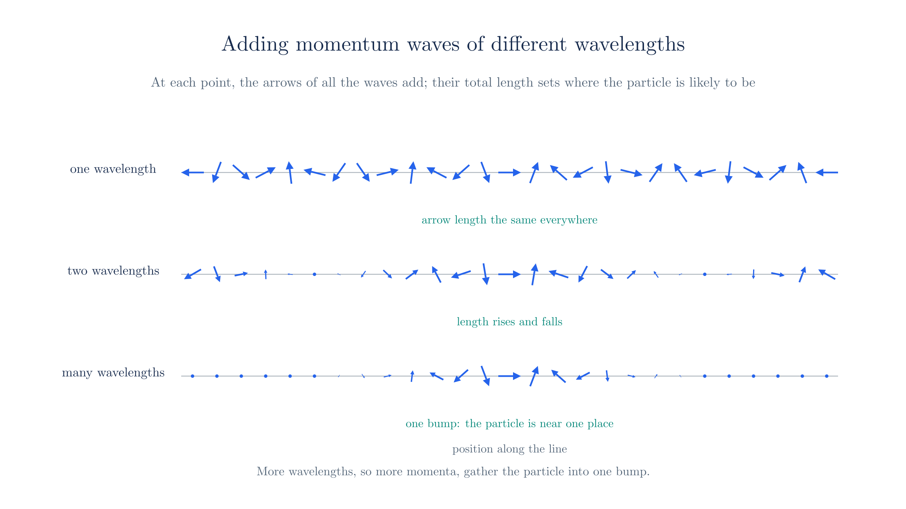
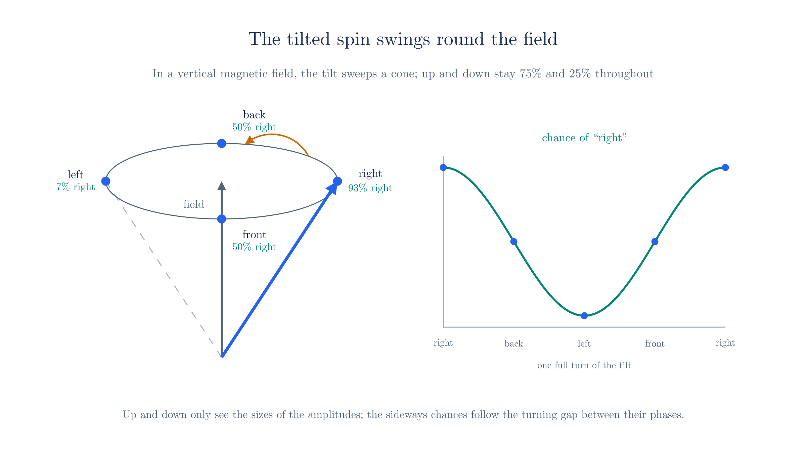

# First Quantization

[Quantum Ideas](./quantum-ideas.md) gave the rules of quantum mechanics in words. A state is a list of amplitudes, a measurement collapses it, and the Born rule gives the chances. This chapter turns those words into maths we can calculate with.

It also keeps the two promises chapter 1 ended with:

- the Hamiltonian keeps its job of moving the state forward in time;
- the Poisson bracket of position with momentum gets a quantum version.

Here's where we end up:

| | Classical (chapter 1) | Quantum (this chapter) |
| --- | --- | --- |
| The state | A point: position and momentum | A list of amplitudes |
| A measurable quantity | A number worked out from the state | An **operator** (section 1) |
| Position with momentum | Their bracket is 1 | Their **commutator** is $i\hbar$ (section 4) |
| What moves the state | Hamilton's equations, from $H$ | The **Schrödinger equation**, from the same $H$ (section 10) |

Turning classical quantities into operators like this is called **first quantization**. It's called "first" because it comes first: it deals with the motion of particles. [Field Quantization](./field-quantization.md) later does the same to fields.

## 1. Measured quantities become operators

Start with the vertical magnet from chapter 2a. It has two results, up and down, and each has a state that gives it for certain: $\lvert\text{up}\rangle$ always gives up, and $\lvert\text{down}\rangle$ always gives down. To calculate with results, give each one a number: $+1$ for up and $-1$ for down.

Now build a rule, call it $\hat Z$, that takes a state and returns a state. The hat marks it as a rule acting on states, not a plain number:

$$\hat Z\lvert\text{up}\rangle = +1\,\lvert\text{up}\rangle, \qquad \hat Z\lvert\text{down}\rangle = -1\,\lvert\text{down}\rangle.$$

On each certain state, $\hat Z$ just multiplies by that state's number. On a mix of up and down, it multiplies each part by its own number:

$$\begin{aligned}
\hat Z\big(c_0\lvert\text{up}\rangle + c_1\lvert\text{down}\rangle\big) &= c_0\,\hat Z\lvert\text{up}\rangle + c_1\,\hat Z\lvert\text{down}\rangle \\
&= c_0\,(+1)\lvert\text{up}\rangle + c_1\,(-1)\lvert\text{down}\rangle \\
&= c_0\lvert\text{up}\rangle - c_1\lvert\text{down}\rangle.
\end{aligned}$$

So $\hat Z$ holds everything about the vertical magnet in one object: the numbers its results give, and the state that gives each one.

A rule like this is called an **operator**. Every measurable quantity has one:

- its certain states are called **eigenstates**;
- the numbers it multiplies them by are called **eigenvalues** (see the [Math Refresher](appendix-math-linear-algebra.md#_4-eigenvalues-and-eigenvectors)).

*Eigen* is German for "own": a quantity's own states and its own numbers.

The sideways magnet has its own operator, $\hat S$. Its eigenstates are right, with eigenvalue $+1$, and left, with eigenvalue $-1$.

Applying an operator is a calculation on paper, not a measurement. It doesn't pick a result or collapse the state. A measurement still works the way chapter 2a's Rule 2 says. What operators are for is calculating: they give the quantum version of chapter 1's bracket (section 4), and averages straight from the amplitudes (section 5).

The calculation: the spin's operators as matrices

Write a spin state as the column of its two amplitudes (see [matrices](appendix-math-linear-algebra.md#_2-operators-and-matrix-multiplication) in the Math Refresher). Then

$$\hat Z = \begin{pmatrix} 1 & 0 \\ 0 & -1 \end{pmatrix}, \qquad \hat S = \begin{pmatrix} 0 & 1 \\ 1 & 0 \end{pmatrix}.$$

$\hat Z$ leaves up, $(1, 0)$, unchanged and turns down, $(0, 1)$, into its negative. $\hat S$ swaps the two amplitudes: it leaves right, $(1, 1)/\sqrt2$, unchanged and turns left, $(1, -1)/\sqrt2$, into its negative.

**The general notation.** Physicists name an eigenstate after its eigenvalue. For an operator $\hat A$ with an eigenstate whose eigenvalue is $a$, they write

$$\hat A\lvert\mathsf{a}\rangle = a\,\lvert\mathsf{a}\rangle.$$

The sans-serif $\mathsf{a}$ inside the bracket is the state's name, and the italic $a$ is the number it gives. Operators are **linear**: they act on each part of a mix separately and add the results.

Reference: Hermitian operators

Not every operator describes a measurement. Eigenvalues are measurement results, so they must be real numbers. And an eigenstate that gives one result for certain can never give another, so different eigenstates can't overlap. Operators with both properties are called **Hermitian**, and the quantities they describe are **observables**.

A Hermitian operator satisfies $\hat A = \hat A^\dagger$, where the **adjoint** $\hat A^\dagger$ is defined by $\langle\phi\vert\hat A^\dagger\psi\rangle = \langle\hat A\phi\vert\psi\rangle$ (see [conjugation and the adjoint](appendix-math-complex.md#_5-conjugation-and-the-adjoint) and [bra-ket notation](appendix-math-linear-algebra.md#_5-inner-products-and-bra-ket-notation)). For matrices, $\hat A^\dagger = (\hat A^*)^T$: conjugate the entries, then transpose. Both $\hat Z$ and $\hat S$ are Hermitian.

Its eigenvalues are real, and eigenvectors with different eigenvalues are orthogonal. The spectral theorem says a Hermitian operator has enough eigenvectors to write any state in them. Position and momentum can take any number along a line, so their sums become integrals, and their eigenstates, a spike at one point or an endless wave, can't be scaled to length one.

**A measurable quantity is an operator: it multiplies each of its eigenstates by that state's eigenvalue.**

## 2. Order matters: the commutator

With ordinary numbers, the order of multiplying doesn't matter: $2 \times 3 = 3 \times 2$. With operators, it can. Applying $\hat Z$ then $\hat S$ can give a different state from $\hat S$ then $\hat Z$. Writing two operators side by side means applying them one after the other, and the one on the right acts first: $\hat A\hat B$ means apply $\hat B$, then $\hat A$.

The **commutator** measures the difference:

$$[\hat A, \hat B] = \hat A\hat B - \hat B\hat A.$$

When the commutator is zero, the two operators are said to **commute**.

When is it zero? Suppose two operators share all their eigenstates. On each shared state, both just multiply by numbers, and numbers don't care about order. So the commutator is zero.

Chapter 2a's magnets in a row show the other case. An atom that is certainly up splits half and half in a sideways magnet, so up is not an eigenstate of $\hat S$. The two operators don't share eigenstates, and the order does matter. Apply both orders to $\lvert\text{up}\rangle$. Up is an equal mix of right and left, so $\hat S$ flips the sign of its left part, which turns it into $\lvert\text{down}\rangle$ (chapter 2a showed that right minus left, divided by $\sqrt2$, is down):

- $\hat Z$ first, then $\hat S$, written $\hat S\hat Z$: up stays up, then becomes $\lvert\text{down}\rangle$.
- $\hat S$ first, then $\hat Z$, written $\hat Z\hat S$: up becomes $\lvert\text{down}\rangle$, then $-\lvert\text{down}\rangle$.

Same two steps, and the results differ by a sign. Measured on its own, $-\lvert\text{down}\rangle$ gives the same chances as $\lvert\text{down}\rangle$ (chapter 2a, section 4). But its phase is different, half a turn away, and a phase counts as soon as a state is added to or subtracted from another. That minus sign comes back later, with spinors in [The Dirac Equation](./dirac-equation.md). Here it shows at once, because the commutator applies both orders and subtracts the resulting states:

$$[\hat Z, \hat S]\lvert\text{up}\rangle = \hat Z\hat S\lvert\text{up}\rangle - \hat S\hat Z\lvert\text{up}\rangle = -\lvert\text{down}\rangle - \lvert\text{down}\rangle = -2\,\lvert\text{down}\rangle \neq 0.$$

So their commutator isn't zero (the box has it as a matrix).

The calculation: the spin's commutator

With the matrices from section 1,

$$\hat Z\hat S = \begin{pmatrix} 1 & 0 \\ 0 & -1 \end{pmatrix}\begin{pmatrix} 0 & 1 \\ 1 & 0 \end{pmatrix} = \begin{pmatrix} 0 & 1 \\ -1 & 0 \end{pmatrix},$$

$$\hat S\hat Z = \begin{pmatrix} 0 & 1 \\ 1 & 0 \end{pmatrix}\begin{pmatrix} 1 & 0 \\ 0 & -1 \end{pmatrix} = \begin{pmatrix} 0 & -1 \\ 1 & 0 \end{pmatrix}.$$

Subtracting,

$$\hat Z\hat S - \hat S\hat Z = \begin{pmatrix} 0 & 1 \\ -1 & 0 \end{pmatrix} - \begin{pmatrix} 0 & -1 \\ 1 & 0 \end{pmatrix} = \begin{pmatrix} 0 & 2 \\ -2 & 0 \end{pmatrix},$$

which isn't zero.

**The commutator measures whether order matters. It's zero when two quantities share their eigenstates, and the two magnets, which don't, give a commutator that isn't zero.**

## 3. Position and momentum operators

Sections 1 and 2 used the spin. Now build the operators for chapter 1's two quantities, position and momentum.

**Position.** The state that is certain to be at one point is a wave function squeezed onto that point. An operator multiplies its eigenstates by their eigenvalues, so the position operator $\hat x$ has to multiply that state by the point's position. Multiplying the wave function at each point by that point's own position $x$ does it.

**Momentum.** Chapter 2a already found the states of definite momentum: waves whose phase turns steadily. Here they are in full:

- the arrow has the same length everywhere;
- its phase turns steadily along the line;
- it makes one full turn every $h/p$.

The momentum operator $\hat p$ has to multiply each of these waves by its own momentum $p$. One operation does that: taking the slope.

The **slope** of a wave function is how fast its arrow changes as you move along the line, written $d/dx$ (see [derivatives](appendix-math-calculus.md#_1-derivatives)). For an arrow that turns steadily, each small step adds a piece at right angles to the arrow. So the slope is the arrow itself, turned a quarter turn and multiplied by how fast it turns:

- a quarter turn is multiplying by $i$ (see [the complex plane](appendix-math-complex.md#_2-the-complex-plane-and-euler-s-formula));
- the wave makes one full turn, an angle of $2\pi$, every $h/p$ metres, so it turns by $2\pi p/h$ per metre.

The combination $h/2\pi$ comes up so often that it has its own symbol, $\hbar$, read "h-bar". It's about $10^{-34}$ joule-seconds. With it, the wave turns by an angle of $p/\hbar$ per metre (that's $p/h$ full turns per metre), and

$$\text{slope of the wave} = i\,\frac{p}{\hbar} \times \text{the wave}.$$

Multiply both sides by $-i\hbar$. Since $-i \times i = 1$, the right side becomes $p$ times the wave, which is what we wanted. So

$$\hat p = -i\hbar\,\frac{d}{dx}.$$

These waves go on forever, so their total chance can't add up to one. No actual particle is in such a state. Like a state squeezed onto one point, it's a limit that actual states can come close to. Actual states are sums of such waves, and section 6 uses that.

The calculation: the momentum waves

A wave whose phase turns by $p/\hbar$ per metre is $\psi_p(x) = e^{ipx/\hbar}$ (see [Euler's formula](appendix-math-complex.md#_2-the-complex-plane-and-euler-s-formula)). Its slope is $\psi_p' = (ip/\hbar)\,\psi_p$, so

$$\hat p\,\psi_p = -i\hbar \times \frac{ip}{\hbar}\,\psi_p = p\,\psi_p.$$

Its phase $px/\hbar$ grows by $2\pi$ over a distance $2\pi\hbar/p = h/p$. Numerically, $\hbar = h/2\pi = 1.055\times10^{-34}$ J s.

**Representations.** In the position representation used here, $\hat x$ multiplies by $x$ and $\hat p$ acts as $-i\hbar\,d/dx$. In the momentum representation, $\hat p$ multiplies by $p$ and $\hat x$ acts as $i\hbar\,d/dp$. A [Fourier transform](appendix-math-complex.md#_4-waves-and-the-fourier-transform) relates the two.

**Position multiplies by $x$. Momentum is $-i\hbar$ times the slope, because that's what multiplies chapter 2a's matter waves by their momentum.**

## 4. The bracket becomes a commutator

Section 2 asked whether the order of two operators matters. Ask it of $\hat x$ and $\hat p$. Apply both orders to any wave function $\psi$:

- **$\hat p$ first, then $\hat x$:** take the slope of $\psi$, then multiply by $x$.
- **$\hat x$ first, then $\hat p$:** multiply by $x$, then take the slope. By the product rule, the slope of $x\psi$ is $\psi$ plus $x$ times the slope of $\psi$.

The second order has one extra term, $\psi$ itself, which comes with the slope's factor $-i\hbar$. The commutator is the first order minus the second, so that extra term is subtracted, and the difference is $+i\hbar\,\psi$ (box). So

$$[\hat x, \hat p] = i\hbar.$$

Here a commutator equals a number. That means applying $\hat x\hat p - \hat p\hat x$ to any state just multiplies it by $i\hbar$. Position and momentum never commute.

Now compare chapter 1. It ended on one relation, the Poisson bracket of position with momentum. Chapter 1 wrote position as $q$, and it's the same position as $x$ here:

$$\{q, p\} = 1.$$

The two look alike, and the match goes further. Take position squared, where $\hat x^2$ means applying $\hat x$ twice:

| | Classical | Quantum |
| --- | --- | --- |
| The basic relation | $\{q, p\} = 1$ | $[\hat x, \hat p] = i\hbar$ |
| Position squared | $\{q^2, p\} = 2q$ | $[\hat x^2, \hat p] = 2\,i\hbar\,\hat x$ |

Chapter 1's formula gives $\{q^2, p\} = 2q \times 1 - 0 = 2q$, and the box works out the quantum entry. The quantum column is the classical one times $i\hbar$, and that pattern holds for the quantities this chapter needs.

This is the quantum version of the bracket that chapter 1 promised: **the commutator, divided by $i\hbar$, plays the role of the Poisson bracket**. Physicists often run the argument the other way. They start from the bracket, replace it by a commutator, and get the operators from that. [Field Quantization](./field-quantization.md) will do exactly this.

The calculation: the commutator, the general rule, and why the i and the ħ

**The commutator.** Apply both orders of $\hat x$ and $\hat p = -i\hbar\,d/dx$ to a wave function $\psi(x)$, using the product rule:

$$[\hat x, \hat p]\psi = x\,(-i\hbar\,\psi') + i\hbar\,(x\psi)' = -i\hbar\,x\psi' + i\hbar\,(\psi + x\psi') = i\hbar\,\psi.$$

The same steps with any $f(x)$ in place of $x$ give $[f, \hat p] = i\hbar f'$, the quantum version of chapter 1's $\{f, p\} = \partial f/\partial q$.

**The rule.** For the quantities used here, each Poisson bracket becomes a commutator divided by $i\hbar$: $\{f, g\} \to [\hat f, \hat g]/i\hbar$. Commutators share the bracket's properties: they flip sign when you swap the two quantities, obey the same product rule, and give zero for plain numbers. For $q^2$: $[\hat x^2, \hat p] = \hat x[\hat x, \hat p] + [\hat x, \hat p]\hat x = 2i\hbar\,\hat x$. For products of higher powers of position and momentum, the order of the operators matters and the match is no longer exact.

**Why $i$.** A bracket of two measurable quantities is itself measurable, but a commutator isn't: the commutator of two Hermitian operators is minus its own adjoint, because $(\hat A\hat B)^\dagger = \hat B\hat A$, so its eigenvalues are imaginary. Dividing it by $i$ makes it Hermitian, with real eigenvalues. For the spin, $[\hat Z, \hat S]$ has eigenvalues $+2i$ and $-2i$, and $[\hat Z, \hat S]/i$ has eigenvalues $+2$ and $-2$.

**Why $\hbar$.** A commutator of position with momentum has units of position times momentum, the units of $\hbar$, while $\{q, p\} = 1$ has none.

**Position and momentum don't commute: $[\hat x, \hat p] = i\hbar$. That's chapter 1's $\{q, p\} = 1$ in quantum form, with the commutator in place of the bracket.**

## 5. Averages and spreads

A single measurement gives a random result, so one result says little. But repeat the measurement on many atoms in the same state, and the results form a pattern that the theory predicts exactly. Two numbers describe that pattern: the average and the spread. They're where quantum mechanics becomes predictable again.

Take atoms like chapter 2a's leaning atoms: tilt the first magnet 60° to the right, and keep the ones that went up along it. Their up and down amplitudes are $\sqrt3/2$ and $1/2$ (chapter 2a's section 4 box gives the rule). Send many of them through a sideways magnet:

| Result | Eigenvalue | Chance |
| --- | ---: | ---: |
| right | $+1$ | 93.3% |
| left | $-1$ | 6.7% |

- **The average** is each eigenvalue times its chance, added up: $(+1)(0.933) + (-1)(0.067) \approx 0.87$. It's called the **expectation value**, though it isn't a result any single atom gives.
- **The spread** measures how far the results land from the average. The distances from the average are $1 - 0.87 = 0.13$ and $-1 - 0.87 = -1.87$. Square each distance, average those squares, and take the square root: $0.933 \times 0.13^2 + 0.067 \times 1.87^2 \approx 0.25$, whose root is $0.5$.

The operator gives the average and the spread directly, without having to find its eigenstates and eigenvalues first. Writing $\langle A\rangle$ for the average of a quantity $A$ in the state $\psi$, the formula is

$$\langle A\rangle = \langle\psi\vert\hat A\vert\psi\rangle.$$

In words: apply the operator to the state, then take the **overlap** of the result with the original state, which multiplies their amplitudes pair by pair and adds. The reversed bracket $\langle\psi\vert$ on the left is how physicists write "take the overlap with $\psi$". The spread comes the same way, from the averages of $A$ and of $A$ squared. For the tilted atoms, that means working straight from the up and down amplitudes, with no need to rewrite the state as right and left. The box shows why it works and runs the numbers. We'll write the spread of a quantity with $\Delta$, so $\Delta x$ is the spread in position. Here $\Delta$ means spread, not change.

The calculation: the average and the spread from the operator

In full, the overlap of two states multiplies their amplitudes pair by pair and adds, after conjugating the first: $\langle\phi\vert\psi\rangle = \sum_k \phi_k^*\psi_k$. The overlap of a state with the operator applied to it, $\langle\psi\vert\hat A\vert\psi\rangle$, adds up each eigenvalue times its chance, because different eigenstates don't overlap and the mixed terms drop out.

For the tilted atoms, the amplitudes are $\sqrt3/2$ and $1/2$. $\hat S$ swaps them to $1/2$ and $\sqrt3/2$, and the overlap with the state is $\sqrt3/4 + \sqrt3/4 \approx 0.866$. That's the same as $(+1)(0.933) + (-1)(0.067)$.

The spread is the root of the average squared distance from the average, $\Delta A = \sqrt{\langle A^2\rangle - \langle A\rangle^2}$. Every result squared is 1, so $\langle S^2\rangle = 1$ and $\Delta S = \sqrt{1 - 0.75} = 0.5$.

**Many measurements give an average and a spread, and the operator gives the average directly.**

## 6. Position and momentum can't both be exact

Go back to chapter 2a's single slit, and make the slit narrower. You might expect a narrower hump on the screen. Instead the electrons spread out wider.

Read the slit and the hump as spreads:

- The slit fixes where the electron is across it. So the slit's width is the spread in position, $\Delta x$.
- An electron that lands far from the centre was moving sideways. So the hump's width shows the spread in sideways momentum, $\Delta p$.

A narrower slit means a smaller $\Delta x$, and the wider hump means a larger $\Delta p$.

Sound does the same. A long, steady note has one pitch. A short click has no single pitch; it's a mix of many. A sound squeezed into a short time needs many pitches, just as a particle squeezed into a small region needs many wavelengths.

Wave functions work the same way. A wave function with one wavelength is a state of one momentum, section 3's wave. Its arrow has the same length everywhere, so the particle is equally likely to be anywhere. To make a wave function that's a narrow bump, you have to add many of those momentum waves, with different wavelengths. They reinforce near the bump and cancel everywhere else.

*Adding momentum waves of more and more wavelengths squeezes the wave function into a bump.*

The narrower the bump, the wider the range of momenta it needs. So the two spreads can't both be small: their product, $\Delta x$ times $\Delta p$, has a lower limit. That's the **Heisenberg uncertainty relation**:

$$\Delta x\,\Delta p \ \ge\ \frac{\hbar}{2}.$$

The commutator is the reason. Take a state exact in both position and momentum, meaning zero spread in each. On that state, both operators only multiply by numbers, so $\hat x\hat p - \hat p\hat x$ would give zero. But section 4 says it multiplies every state by $i\hbar$, so no such state exists. That rules out both spreads being zero, and the box shows the same commutator sets the limit at $\hbar/2$.

**An electron and a ball.** The limit is tiny in everyday units:

- Confine an electron to the size of an atom, and its speed is uncertain by about 580 km/s (box). It can't be pictured as a little ball on a path.
- Confine a 1 kg ball to a micrometre, and its speed is uncertain by only about $5\times10^{-29}$ m/s, far below anything measurable.

That's why chapter 1 never noticed it.

The calculation: the electron, the ball, and the general limit

The smallest momentum spread is $\hbar/(2\Delta x)$, and the velocity spread is that divided by the mass.

| System | Position spread | Smallest momentum spread | Smallest velocity spread |
| --- | --- | --- | --- |
| Electron within an atom, mass $9.11\times10^{-31}$ kg | $0.1\ \mathrm{nm}$ | $5.3\times10^{-25}\ \mathrm{kg\,m/s}$ | $5.8\times10^{5}\ \mathrm{m/s}$ |
| A 1 kg ball | $10^{-6}\ \mathrm{m}$ | $5.3\times10^{-29}\ \mathrm{kg\,m/s}$ | $5.3\times10^{-29}\ \mathrm{m/s}$ |

**Any two observables.** The product of their spreads is at least half the size of the average of their commutator, $\Delta A\,\Delta B \ge \tfrac12\lvert\langle[\hat A,\hat B]\rangle\rvert$. To show it, define $\lvert u\rangle = (\hat A - \langle A\rangle)\lvert\psi\rangle$ and $\lvert v\rangle = (\hat B - \langle B\rangle)\lvert\psi\rangle$, whose squared lengths are the squared spreads. The Cauchy–Schwarz inequality gives $(\Delta A)^2(\Delta B)^2 \ge \lvert\langle u\vert v\rangle\rvert^2 \ge (\operatorname{Im}\langle u\vert v\rangle)^2$, and $2i\operatorname{Im}\langle u\vert v\rangle = \langle u\vert v\rangle - \langle v\vert u\rangle = \langle[\hat A,\hat B]\rangle$. With $[\hat x,\hat p] = i\hbar$ this gives $\Delta x\,\Delta p \ge \hbar/2$. The bound is about the spreads within one state, not about a measuring device disturbing the particle.

**Squeezing a particle's position spreads its momentum: $\Delta x\,\Delta p \ge \hbar/2$. It matters for an electron, not for a ball.**

## 7. The energy operator

Chapter 2a said that between measurements, the state changes in a fully predictable way. To find how, start from the energy.

**From quantities to operators.** In chapter 1, the Hamiltonian $H = p^2/2m + V(x)$ was the energy, kinetic plus potential, and it moved the state forward. To use it, we need its operator. The rule is: a quantity built from position and momentum becomes an operator built the same way from $\hat x$ and $\hat p$.

Here's why that's a natural guess. Take a state of definite momentum $p$. There, $\hat p$ just multiplies by $p$, so applying it twice multiplies by $p^2$. Likewise, on a state squeezed onto one point $x$, the potential energy operator multiplies by $V(x)$, the potential energy at that point. So whenever the state has a definite position or a definite momentum, the operator gives exactly chapter 1's answer. What it does on other states is the guess, and it's tested by what it predicts: section 11, and the next chapter's spring.

**The energy operator.** Here's what $\hat H$ does to a wave function $\psi$:

- **Kinetic energy.** $\hat p^2$ is $\hat p\hat p$: by section 2, a product of operators means applying them one after the other. So apply $\hat p$ twice:

  $$\frac{\hat p\hat p}{2m}\,\psi = \frac{1}{2m}\,(-i\hbar)\frac{d}{dx}\Big((-i\hbar)\frac{d\psi}{dx}\Big) = -\frac{\hbar^2}{2m}\,\frac{d^2\psi}{dx^2},$$

  since $(-i\hbar)^2 = -\hbar^2$. The slope of the slope measures how sharply the wave function bends. A shorter wavelength bends more sharply, so it carries more kinetic energy.
- **Potential energy.** $V(\hat x)$ multiplies the wave function at each point by the potential energy there, the way $\hat x$ multiplies by $x$.

Together,

$$\hat H\,\psi = -\frac{\hbar^2}{2m}\,\frac{d^2\psi}{dx^2} + V(x)\,\psi.$$

The eigenstates of $\hat H$ are the **states of definite energy**.

**The energy becomes an operator, built from $\hat x$ and $\hat p$ the way chapter 1's Hamiltonian is built from position and momentum.**

## 8. A definite energy turns the phase

Section 7 ended with the states of definite energy. As time passes, each one turns its phase steadily. Momentum does the same thing along the line:

| A state with a definite… | Its phase turns… | How fast |
| --- | --- | --- |
| momentum $p$ | along the line | $p/h$ turns per metre |
| energy $E$ | in time | $E/h$ turns per second |

The second row comes from light. Light arrives in packets, and each packet's energy is $h$ times the light's frequency, the number of turns per second: $E = hf$ (chapter 2a's box on light). De Broglie applied the same rule to matter. It's an assumption, and experiment has confirmed it ever since.

**Stationary states.** In a state of definite energy, every amplitude turns together. Every arrow turns by the same angle, so no length and no angle between arrows changes, and so no chance changes. The state looks the same at every moment, and it's called a **stationary state**.

**Energy is an operator, and a state of definite energy turns its whole phase at $E/h$ turns per second without changing any chance.**

## 9. A state that moves

A state of one energy stands still. Mix two energies, and the state does change.

Take section 5's atoms again, tilted 60° to the right, and leave them in an even vertical magnetic field. An even field only twists the atoms (chapter 2a, section 1), so it doesn't sort or measure them. Their up and down amplitudes are $\sqrt3/2$ and $1/2$, so their up and down chances are 75% and 25%. Like a compass needle, an atom has slightly different energies pointing up and pointing down. The energy depends only on the up-or-down reading, so $\hat H$ has the same eigenstates as $\hat Z$. So up and down are the states of definite energy here.

Here's what happens next:

1. The state is a mix of up and down, and each part turns its phase at its own energy's rate (section 8). The two rates differ slightly.
2. So the angle between their two arrows grows steadily.
3. In chapter 2a, that angle set which way the atom leans.
4. So the lean swings round the field like a spinning top: right, back, left, front.
5. A sideways magnet's chance of "right" rises and falls with it.

The up and down chances never change, because they only see the lengths of the arrows.

*The lean swings round the field. Up and down stay 75% and 25% throughout, while the chance of "right" rises and falls.*

The calculation: the spinning atom

With the shared phase removed, the state at time $t$ is $c_0\lvert\text{up}\rangle + c_1 e^{-i\varphi}\lvert\text{down}\rangle$, with $\varphi = (E_1 - E_0)t/\hbar$, $c_0 = \sqrt3/2$ and $c_1 = 1/2$. It makes a full turn in $\tau = 2\pi\hbar/(E_1 - E_0)$, taking down as the higher energy, $E_1 > E_0$. The other way round, the lean swings the opposite way. The chance of "right" is

$$\Big\lvert\frac{c_0 + c_1 e^{-i\varphi}}{\sqrt2}\Big\rvert^2 = \frac12 + \frac{\sqrt3}{4}\cos\varphi.$$

| Time | Down amplitude (up held at $\sqrt3/2$) | Up / down | Right | Average of $S$ |
| --- | --- | --- | ---: | ---: |
| $0$ | $1/2$ | 75% / 25% | 93.3% | 0.866 |
| $\tau/4$ | $-i/2$ | 75% / 25% | 50% | 0 |
| $\tau/2$ | $-1/2$ | 75% / 25% | 6.7% | $-0.866$ |
| $3\tau/4$ | $i/2$ | 75% / 25% | 50% | 0 |

**A mix of energies changes in time: the tilted atom's lean swings round the field, and its sideways chances rise and fall.**

## 10. The Schrödinger equation

Any state is a mix of states of definite energy. Each part turns its phase at its own rate, and, as the spinning atom showed, that decides how the whole state moves. Written as one equation, it's the **Schrödinger equation**:

$$i\hbar\,\frac{\partial\Psi}{\partial t} = \hat H\,\Psi.$$

Here $\Psi$ is the wave function as it changes in time. The left side is $i\hbar$ times its rate of change in time. The right side is the energy operator applied to it. For a state of definite energy, both sides come out as $E$ times the state. The right side does because the state is an eigenstate of $\hat H$. The left side does because a phase turning steadily in time makes the rate of change an imaginary number times the state, just as the slope was for momentum in section 3, and multiplying by $i\hbar$ leaves $E$ times the state (box). Every state is a mix of these, so every state obeys it.

What the equation tells us:

- **The state fixes its future.** Like Hamilton's equations, it involves only the first rate of change in time, with no acceleration. Know the state now, and you know it at every later time.
- **The total chance stays one.** Each energy part only turns its phase, so the state's amplitude for each energy keeps its length, and their squares still add to one.
- **Energy and momentum look alike.** A rate of change in time, times $i\hbar$, stands for the energy, just as a slope times $-i\hbar$ stands for the momentum.

The calculation: from the turning phase to the equation

Turning at $E/h$ turns per second, the phase after a time $t$ has turned by $2\pi Et/h = Et/\hbar$. So a state of definite energy picks up the factor $e^{-iEt/\hbar}$. Its rate of change in time brings down $-iE/\hbar$, so $i\hbar\,\partial_t\Psi = E\,\Psi$. And $\hat H\Psi = E\,\Psi$ too, since $\Psi$ is an eigenstate of $\hat H$. Both sides are linear, so a mix of such states obeys the equation as well.

The $\partial$ marks a rate of change in one variable, here time, with the other, position, held fixed.

The minus sign in $e^{-iEt/\hbar}$ makes waves move the way their momentum points. A crest of $e^{i(px - Et)/\hbar}$, where $px - Et$ is fixed, moves at $x = (E/p)\,t + \text{const}$, toward $+x$ when $p > 0$. That's the speed of the crests, not of the particle. Section 11 gives the particle's.

Reference: unitary steps and generators

Collect the phase factors into one operator $\hat U(t)$, which multiplies each state of definite energy $E$ by $e^{-iEt/\hbar}$, so that $\lvert\Psi(t)\rangle = \hat U(t)\lvert\Psi(0)\rangle$. It's written $e^{-i\hat Ht/\hbar}$. A **unitary** operator satisfies $\hat U^\dagger\hat U = \hat U\hat U^\dagger = \hat I$, so it keeps overlaps, and with them the total chance. For Hermitian $\hat G$, $e^{-i\theta\hat G}$ is unitary. Conversely, a smooth family of unitary steps with $\hat U(a)\hat U(b) = \hat U(a + b)$ can be written $\hat U(\theta) = e^{-i\theta\hat G}$ with $\hat G$ Hermitian, called its **generator**. The Hamiltonian divided by $\hbar$ is the generator of time evolution.

**The Schrödinger equation moves the state: $i\hbar$ times its rate of change equals the energy operator applied to it.**

## 11. Averages follow chapter 1

Chapter 1's bracket had one more job: it told how any quantity changes in time. Its rate of change was its bracket with the Hamiltonian.

The Schrödinger equation gives the quantum version, for averages. Before a measurement, a quantity has no single result, only chances, so what changes smoothly is its average (section 5). The average of any quantity changes at a rate given by the average of its commutator with $\hat H$, divided by $i\hbar$. With $\langle A\rangle$ for the average of a quantity $A$, as in section 5, the two rules sit side by side:

| Chapter 1 | Quantum |
| --- | --- |
| $\dfrac{df}{dt} = \{f, H\}$ | $\dfrac{d\langle A\rangle}{dt} = \dfrac{1}{i\hbar}\,\langle[\hat A, \hat H]\rangle$ |

It's chapter 1's rule, with the bracket swapped for a commutator divided by $i\hbar$, the same swap as in section 4.

For position and momentum, it gives Hamilton's equations for the averages:

- the average position changes at the average momentum divided by the mass;
- the average momentum changes at the force averaged over where the particle might be. For a narrow state like a ball's, that's the force at its average position.

This is why chapter 1 works for a ball. Its spreads can be far too small to notice (section 6), so the average is all we ever see, and the averages follow chapter 1's equations.

The calculation: how averages change

**Averages.** Write $\langle A\rangle = \langle\Psi\vert\hat A\vert\Psi\rangle$ and differentiate both copies of $\Psi$. The Schrödinger equation gives $\partial_t\lvert\Psi\rangle = \tfrac{1}{i\hbar}\hat H\lvert\Psi\rangle$, and its adjoint gives $\partial_t\langle\Psi\rvert = -\tfrac{1}{i\hbar}\langle\Psi\rvert\hat H$. So

$$\frac{d\langle A\rangle}{dt} = \frac{1}{i\hbar}\langle[\hat A,\hat H]\rangle.$$

**Position.** Only the $\hat p^2/2m$ part of $\hat H$ fails to commute with $\hat x$. Using $[\hat x, \hat p] = i\hbar$ twice,

$$[\hat x,\hat p^2] = \hat x\hat p\hat p - \hat p\hat p\hat x = (\hat p\hat x + i\hbar)\hat p - \hat p(\hat x\hat p - i\hbar) = 2i\hbar\,\hat p,$$

so $[\hat x, \hat H] = 2i\hbar\,\hat p/2m = i\hbar\,\hat p/m$, and $d\langle x\rangle/dt = \langle p\rangle/m$.

**Momentum.** Only the $V$ part fails to commute with $\hat p$. Using the product rule,

$$[\hat p, V]\psi = -i\hbar\,(V\psi)' + i\hbar\,V\psi' = -i\hbar\,(V'\psi + V\psi') + i\hbar\,V\psi' = -i\hbar\,V'\psi,$$

so $d\langle p\rangle/dt = \tfrac{1}{i\hbar}\langle -i\hbar\,V'\rangle = -\langle V'\rangle$, the force averaged over the state. That equals the force at the average position when the force barely changes across the state, and exactly for a spring or a constant force.

**Averages change by the commutator with $\hat H$, which is chapter 1's bracket rule. That's why a ball follows chapter 1.**

## Where this comes back

The next chapter, [The Harmonic Oscillator](./harmonic-oscillator.md), applies these rules to chapter 1's spring, from start to finish. It finds the spring's energies from the commutator $[\hat x, \hat p] = i\hbar$ alone, and they come in evenly spaced steps.

Further on, [Field Quantization](./field-quantization.md) applies the same bracket-to-commutator rule to a field, with a pair of operators at every point of space. The change that carries a state forward in time keeps the total chance at one. A change like that is called **unitary**. It returns in [Symmetries](./symmetries.md) and [Quantum Field Theory](./qft.md).

---

Previous: [Quantum Ideas](./quantum-ideas.md)

Next: [The Harmonic Oscillator](./harmonic-oscillator.md)
