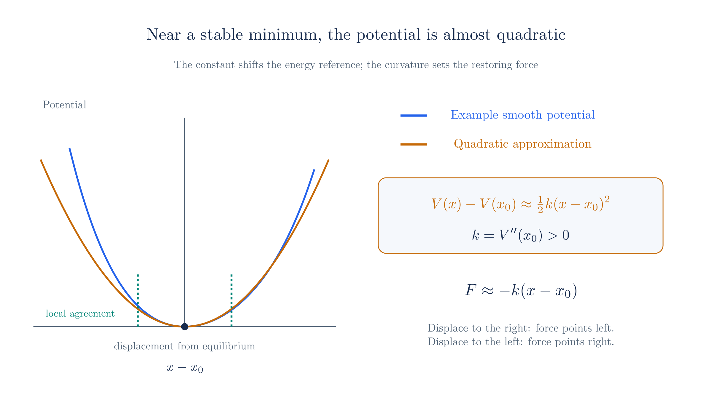
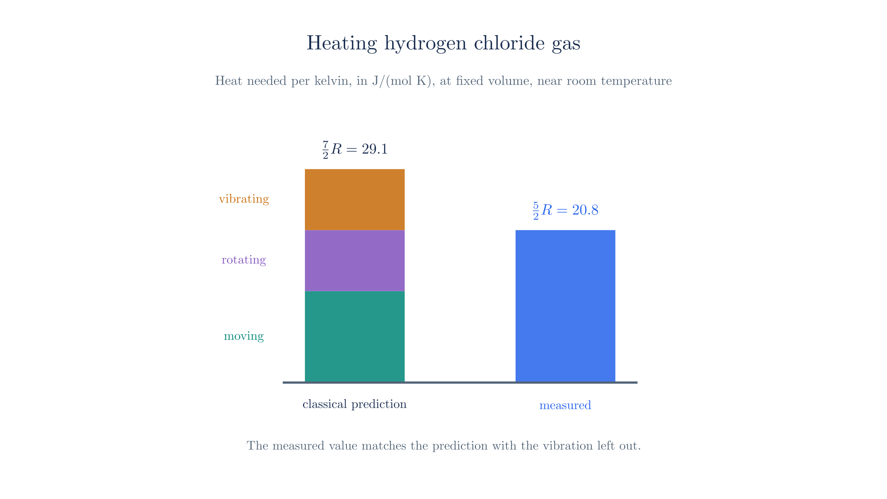
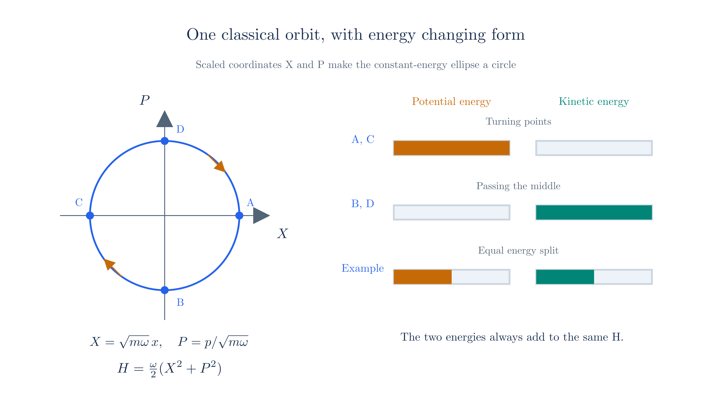
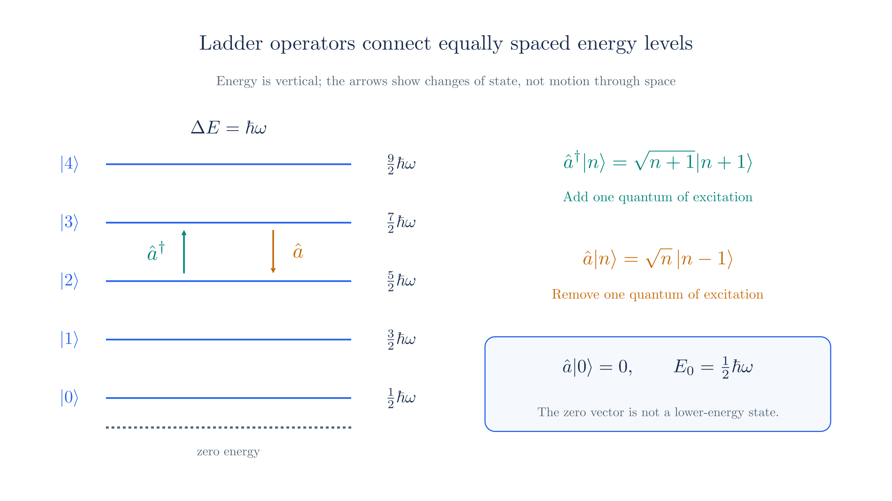
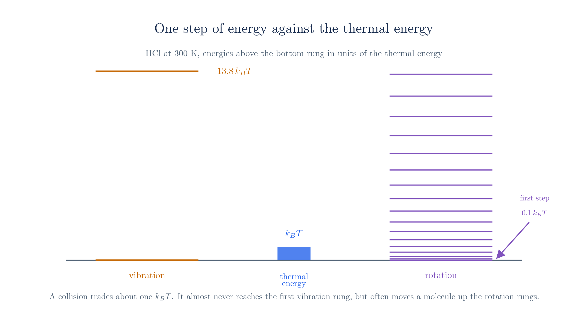
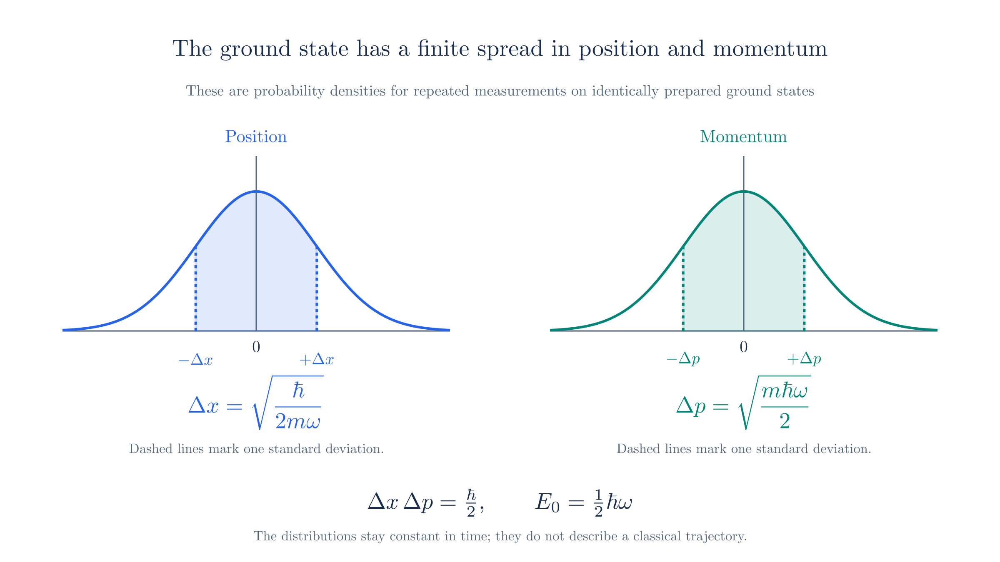
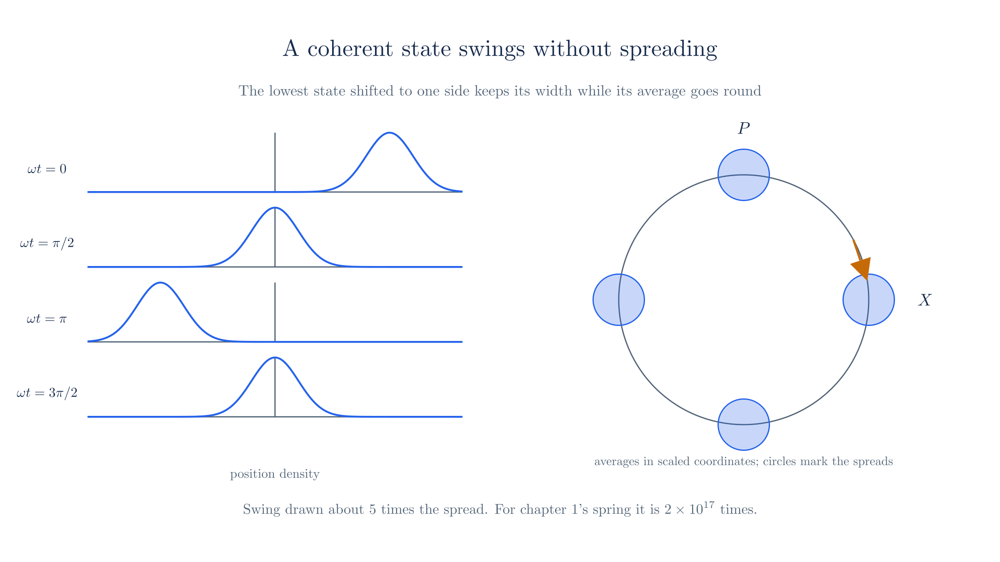

# The Harmonic Oscillator

Chapter 2 gave us the rules of quantum mechanics. Now we run them on one thing, all the way through: the spring from chapter 1.

Why a spring? Because almost anything that wobbles a little around a resting spot behaves like one: a pendulum, a molecule, a guitar string. And later, every wave of a quantum field will turn out to be a spring too. So if we understand the quantum spring, we understand a lot.

Here is where we end up:

| | Classical spring | Quantum spring |
| --- | --- | --- |
| Energy | Any amount | Only certain amounts, evenly spaced, like rungs of a ladder |
| Lowest energy | Zero, sitting still | Never zero. It always jiggles a little |
| Motion | Swings back and forth | Its average swings exactly like the classical one |

## 1. Why springs are everywhere

Zoom in on the bottom of any smooth valley and it looks like a parabola. A parabola is exactly the shape of a spring's energy, $\tfrac12 k x^2$. So any small wobble around a resting point is a spring wobble.

The pendulum is a good check. Its energy curve and the spring's parabola agree to within 0.3% for swings up to about 11°. The atoms in a molecule also sit at the bottom of an energy valley, so the bond between them is a tiny, very stiff spring.

*Near the bottom, a smooth valley (blue) is almost a parabola (orange), which is a spring.*

More detail: the pendulum numbers, and why every valley looks like a parabola

The pendulum's energy is $mg\ell\,(1 - \cos\theta)$. Since $\cos\theta \approx 1 - \tfrac12\theta^2$ for small angles, this is close to the spring's $\tfrac12 mg\ell\,\theta^2$:

| Angle $\theta$ (radians) | $1 - \cos\theta$ | $\tfrac12\theta^2$ | Difference |
| ---: | ---: | ---: | ---: |
| 0.1 | 0.00500 | 0.00500 | 0.1% |
| 0.2 | 0.01993 | 0.02000 | 0.3% |
| 0.5 | 0.12242 | 0.12500 | 2.1% |
| 1.0 | 0.45970 | 0.50000 | 8.8% |

For any smooth energy $V(x)$ with its lowest point at $x_0$, a Taylor expansion gives

$$V(x) = V(x_0) + V'(x_0)\,(x - x_0) + \tfrac12 V''(x_0)\,(x - x_0)^2 + \ldots$$

At the bottom the slope $V'(x_0)$ is zero, the constant changes nothing, and for small wobbles the higher terms are tiny. What's left is a spring with stiffness $k = V''(x_0)$.

## 2. A puzzle: a vibration that won't take heat

Take hydrogen chloride, HCl: one hydrogen atom stuck to one chlorine atom, so a tiny spring. Shine infrared light through the gas and it soaks up light most strongly at around $8.65\times10^{13}$ vibrations per second. That's how fast the bond vibrates.

Now heat the gas. Classical physics has a simple rule for this: every way a molecule can hold energy takes an equal share of the heat. HCl can hold energy by flying around, by tumbling, and by vibrating, and the rule predicts how much heat it should take to warm it. The measurement comes out lower, by exactly the vibration's share. The bond refuses to take any heat at all, as if it were frozen.

Classical physics can't explain that. The quantum spring can, and section 6 shows how.

*The heat HCl should need (left) and the heat it actually needs (right). The vibration's share is missing.*

More detail: counting the shares of heat

The classical rule, which this book takes on trust, says that in a gas at temperature $T$ every term in a molecule's energy that is a square holds on average $\tfrac12 k_BT$, where $k_B = 1.38\times10^{-23}$ J/K is Boltzmann's constant. For a mole of gas at fixed volume, each such term adds $\tfrac12 R$ to the heat needed per degree, with $R = 8.314$ J/(mol·K).

| Motion | Square terms | Heat per degree, per mole |
| --- | --- | --- |
| Flying around | 3 | $\tfrac32 R$ |
| Tumbling, about the two axes across the bond | 2 | $R$ |
| Vibrating, kinetic and potential | 2 | $R$ |
| Classical prediction | 7 | $\tfrac72 R = 29.1$ J/(mol·K) |
| Measured at room temperature | | $\tfrac52 R = 20.8$ J/(mol·K) |

The infrared light is absorbed in a band centred on $f = 8.652\times10^{13}$ Hz, the bond's vibration frequency.

## 3. The spring as a spinning arrow

Chapter 1's spring has a mass and a stiffness, and it swings back and forth. Its energy is a sum of two squares: one for its position, one for its momentum.

Here's a neat trick. Two squares added together are the squared length of one arrow in the complex plane. So we can pack the position and momentum into a single arrow, $z$. Then the whole motion becomes very simple: the arrow keeps its length, which is the energy, and spins round at a steady rate, the spring's frequency $\omega$. The whole spring is one spinning arrow.

Why bother? Because the squared length of an arrow is a product, the arrow times its mirror image. Section 4 turns that product into quantum operators, and that's what unlocks the quantum spring.

*Position across, momentum up: the spring goes round a circle. Energy moves between stored (potential) and moving (kinetic) form, and the total stays the same.*

The calculation: the arrow and why it spins

The spring's energy, with mass $m$ and angular frequency $\omega$, is

$$H = \frac{p^2}{2m} + \tfrac12 m\omega^2 x^2.$$

Define

$$z = \sqrt{\frac{m\omega}{2}}\left(x + \frac{i\,p}{m\omega}\right), \qquad \text{so that} \qquad H = \omega\,\lvert z\rvert^2 = \omega\,z^*z.$$

Hamilton's equations from chapter 1, $\dot x = p/m$ and $\dot p = -m\omega^2 x$, give $\dot z = -i\omega z$, so $z(t) = z(0)\,e^{-i\omega t}$: fixed length, turning clockwise at rate $\omega$.

For chapter 1's spring ($m = 1$ kg, $\omega = 2$ per second, released from 1 m), $z = \cos 2t - i\sin 2t$ and the energy is 2 J:

| Time $t$ (s) | $x$ (m) | $p$ (kg·m/s) | $z$ | Energy $\omega\lvert z\rvert^2$ (J) |
| ---: | ---: | ---: | --- | ---: |
| 0 | 1.000 | 0.000 | $1$ | 2.000 |
| $\pi/8$ | 0.707 | $-1.414$ | $0.707 - 0.707i$ | 2.000 |
| $\pi/4$ | 0.000 | $-2.000$ | $-i$ | 2.000 |
| $\pi/2$ | $-1.000$ | 0.000 | $-1$ | 2.000 |

## 4. Turning the arrow into a quantum tool

In quantum mechanics, position and momentum become operators that don't commute (chapter 2). The spring's energy keeps the same form, and we want to know which energies it allows.

You could solve a differential equation for that, but there's a shortcut: copy the arrow trick. Turn the arrow into an operator, called $\hat a$, and its mirror image into a partner, $\hat a^\dagger$. Then multiply them, just as the classical energy was the arrow times its mirror image.

With ordinary numbers, that product gives back exactly the energy. With operators, it falls a little short of the energy, because position and momentum don't commute. The result is

$$\text{energy} = \hbar\omega\left(\hat a^\dagger\hat a + \tfrac12\right).$$

It's the classical answer with an extra $\tfrac12\hbar\omega$ on the end. That extra bit is pure quantum mechanics, and it will matter.

The other thing that drops out is a simple rule for swapping the two operators: $\hat a\hat a^\dagger - \hat a^\dagger\hat a = 1$. That one rule is all the next section needs.

The calculation: building â and multiplying it out

Replace $x$ and $p$ in $z$ by operators, and divide by $\sqrt\hbar$ to make the result a plain number:

$$\hat a = \sqrt{\frac{m\omega}{2\hbar}}\left(\hat x + \frac{i\,\hat p}{m\omega}\right), \qquad \hat a^\dagger = \sqrt{\frac{m\omega}{2\hbar}}\left(\hat x - \frac{i\,\hat p}{m\omega}\right).$$

Multiplying, the cross terms leave the commutator $[\hat x,\hat p] = i\hbar$:

$$\hat a^\dagger\hat a = \frac{m\omega}{2\hbar}\left(\hat x^2 + \frac{\hat p^2}{m^2\omega^2} + \frac{i}{m\omega}\,[\hat x,\hat p]\right) = \frac{\hat H}{\hbar\omega} - \frac12.$$

In the other order the commutator term flips sign, $\hat a\hat a^\dagger = \hat H/\hbar\omega + \tfrac12$, and subtracting gives $[\hat a,\hat a^\dagger] = 1$.

$\hat a$ and $\hat a^\dagger$ are not Hermitian, so they are not things we measure. They are tools for moving between states.

## 5. Climbing the ladder

Call $\hat N = \hat a^\dagger\hat a$ the **number operator**. The energy is $\hbar\omega$ times its value, plus $\tfrac12\hbar\omega$. So the question is: what values can $\hat N$ have?

Using only the swapping rule, three things follow:

1. **$\hat a$ steps down, $\hat a^\dagger$ steps up.** Applied to a state, $\hat a$ lowers the value of $\hat N$ by exactly 1, and $\hat a^\dagger$ raises it by 1. Each step changes the energy by $\hbar\omega$. That's why they're called **ladder operators**.
2. **The ladder has a bottom.** You can't step down forever, because the values can't go negative. Stepping down has to stop exactly at 0, so the values are whole numbers: 0, 1, 2, …
3. **The ladder has no top.** You can always step up.

So the allowed energies are

$$E_n = \hbar\omega\left(n + \tfrac12\right), \qquad n = 0, 1, 2, \ldots$$

Evenly spaced rungs, each $\hbar\omega$ apart, and the lowest rung isn't at zero but at $\tfrac12\hbar\omega$. One step of $\hbar\omega$ is called a **quantum**, and $n$ counts how many quanta the spring holds.

*The quantum spring's energy ladder. $\hat a^\dagger$ climbs one rung, $\hat a$ goes down one, and there's nothing below the bottom rung.*

The calculation: why the values are whole numbers

**Stepping.** From $[\hat a,\hat a^\dagger] = 1$, we get $[\hat N,\hat a] = -\hat a$. So if $\hat N\lvert n\rangle = n\lvert n\rangle$, then $\hat N(\hat a\lvert n\rangle) = (n - 1)(\hat a\lvert n\rangle)$: $\hat a\lvert n\rangle$ has value $n - 1$. Likewise $[\hat N,\hat a^\dagger] = \hat a^\dagger$ raises the value by 1.

**The bottom.** The squared length of $\hat a\lvert n\rangle$ is $\langle n\vert\hat a^\dagger\hat a\vert n\rangle = n$, so $n$ can't be negative. Stepping down only stops when $\hat a$ gives zero, which needs $n = 0$ exactly. A starting value that isn't whole skips past 0:

| Start | Stepping down | Outcome |
| --- | --- | --- |
| 3 | 3, 2, 1, 0, then zero | Fine |
| 2.5 | 2.5, 1.5, 0.5, −0.5 | Impossible: a negative squared length |

**The top.** The squared length of $\hat a^\dagger\lvert n\rangle$ is $n + 1$, never zero, so stepping up never stops.

**Step sizes.** With the phases chosen to make them positive, $\hat a\lvert n\rangle = \sqrt n\,\lvert n - 1\rangle$ and $\hat a^\dagger\lvert n\rangle = \sqrt{n+1}\,\lvert n + 1\rangle$. Adding the definitions of $\hat a$ and $\hat a^\dagger$ also gives position: $\hat x = \sqrt{\hbar/2m\omega}\,(\hat a + \hat a^\dagger)$.

## 6. How big are the steps?

Now we can solve the puzzle from section 2.

**The frozen bond.** For HCl, one step on the ladder is about 14 times the energy that molecules typically trade when they bump into each other at room temperature. The bond can only take a whole step, never part of one, and bumps that big are rare: about one in a million. So the bond almost never gets kicked up a rung. It sits on the bottom rung and takes no heat. That's the missing share.

Tumbling is quantized too, but its steps are about ten times smaller than a typical bump. So bumps move molecules up and down the tumbling ladder all the time, and tumbling takes its full share of heat, just as classical physics says.

**Why the steps are so different.** Every motion has its own ladder, and the rule from section 5, step $= \hbar\omega$, says how far apart its rungs are: about $\hbar$ times how fast that motion naturally repeats. Fast motions come in big steps, slow ones in small steps.

- **Vibrating is fast.** A spring rings at a rate set by its stiffness and its mass. The bond is very stiff and the hydrogen atom is very light, so the bond rings almost $9\times10^{13}$ times a second. Big steps.
- **Tumbling is slow.** Nothing pulls the molecule back to a preferred angle, so it has no ringing rate of its own. Its slowest allowed spin is set by how hard the whole molecule is to turn, and that comes out about a hundred times slower than the vibration. Small steps.
- **Flying around is slower still.** The only thing that repeats is bouncing from wall to wall of the container, which takes ages. Its steps are far too small to matter.

Room temperature happens to sit between the vibration's steps and the tumbling steps. That's why only the vibration freezes. Cool the gas far enough and tumbling freezes too, and heat it to thousands of degrees and the vibration thaws.

*A typical bump (blue) easily climbs the tumbling ladder (purple), but almost never reaches the vibration's first rung (orange).*

**The everyday spring.** Chapter 1's spring is the opposite. Its steps are about $10^{-34}$ of its energy. Adding or removing one quantum changes the energy by one part in $10^{34}$, and nobody could ever measure that. So its energy looks perfectly smooth, which is why chapter 1 never noticed the ladder.

The numbers

| | Chapter 1's spring | The HCl bond |
| --- | --- | --- |
| Angular frequency $\omega$ | $2\ \mathrm{s^{-1}}$ | $2\pi\times8.652\times10^{13}\ \mathrm{Hz} = 5.44\times10^{14}\ \mathrm{s^{-1}}$ |
| One step, $\hbar\omega$ | $2.1\times10^{-34}$ J | $5.73\times10^{-20}$ J |
| Compared with | Its energy, 2 J | A typical bump at room temperature, $k_BT = 4.14\times10^{-21}$ J |
| Ratio | $9.5\times10^{33}$ quanta | One step is $13.8\,k_BT$ |

The "one in a million" uses a rule from thermal physics, taken on trust here: the share of molecules lifted by an energy $\Delta E$ is about $e^{-\Delta E/k_BT}$, and $e^{-13.8} \approx 10^{-6}$. The three ladders of an HCl molecule:

| Motion | How fast it repeats, as an angular frequency | One step | Compared with $k_BT$ |
| --- | --- | --- | --- |
| Vibrating | $5.4\times10^{14}$ per second | $5.7\times10^{-20}$ J | 14 times larger |
| Tumbling, slowest spin | about $4\times10^{12}$ per second | $4.1\times10^{-22}$ J | about a tenth |
| Crossing a 1 cm box | about $10^{-5}$ per second | about $10^{-39}$ J | negligible |

The tumbling rate is $\hbar/I$, where $I$ is how hard the molecule is to spin (its moment of inertia, about $2.7\times10^{-47}$ kg·m² for HCl), and the first tumbling step is $\hbar^2/I$. The box rate is $\hbar/(mL^2)$ for a molecule of mass $m$ in a box of size $L$.

## 7. The lowest rung

A classical spring can sit perfectly still at the bottom, with zero energy. A quantum spring can't. Sitting still at the bottom would mean its position and its momentum are both exactly zero, and chapter 2 showed that quantum mechanics never allows both to be sharp at once. So even on its lowest rung, the spring keeps a little energy, $\tfrac12\hbar\omega$, called the **zero-point energy**.

What does that lowest state look like? A bell curve. The spring's position is spread out a little around the bottom, and so is its momentum, and the two spreads are as small together as the uncertainty rule allows. The energy is split evenly: half from moving, half from stretching.

For chapter 1's spring, the spread is about $5\times10^{-18}$ m, a few hundred times smaller than an atomic nucleus. For a molecule's bond it's a few percent of the bond's length, so even near absolute zero a bond's length is never perfectly sharp.

*The lowest rung: position (left) and momentum (right) are both spread out a little, and the spreads are as small as quantum mechanics allows.*

The calculation: the bell curve and its spreads

The bottom rung satisfies $\hat a\lvert 0\rangle = 0$. With $\hat p = -i\hbar\,d/dx$ from chapter 2 this becomes

$$\psi_0'(x) = -\frac{m\omega}{\hbar}\,x\,\psi_0(x), \qquad\text{solved by}\qquad \psi_0(x) = \Big(\frac{m\omega}{\pi\hbar}\Big)^{1/4} e^{-m\omega x^2/2\hbar}.$$

The spreads are

$$\Delta x_0 = \sqrt{\frac{\hbar}{2m\omega}}, \qquad \Delta p_0 = \sqrt{\frac{m\hbar\omega}{2}}, \qquad \Delta x_0\,\Delta p_0 = \frac{\hbar}{2},$$

the smallest product chapter 2's uncertainty relation allows. The kinetic energy is $\Delta p_0^2/2m = \hbar\omega/4$ and the potential energy is $\tfrac12 m\omega^2\Delta x_0^2 = \hbar\omega/4$, which add to $\tfrac12\hbar\omega$. For chapter 1's spring, $\Delta x_0 = 5.1\times10^{-18}$ m. For HCl it is $7.7\times10^{-12}$ m, about 6% of the bond's length of $1.27\times10^{-10}$ m.

## 8. How the quantum spring moves

**One rung on its own doesn't move.** Its state only turns its phase, and nothing you could measure changes.

**A mix of rungs.** The spring doesn't have to sit on a single rung. Just as chapter 2's tilted spin was partly up and partly down, the spring's state can be partly on one rung and partly on another. It's still one spring in one state, with an amplitude on each of the two rungs. Measure its energy and you get one rung's energy or the other, with probabilities set by the amplitudes. The mix doesn't have to be equal: 50/50, 75/25, anything that adds up to 100%.

**Two rungs mixed together swing.** Their phases turn at different rates, and the growing gap between them makes the average position and momentum go round and round, at exactly the classical spring's rate $\omega$. The more even the mix, the bigger the swing. A 50/50 mix swings the most, and a mix that is almost all one rung barely moves. In fact any mixture of rungs does this. Because the rungs are evenly spaced, the phase gap between any two neighbouring rungs grows at the same rate, so the averages always follow chapter 1's equations exactly.

**What we see is a coherent state.** When you pull chapter 1's spring to 1 m and let go, quantum mechanics describes it as the bell curve from section 7, shifted over to where you let go. This state is called a **coherent state**. Its centre swings back and forth exactly along chapter 1's path, and its width stays at the bell's width forever. A swinging spring, a pendulum, anything you see oscillating at everyday scale is, in quantum terms, very close to a state like this.

**Why it looks classical.** The width is fixed by the spring's mass and frequency, and it doesn't grow when you pull harder. The swing is whatever you give it. So what you see depends on how the two compare:

- **Chapter 1's spring:** the width is about $5\times10^{-18}$ m and the swing is 1 m, so the swing is $2\times10^{17}$ widths. No instrument could ever see the width, so all you see is the centre, a point following chapter 1's path. That's the classical spring.
- **A molecule's bond:** the width is about 6% of the bond's length, and a vibration spans only a few widths. Here the blur can't be ignored, so the bond never looks like a classical spring. You see rungs and jumps instead.

Same rules, same kind of state. At our scale, the quantum blur is just far too small to notice.

*A coherent state: the bell keeps its shape while it swings (left), and its average goes round the classical circle (right). Here the swing is drawn just 5 times the width; for chapter 1's spring it is $2\times10^{17}$ times.*

The calculation: swinging averages and the coherent state

**Two rungs.** A mix of rungs 0 and 1 is $c_0\lvert 0\rangle + c_1\lvert 1\rangle$, with $\lvert c_0\rvert^2 + \lvert c_1\rvert^2 = 1$. Measuring the energy gives $\tfrac12\hbar\omega$ with probability $\lvert c_0\rvert^2$ and $\tfrac32\hbar\omega$ with probability $\lvert c_1\rvert^2$. In time, with the shared phase removed, $c_1$ picks up $e^{-i\omega t}$. Using $\hat x = \Delta x_0(\hat a + \hat a^\dagger)$, the average position swings as $\langle x\rangle = 2\lvert c_0\rvert\lvert c_1\rvert\,\Delta x_0\cos(\omega t - \varphi)$, where $\varphi$ is the phase of $c_1$ relative to $c_0$. A complex amplitude, like chapter 2's $i/2$, only shifts when the swing starts.

| $c_0$ | $c_1$ | Rung 0 / rung 1 | Size of the swing |
| --- | --- | --- | --- |
| $1/\sqrt2$ | $1/\sqrt2$ | 50% / 50% | $\Delta x_0$, the largest possible |
| $\sqrt3/2$ | $1/2$ | 75% / 25% | $0.87\,\Delta x_0$ |
| $1$ | $0$ | 100% / 0% | none |

For the equal mix, with $\hat p = i\Delta p_0(\hat a^\dagger - \hat a)$:

| $\omega t$ | $\langle x\rangle$ | $\langle p\rangle$ |
| --- | ---: | ---: |
| 0 | $\Delta x_0$ | 0 |
| $\pi/2$ | 0 | $-\Delta p_0$ |
| $\pi$ | $-\Delta x_0$ | 0 |
| $3\pi/2$ | 0 | $\Delta p_0$ |

**Any state.** For $\sum_n c_n\lvert n\rangle$, the average of $\hat a$ is $\sum_n\sqrt{n+1}\,c_n^*c_{n+1}\,e^{-i(E_{n+1}-E_n)t/\hbar}$. Every gap $E_{n+1} - E_n$ is $\hbar\omega$, so $\langle\hat a\rangle$ turns as $e^{-i\omega t}$: the classical arrow of section 3, divided by $\sqrt\hbar$.

**The coherent state.** The shifted bell $\psi_0(x - s)$ satisfies $\hat a\,\psi_0(x - s) = \alpha\,\psi_0(x - s)$ with $\alpha = s/2\Delta x_0$. In time, $\alpha$ turns as $\alpha e^{-i\omega t}$, and the state stays a bell of the same width, with $\Delta x = \Delta x_0$ and $\Delta p = \Delta p_0$. Its average number of quanta is $\lvert\alpha\rvert^2$, which for chapter 1's spring ($s = 1$ m) is $9.5\times10^{33}$.

## Where this comes back

- **[Field Quantization](./field-quantization.md):** every wave of a field is a spring with its own ladder. One quantum on a wave's ladder is one particle with that wave's momentum.
- **The same chapter:** every wave also has its own zero-point energy, $\tfrac12\hbar\omega$. There are infinitely many waves, so the total is infinite, and it gets subtracted off.
- **[Quantum Electrodynamics](./qed.md):** the quanta of the light field are photons, the packets of light from chapter 2.

But first, fields have to agree with relativity, so the next chapter is [Special Relativity](./special-relativity.md).

---

Previous: [First Quantization](./first-quantization.md)

Next: [Special Relativity](./special-relativity.md)
