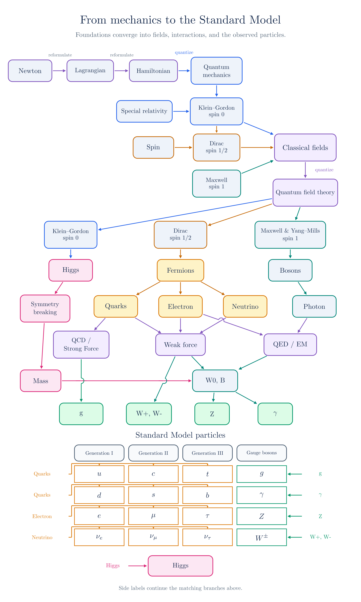

# Mindmap

This roadmap follows the progression from mechanics to classical fields, quantum field theory, interactions, and the Standard Model particle table.

## Notes

- Start with Newton Mechanics and the laws of motion
- Lagrangian mechanics is a reformulation using kinetic energy and potential energy. One major advantage is that it works without having to track internal forces (connecting the parts of the system)
> The principle of Least Action and its Lagrangian is fundamental to the rest. It is very important to get a good grasp before going forward.

We'll mark the important checkpoint in quotes.

- Next, comes the Hamiltonian formulation. Also equivalent to the Lagrangian but this introduces the notion of Hamiltonian and *generalized* coordinates. We abandon the system coordinates, $x$ and $p$ for state variables
> Reasoning "indirectly" in a state space is very important in quantum mechanics.

In QM, the system state is not directly observable. We can measure $x$ but it usually modifies the state.

In parallel to QM, we have special relativity SR. QM deals with the very small, SR deals with the very fast.
The next goal is to reconcile small and fast.

We take $E^2=m^2+p^2$ (with $c = 1$). It's the famous $E=mc^2$, with momentum included. Then we do the QM quantization where we promote values to operators.
That gives the first field equation: The Klein Gordon Equation.

> The Klein Gordon Equation is the first and simplest type of field equation.

$$
\left(\frac{\partial^2}{\partial t^2} - \nabla^2 + m^2\right)\phi = 0
$$

Here we use units where $\hbar = c = 1$, and $\phi$ is the field.

However, it is second order and accepts negative energy and negative probability solutions.

Finding a first-order equation leads to the Dirac equation. It needs 4 matrices mutually anti commuting. The 3 2x2 Pauli aren't enough, so we need 4x4, and thus 4 components for the state.
Lorentz transformations modify the state according to spinor rules.

$$
i\frac{\partial\psi}{\partial t} = \left(-i\boldsymbol{\alpha}\cdot\nabla + \beta m\right)\psi
$$

Here $\psi$ is the four-component spinor, and $\alpha_1, \alpha_2, \alpha_3, \beta$ are the four matrices, again using $\hbar = c = 1$.

Requiring preservation of total anguar momentum allows you to identify the intrinsic angular momentum as Spin. The solutions at rest
have energy (-m, +m), each with spin (up, down), ie 4 independent solutions.

The third and final type of classical field we have is the ElectroMagnetic field that is govern by the Maxwell equation.

$$
\partial_\mu F^{\mu\nu} = j^\nu
$$

Here $F^{\mu\nu}$ combines the electric and magnetic fields, and $j^\nu$ combines charge density and current. We use units where $c = \varepsilon_0 = \mu_0 = 1$.
