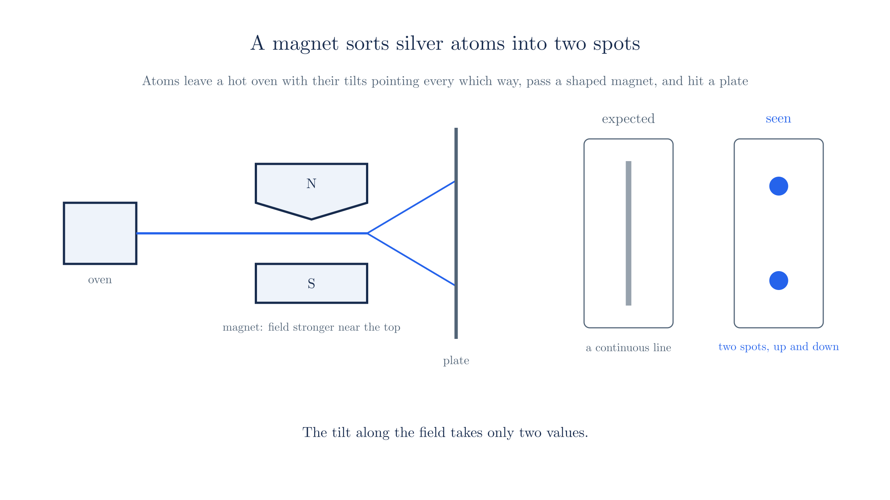
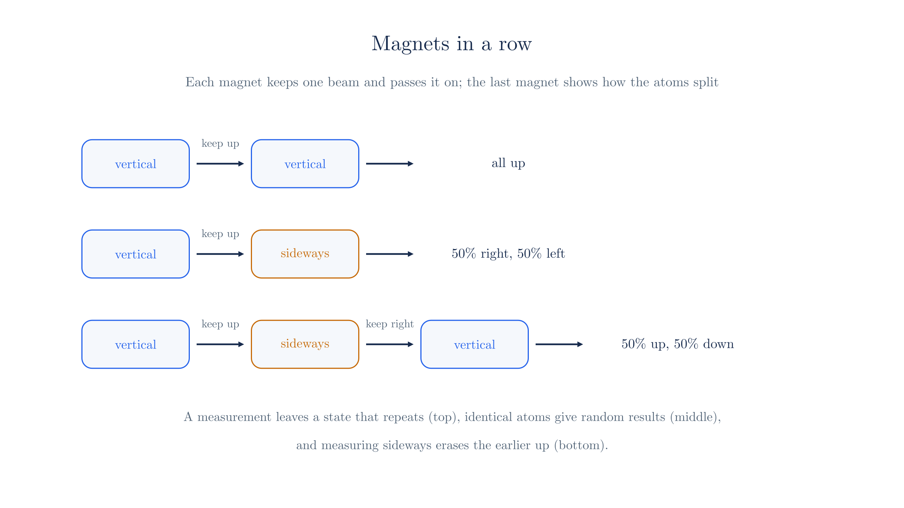
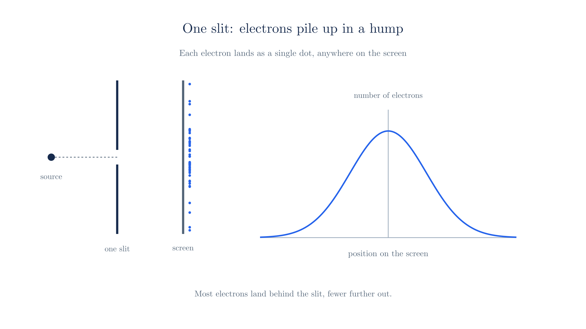
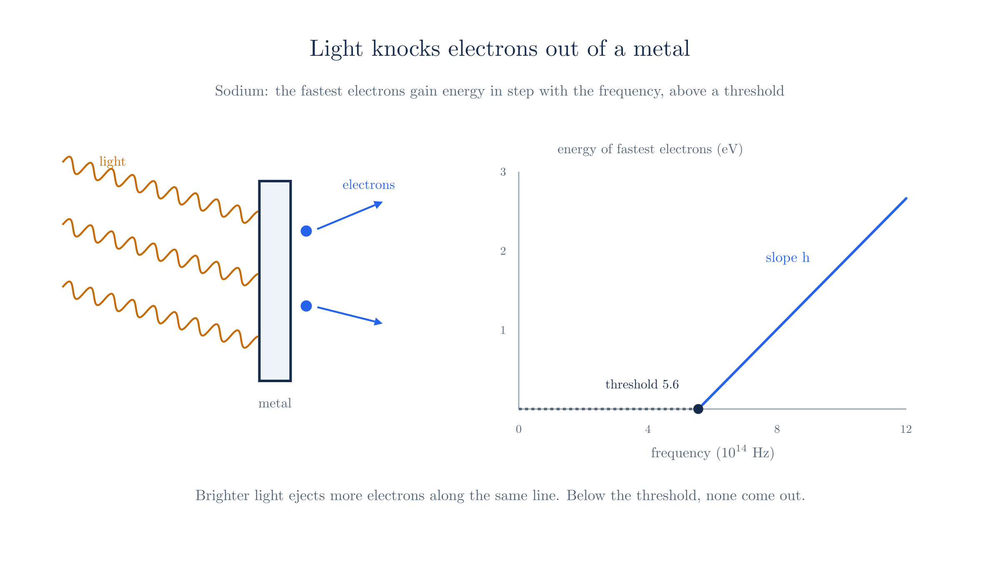
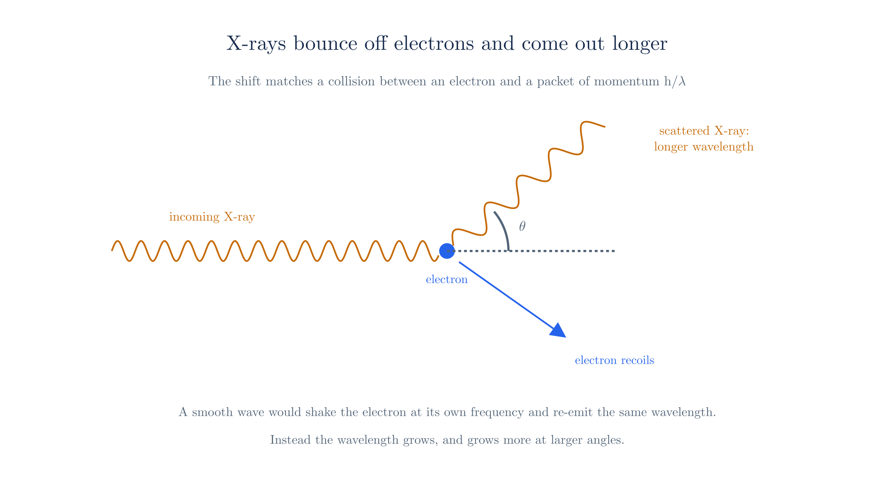
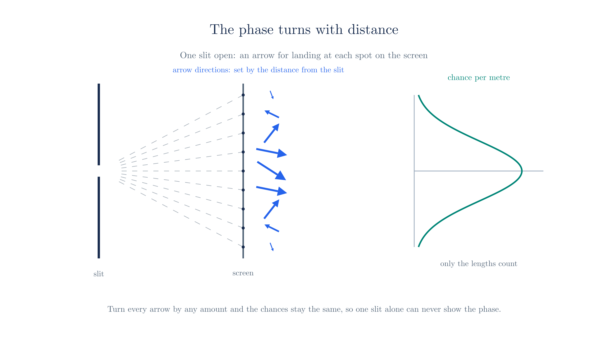
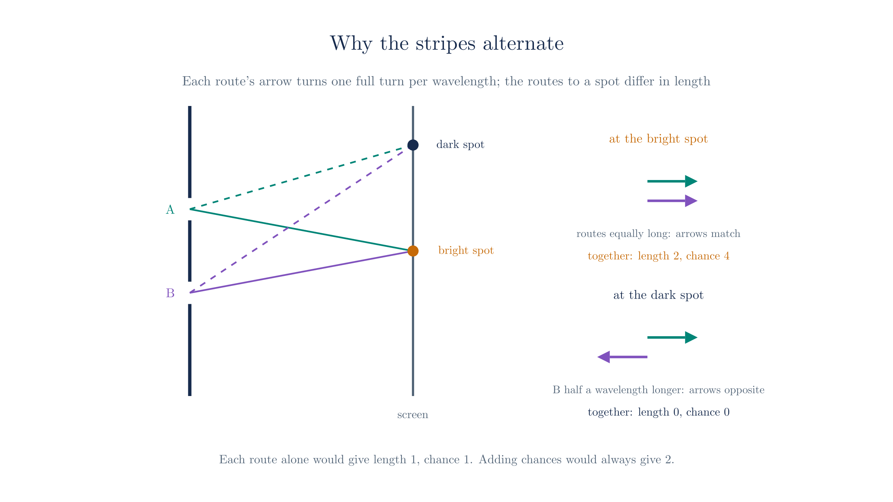

# Quantum Ideas

Chapter 1 described a system at one instant by a point: its position and its momentum. Quantum mechanics replaces that point with a list of amplitudes. This chapter starts from an experiment with silver atoms and magnets whose results no point can explain. Then it gives the rules of quantum mechanics, which look strange at first, and shows how they explain every one of those results. A tilted magnet then shows why the amplitudes have to be complex numbers. A spin's up or down doesn't tell you where the atom is or how fast it moves, though, so the chapter then turns to an electron's position, using the two-slit experiment, and ends with its momentum.

This is chapter 2a, the ideas. Chapter 2b, [First Quantization](./first-quantization.md), turns them into maths.

## 1. A puzzle: magnets that sort atoms

In 1922 Otto Stern and Walther Gerlach heated silver in an oven and fired the atoms that boiled off through a magnet and onto a glass plate. Each silver atom is itself a tiny magnet, because of a property of one of its electrons called **spin**. The magnet was shaped so that its field is stronger near one pole. An even field would only twist each atom, but in an uneven one, one end of the atom's magnet is pulled harder than the other, so the field pushes each atom up or down by an amount that depends on how the atom's own magnet is tilted: an atom pointing straight up is pushed up the most, one pointing straight down is pushed down the most, and one lying sideways isn't pushed at all.

The atoms come out of the oven tilted every which way, so the plate should show a smear, one point for each tilt. It shows two spots and nothing between them.

*The Stern–Gerlach setup, and what the plate shows.*

Later experiments put magnets one after another. Start with the atoms that went up in a vertical magnet:

- a second vertical magnet sends all of them up;
- a sideways magnet sends half to the right and half to the left, and nothing tells you in advance which atom goes where;
- keep the ones that went right, send them through a vertical magnet again, and half go up and half go down (keeping the ones that went left gives the same split).

*The three sequences, idealized as textbooks present them. Thomas Phipps and Otto Stern in 1932, and Otto Frisch and Emilio Segrè in 1933, first sent atoms through magnets in a row; the sideways sequences are idealized.*

That leaves four things to explain. The plate shows two spots instead of a smear. An atom that went up goes up again. Atoms that all went up, and that no vertical magnet can tell apart, split half and half in a sideways magnet, with no way to tell which goes where. And atoms found right have forgotten that they were up.

**Measured along a magnet, spin comes out only up or down, identical atoms can give different results, and a later measurement along a different direction wipes out an earlier one.**

## 2. The rules

Quantum mechanics explains all four results with two rules. They'll look strange, so for now take them as given. Section 3 shows how they solve the puzzle.

**Rule 1: the state is a superposition.** Compare a coin. It lands heads or tails, and before you look it's already one or the other, even while it's hidden under your hand and you don't know which. A spin measured by a vertical magnet also gives only two results, up or down, which is what the two spots show. The difference is before the measurement. A spin can be in a **superposition** of up and down, a state with an **amplitude** for each result, $c_0$ for up and $c_1$ for down. A spin in a superposition isn't secretly one or the other. That's the new idea, and section 3 shows how the magnets can tell the difference.

An amplitude is a complex number (section 4 shows why), which you can picture as an arrow with a length and a direction (see [the complex plane](appendix-math-complex.md#_2-the-complex-plane-and-euler-s-formula)). The arrow's direction is called its **phase**. The state is written as a sum:

$$\lvert\psi\rangle = c_0\lvert\text{up}\rangle + c_1\lvert\text{down}\rangle.$$

The brackets just mark a state. $\lvert\text{up}\rangle$ is the state that's certainly up, with amplitudes 1 and 0, and $\lvert\text{down}\rangle$ is certainly down, with 0 and 1.

The plus sign doesn't add directions in space. Up and down are opposite directions in space, so adding them as directions would give nothing. Here $\lvert\text{up}\rangle$ and $\lvert\text{down}\rangle$ are two entries in the state's list, and the sum just says "amplitude $c_0$ for up, amplitude $c_1$ for down". A superposition is a state in its own right, not a spin pointing partly up and partly down.

**Rule 2: measurement.** A measurement does two things: it changes the state, and it gives a result with a chance the rule lets you calculate. First, the change. Before a vertical magnet, the spin is in a superposition. Afterwards, it's in the certain state of the result that was found: an atom that went up is now in $\lvert\text{up}\rangle$, whatever its amplitudes were before. This jump is called **collapse**. It's the strangest part of the rules, and the end of section 3 comes back to it.

Collapse says what the state becomes, not which result you get. For that, the rule gives a chance, the **Born rule**: the chance of a result is the squared length of its amplitude. Say a spin has $c_0$ of length 0.6 and $c_1$ of length 0.8. A vertical magnet finds it up with chance $0.6^2 = 0.36$ and down with chance $0.8^2 = 0.64$. The two chances must add to one, so the squared lengths of the amplitudes always do too: $0.36 + 0.64 = 1$. Only the lengths go into these chances, not the arrows' directions. Section 4 shows where the directions do matter.

The chance isn't there because the state is unknown. Unlike the coin under your hand, the spin's state is fully definite. In standard quantum mechanics the state is the whole description, so two atoms with the same amplitudes are in exactly the same state, with nothing hidden. The chance comes in only when you measure.

That's worth stressing, because quantum mechanics is often summed up as "everything is random". Most of it isn't. The state is definite, and between measurements it changes in a fully predictable way, which chapter 2b's Schrödinger equation describes. Even at a measurement, the chances themselves are fixed exactly by the amplitudes. Only which result a single atom gives is left to chance.

A result is certain only when the spin is already in that result's certain state. Then that amplitude has length 1, the other is 0, and the chance is $1^2 = 1$. Any other state leaves both results possible.

**Other magnets.** A magnet turned another way has its own two certain states. A sideways magnet's are "right" and "left". Experiment shows how much up and down each contains: atoms found right split half up and half down, and so do atoms found left, so each is an equal mix. A chance of $1/2$ needs an amplitude of length $1/\sqrt2$, since $(1/\sqrt2)^2 = 1/2$. Written out, they are

$$\lvert\text{right}\rangle = \frac{\lvert\text{up}\rangle + \lvert\text{down}\rangle}{\sqrt2}, \qquad \lvert\text{left}\rangle = \frac{\lvert\text{up}\rangle - \lvert\text{down}\rangle}{\sqrt2}.$$

The equal mix of up and down turns out to be a sideways state, but that comes from experiment, not from adding arrows in space. Section 4 shows where the minus sign comes from.

It works the other way round too. Adding the two lines, the $\lvert\text{down}\rangle$ parts cancel, leaving $\lvert\text{right}\rangle + \lvert\text{left}\rangle = (2/\sqrt2)\lvert\text{up}\rangle = \sqrt2\,\lvert\text{up}\rangle$. Dividing by $\sqrt2$ gives $\lvert\text{up}\rangle = (\lvert\text{right}\rangle + \lvert\text{left}\rangle)/\sqrt2$, so "up" is an equal mix of right and left.

Both parts of Rule 2 work the same way for any magnet. The same state has a different list of amplitudes for each magnet, one for each of that magnet's results. Take $\lvert\text{up}\rangle$. For a vertical magnet its list is 1 for up and 0 for down. The line above writes it as an equal mix of right and left, so for a sideways magnet its list is $1/\sqrt2$ for right and $1/\sqrt2$ for left. Nothing about the atom differs between the two lists. It's one state seen from two magnets' points of view, much as one spot on a map gets different coordinates if you turn the grid. To get the chances for a sideways magnet, use the sideways list and square the lengths. Afterwards, the atom has collapsed to $\lvert\text{right}\rangle$ or $\lvert\text{left}\rangle$.

**An unmeasured state is a superposition with an amplitude for each result, and measuring collapses it to the result found, with a chance equal to that amplitude's squared length.**

## 3. How the rules solve the puzzle

Now put the rules to work on each of the four results.

**Two spots.** The number of spots comes from experiment: section 2 gave a vertical magnet two results because that's what the plate shows. What the rules explain is why there's no smear. Atoms leave the oven in all sorts of superpositions of up and down. The vertical magnet measures each one, and a measurement only ever gives one of the magnet's results, so each atom lands in one of the two spots. What the classical picture called an atom's tilt becomes, in the rules, its amplitudes (section 4 shows how), and they don't move the spots. They only change the chances, through the lengths of $c_0$ and $c_1$.

**Up stays up.** An atom that went up has collapsed to $\lvert\text{up}\rangle$, with amplitude 1 for up. By the Born rule, a second vertical magnet finds it up with chance $1^2$, which is 100%.

**Half right, half left.** A sideways magnet measures right or left, so the state has to be written in terms of right and left. For an atom in $\lvert\text{up}\rangle$, that's $(\lvert\text{right}\rangle + \lvert\text{left}\rangle)/\sqrt2$. Each amplitude has length $1/\sqrt2$, and the Born rule makes the chance its square, $(1/\sqrt2)^2 = 1/2$. Section 2 put in the reverse fact, that atoms found right or left split evenly between up and down, and the rules turn it into this one. Every atom here is in the same state, $\lvert\text{up}\rangle$, and in standard quantum mechanics that state is the whole description, so nothing in any atom decides which way it goes.

**The lost "up".** An atom found right has collapsed to $\lvert\text{right}\rangle$, whatever it was before. That's the same state for every atom found right, whether it started up, down or anything else, so nothing in it records that the atom was once up. That's why the "up" is lost and can't be brought back. The half-and-half split that follows is the experiment section 2 used to define $\lvert\text{right}\rangle$, so it matches by design. What the rules add is the forgetting: the collapse replaced the atom's state.

**Not a hidden coin.** Section 2 said a spin in a superposition isn't secretly one result or the other, and the magnets give a way to check. Atoms found right split half up and half down, just as a bag of coins, half heads and half tails, would. But send atoms found right through a second sideways magnet, and every one goes right again, as experiment confirms and for the same reason up stays up. A bag of atoms that were secretly up or secretly down couldn't do that. The secretly-up ones would split half right and half left, as above, and so would the secretly-down ones: subtracting section 2's two lines instead of adding them gives $\lvert\text{down}\rangle = (\lvert\text{right}\rangle - \lvert\text{left}\rangle)/\sqrt2$, again two amplitudes of length $1/\sqrt2$. So atoms found right aren't a mixture of up atoms and down atoms. They're all in one state, $\lvert\text{right}\rangle$.

**But why these rules?** That's the natural next question, and the honest answer is that nobody knows. Why are there amplitudes, and what really happens in a collapse? Physicists agree on the rules, because every experiment so far matches what they predict. They still disagree about what the rules mean, and that debate has been going since the 1920s. This site does what most physicists do day to day: it uses the rules and leaves the debate aside.

**With two facts from experiment, how many results a magnet has and what right and left are made of, the rules explain the four results, and show that a superposition isn't a hidden coin.**

## 4. Why amplitudes are complex

Rule 1 said amplitudes are complex numbers without saying why. One more experiment, with a tilted magnet, gives the reason: rules that used only ordinary positive and negative numbers couldn't explain it.

Tilt the first magnet away from vertical, keep the atoms that went up along it, and send them through a vertical magnet. Some go up and some go down. How far the first magnet was tilted sets those chances, so it sets the lengths of $c_0$ and $c_1$. But the magnet can be tilted by that same amount in any direction: to the right, toward the front, to the left, toward the back. These directions go all the way round a circle, and a vertical magnet gives every one of them the same chances.

*A vertical magnet only sees how far the atoms lean. A sideways magnet also sees which way.*

A sideways magnet does tell them apart. Atoms that lean right mostly go right, atoms that lean left mostly go left, and atoms that lean toward the front lean neither way, so they split half and half. So the state has to record which way round the circle the atom leans, not only how far.

Real amplitudes can't do that. Once the lengths of $c_0$ and $c_1$ are fixed, the only choice left is their signs. Flipping both together changes no chance, for any magnet, so what counts is the sign of $c_1$ compared with $c_0$, which gives two states: enough for leaning right and leaning left, but nothing in between. A complex $c_1$ has a phase, so its arrow can point any way round a circle, one direction for every way the atom can lean. Careful, though: these are two different pictures. The lean is a direction in space. The phase is an arrow in the complex plane, which is only a drawing of a number. The rule links them: going round the circle of leans turns the down amplitude's arrow by the same angle. The phase shows up in a sideways magnet's chances because its amplitudes are sums: the amplitude for right adds $c_0$ and $c_1$, and two arrows added together make a longer or shorter arrow depending on the angle between them. That's why amplitudes are complex.

The calculation: the phase and the sideways chances

A magnet tilted by $\theta$ from vertical, toward the direction at angle $\varphi$ round the circle ($\varphi = 0$ for right, $90°$ for front, $180°$ for left), lets through atoms with amplitudes

$$c_0 = \cos(\theta/2), \qquad c_1 = \sin(\theta/2)\,e^{i\varphi}.$$

The lengths depend only on $\theta$, and the direction $\varphi$ only sets the phase of $c_1$ (see [Euler's formula](appendix-math-complex.md#_2-the-complex-plane-and-euler-s-formula)). Multiplying the whole state by a phase changes no chance, which is why $c_0$ can always be taken positive. Which of front and back gets $+90°$ is a convention.

This map from spin states to directions in space is called the **Bloch sphere**: up sits at the north pole, down at the south pole, and right and left on the equator. Notice the half angles. Up and down are opposite in space, $180°$ apart, but as amplitude lists they are $(1, 0)$ and $(0, 1)$, two separate entries rather than two opposite arrows. A tilt of $\theta$ from vertical becomes $\theta/2$ in the amplitudes' lengths, while the direction $\varphi$ round the circle becomes the phase of $c_1$ unchanged.

A fully sideways magnet has $\theta = 90°$, so both amplitudes have length $1/\sqrt2$. Turned to the right ($\varphi = 0$), it lets through $(\lvert\text{up}\rangle + \lvert\text{down}\rangle)/\sqrt2$, the state "right" of section 2. Turned to the left ($\varphi = 180°$), the phase is $e^{i\cdot180°} = -1$, which gives "left" with its minus sign.

Rewriting the state in terms of right and left, using the two lines of section 2, gives

$$c_0\lvert\text{up}\rangle + c_1\lvert\text{down}\rangle = \frac{c_0 + c_1}{\sqrt2}\,\lvert\text{right}\rangle + \frac{c_0 - c_1}{\sqrt2}\,\lvert\text{left}\rangle.$$

The chance of right is $\lvert c_0 + c_1\rvert^2/2$. Expanding the square gives $\lvert c_0\rvert^2 + \lvert c_1\rvert^2 + 2\,\mathrm{Re}(c_0^*c_1) = 1 + 2\cos(\theta/2)\sin(\theta/2)\cos\varphi = 1 + \sin\theta\cos\varphi$, so

$$\text{chance of right} = \frac{1 + \sin\theta\cos\varphi}{2}.$$

Leaning right ($\cos\varphi = 1$) gives more than half, leaning toward the front ($\cos\varphi = 0$) gives exactly half, and leaning left ($\cos\varphi = -1$) gives less than half. For a tilt of $60°$ to the right, the amplitudes are $\sqrt3/2$ and $1/2$, and the chance of right is $(1 + \sqrt3/2)/2 = 93.3\%$.

**A vertical magnet misses which way an atom leans and a sideways magnet sees it, so the state needs a phase, and only complex amplitudes have one.**

## 5. Measuring position: one slit

Chapter 1 described a particle by its position and its momentum. The spin taught the rules of quantum mechanics, but a spin has neither, so the chapter still owes you those two. Start with position. Every measurement so far had two possible results, and position can be anywhere along a line, so this is a step from discrete to continuous.

To measure where a particle is, let it land on a screen. Fire electrons, one at a time, at a barrier with a narrow slit, and record where each one lands on a screen behind it. Each electron arrives as a single dot. After many electrons, the dots pile up in a hump behind the slit.

*One slit open. The hump alone doesn't yet look strange, and the next section compares against it.*

**The wave function.** The rules still apply, with many more results. The spin has two results, so its state is two amplitudes, $c_0$ and $c_1$. An electron can land anywhere on the screen, so its state needs one amplitude for every position $x$ across the screen, which makes infinitely many. Together they form a complex function $\psi(x)$, called the **wave function**.

Infinitely many positions share a total chance of one, so any single point gets a chance of zero. The Born rule gives a chance per metre instead, the **probability density** $\lvert\psi(x)\rvert^2$. The chance of finding the particle between two points is the area under the density between them (an [integral](appendix-math-calculus.md#_4-integrals-and-integration-by-parts)), and the total area is one. Behind one slit, the density is the hump.

**Position can take any value, so a particle's state is a wave function, one amplitude per position, and its squared length is a chance per metre.**

## 6. Two slits: stripes

Now open a second slit next to the first. Two slits are the simplest case where an electron can reach a spot on the screen in two ways. Still fire them one at a time, so no electron ever meets another. Count the electrons three times: with only slit A open, with only slit B open, and with both open.

*Electron counts with one slit or both open. The dashed curve is what adding chances would give. Akira Tonomura's team recorded the pattern building up one electron at a time in 1989, using an electron biprism, the electron equivalent of two slits.*

Each slit on its own gives a hump like the one in section 5. If each electron went through one slit or the other, opening both would add the two humps and give the dashed curve. Instead the counts form stripes, and at some spots fewer electrons arrive with both slits open than with only one. Adding chances can never do that, because chances are never negative. The stripes are the same even with a long wait between one electron and the next, so they don't come from electrons meeting each other. They build up from single electrons, dot by dot. The pattern looks just like water waves passing through two gaps in a harbour wall, where crests from the two gaps add up in some places, and a crest meets a trough and cancels in others.

There's one more observation. Put a detector at the slits that records which slit each electron goes through. Then the stripes disappear, and the counts become the dashed curve.

**With both slits open, some spots get fewer electrons than with one, and watching which slit the electrons take removes the effect.**

## 7. Two ways, so add

The two rules already explain the stripes. With both slits open, and nothing recording which slit the electron takes, it can reach each spot in two ways. So its state is a mix of "through A" and "through B", a superposition, just as "right" was a mix of up and down. Its wave function is the sum of $\psi_A$, the wave function with only slit A open, and $\psi_B$, the one with only B open,

$$\psi(x) = \psi_A(x) + \psi_B(x),$$

scaled by a constant so that the total chance stays one. This is Rule 1, not a new rule.

The density is the squared length of this sum. For two arrows $a$ and $b$ at an angle $\alpha$ to each other, the squared length of their sum is

$$\lvert a + b\rvert^2 = \lvert a\rvert^2 + \lvert b\rvert^2 + 2\,\lvert a\rvert\,\lvert b\rvert\cos\alpha.$$

This is the cosine rule for the triangle the two arrows make when placed head to tail. The triangle's corner between them is $180° - \alpha$, and $\cos(180° - \alpha) = -\cos\alpha$, which turns the rule's minus sign into a plus.

The first two terms are the two humps, and the last one is extra. Where the two arrows point the same way, $\cos\alpha = 1$ and the spot gets more than the two humps together. Where they point opposite ways, $\cos\alpha = -1$ and the spot gets fewer, none at all if the arrows are equally long. Adding amplitudes before squaring, so that they can reinforce or cancel, is called **interference**. Section 4 already showed a phase changing a chance, when the direction an atom leaned changed its sideways split. Here the angle between $\psi_A$ and $\psi_B$ at each spot decides.

The detector fits too. Recording which slit an electron takes is a measurement, even if nobody ever reads the detector, so Rule 2 collapses the electron onto one route. Its wave function is then $\psi_A$ or $\psi_B$, never their sum, so there's no extra term. About half the electrons end up in each, so the counts add the two humps, which is the dashed curve. It's the same collapse that lost the atoms' "up" in section 3.

That leaves one question: why does the angle between the two arrows change from spot to spot?

**Two ways that nothing tells apart add their amplitudes, so the arrows can reinforce or cancel, and watching which way collapses the sum.**

## 8. What sets the phase: matter waves

The answer is a fact from experiment, not a third rule. Follow a particle's route, and its amplitude is turned further the further along the route you look, one full turn for every **wavelength** of distance. This turning is the amplitude's phase, not a spin. The wavelength is set by the particle's momentum $p$:

$$\lambda = \frac{h}{p},$$

where $h$ is **Planck's constant**, $6.63\times10^{-34}$ joule-seconds. Louis de Broglie proposed this in 1924, borrowing it from light (box below), and the two-slit stripes are one of its checks, since their spacing matches $h/p$.

Where h/p comes from: light comes in packets

Light arrives in packets, and a packet with frequency $f$ and wavelength $\lambda$ carries an energy and a momentum

$$E = hf, \qquad p = \frac{h}{\lambda}.$$

De Broglie read the second rule the other way round for matter, $\lambda = h/p$. Two experiments gave the first strong evidence that light comes in such packets.

**Light knocking electrons out of a metal.** Shine light on a metal and electrons fly out, but only if the light's frequency is above a threshold, however bright it is. Brighter light throws out more electrons, not faster ones, and above the threshold the fastest electrons' energy rises in a straight line with the frequency.

*The photoelectric effect for sodium.*

Einstein explained this in 1905, and predicted the straight line. Light comes in packets of energy $hf$, and each packet frees at most one electron. Brightness changes only how many packets arrive, and a packet below the threshold can't free an electron at all. The freed electron leaves with the packet's energy minus a fixed cost of escaping, so the line has slope $h$. Robert Millikan measured it in 1916 and found Planck's value to within 1%.

**X-rays bouncing off electrons.** A packet of energy $E$ also carries momentum $E/c$, where $c$ is the speed of light, and with $E = hf$ and $c = f\lambda$ that's $p = h/\lambda$. In 1923 Arthur Compton bounced X-rays off electrons and found the scattered X-rays had a longer wavelength, more so at larger angles. Each packet hands some momentum to the electron it hits, and the longer wavelength matches the lost momentum through $p = h/\lambda$.

*Compton scattering.*

With one slit, the turning can't be seen. The arrow for each spot on the screen points a way set by that spot's distance from the slit, but the chance only uses the arrow's length. It's like section 4, where a vertical magnet couldn't see which way an atom leaned.

*With one slit, the arrows' directions change along the screen, but the chances only see their lengths.*

With two slits, both routes start from the same source with the same arrow, but the routes to a spot have different lengths, so their arrows arrive turned by different amounts. Where one route is a whole number of wavelengths longer, the arrows point the same way and the spot is bright. Where it's half a wavelength longer, they point opposite ways and the spot is dark. Moving along the screen, the difference in route lengths grows steadily, so bright and dark alternate in stripes. Faster electrons have shorter wavelengths, so their stripes sit closer together.

*At the bright spot the two arrows match. At the dark spot route B is half a wavelength longer, and the arrows cancel.*

**A particle's amplitude turns once per wavelength $h/p$ of distance along its route, so the route lengths decide where the two slits' arrows reinforce or cancel.**

## 9. Momentum: how fast the phase turns

Section 5 set out to find position and momentum. Position became the variable of the wave function: $x$ across the screen in section 5, and in general wherever the particle might be. Momentum is in section 8's rule. Read it the other way round,

$$p = \frac{h}{\lambda},$$

and for a particle with a definite momentum, momentum is how fast the arrow turns along its direction of travel. Its phase turns steadily, and $p$ is $h$ times the number of turns per metre along its route. A short wavelength means many turns per metre and a large momentum, and a long wavelength means few turns and a small one.

In chapter 1, momentum was mass times velocity, a second number listed beside the position. In quantum mechanics both live in the one wave function: position is where the amplitudes are, and a definite momentum is how fast their phase turns along the way the particle moves.

**Position is the wave function's variable, and a particle with a definite momentum has a phase that turns steadily along its direction of travel, a full turn every $h/p$.**

## Where this comes back

[First Quantization](./first-quantization.md) turns these ideas into maths. Position and momentum become operators, a new kind of object that acts on the wave function. Chapter 1's Poisson bracket becomes its quantum version, the commutator. And chapter 1's Hamiltonian moves the state forward in time, through the Schrödinger equation mentioned in section 2.

---

Previous: [Classical Mechanics](./classical-mechanics.md)

Next: [First Quantization](./first-quantization.md)
