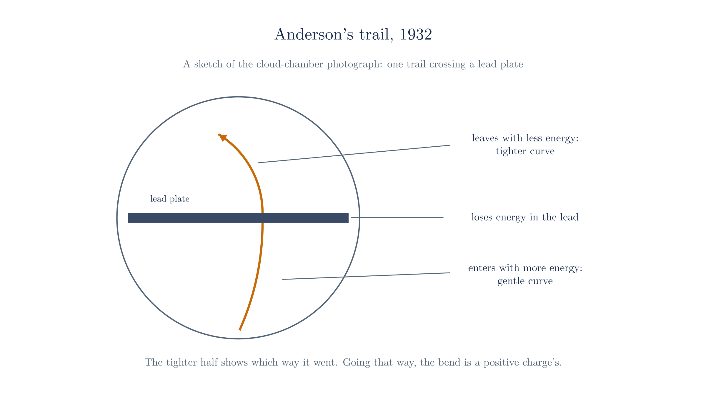
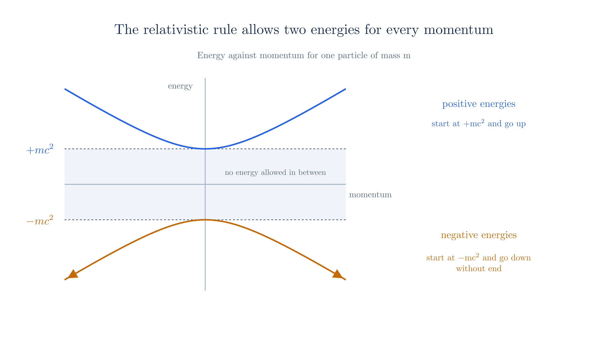

# Relativistic Quantum Mechanics

The last chapter put the Schrödinger equation through relativity's test, and it failed. It treats time and space differently, so it only works for slow particles. This chapter builds the quantum equation for fast ones.

The first try is quick to write down, and it has two things wrong with it. Fixing one of them led Paul Dirac, in 1928, to a new equation. The other problem stayed, and it turned out to predict a kind of matter nobody had seen. We start with the photograph that found it.

Here is where we end up:

| | Schrödinger (chapter 2b) | Klein–Gordon (section 3) | Dirac (section 7) |
| --- | --- | --- | --- |
| Built from | The low-speed energy, $p^2/2m$ | The relativistic energy, squared | The relativistic energy, not squared |
| Works for fast particles | No | Yes | Yes |
| Chance per metre | Never negative | Can be negative | Never negative |
| Energies | Positive | Positive and negative | Positive and negative |
| The state | One wave function | One wave function | Four wave functions |

## 1. A puzzle: a trail that bends the wrong way

In 1932 Carl Anderson was photographing cosmic rays, the fast particles from space that also make chapter 4's muons. He used a cloud chamber, a box of damp gas in which a charged particle leaves a trail of droplets.

**Reading a trail.** A magnet around the chamber bent the trails. Positive and negative charges bend opposite ways, so the bend tells the sign of the charge, as long as you know which way the particle was going. To settle that, Anderson put a lead plate across the chamber. A particle loses energy in the lead, and a particle with less energy bends more. So the tighter half of a trail is where the particle came out.

**The odd one.** One photograph showed a trail that crossed the plate and bent the way a positive charge does.

*Anderson's photograph, sketched. The trail curves more tightly above the lead plate, so the particle was moving upward, and for that direction the bend is that of a positive charge.*

As far as anyone knew in 1932, matter held two kinds of charged particle: the electron, light and negative, and the proton, positive and about 1,800 times heavier. So a positive trail should have been a proton. But a proton is so heavy that, to bend that tightly, it would have to be slow, and the gas stops a slow proton after about a tenth of the trail's length. So the particle was positive, but far too light to be a proton. No known particle fit.

**The puzzle.** Where does a light, positive particle come from? The answer was already on paper. It had come out, the year before, of an attempt to make quantum mechanics agree with relativity. The rest of this chapter follows that attempt.

More detail: Anderson's numbers

Anderson's chamber sat in a magnetic field of 1.5 tesla, with a lead plate 6 mm thick. Physicists measure a single particle's energy in electron-volts: one electron-volt, eV, is the energy an electron gains crossing one volt, and an MeV is a million of them. From the curvature, the particle had about 63 MeV below the plate and 23 MeV above it. The trail above the plate was more than 5 cm long. A proton with that curvature would travel about 5 mm in the gas.

**A cosmic-ray trail in 1932 belonged to a positive particle far lighter than a proton, and no known particle fit.**

## 2. From an energy rule to a wave equation

A box in chapter 2b built the Schrödinger equation from a rule connecting energy and momentum. This chapter uses that recipe twice, so here it is, step by step.

A free particle with a definite momentum $p$ and a definite energy $E$ is a wave whose phase turns steadily, $p/h$ turns per metre along the line and $E/h$ turns per second in time:

$$\psi(x, t) = e^{i(px - Et)/\hbar}.$$

Chapter 2b found that a rate of change in time, times $i\hbar$, pulls the energy $E$ out of this wave, and that a slope along the line, times $-i\hbar$, pulls out the momentum $p$. So a rule connecting energy and momentum becomes a wave equation when each letter is swapped for its operation:

| In the energy rule | In the wave equation |
| --- | --- |
| $E$ | $i\hbar\,\dfrac{\partial}{\partial t}$ |
| $p$ | $-i\hbar\,\dfrac{\partial}{\partial x}$ |
| $p^2$ | $-\hbar^2\,\dfrac{\partial^2}{\partial x^2}$ |

A squared momentum means taking the slope twice. For example, chapter 1's rule for a slow free particle is $E = p^2/2m$, and the recipe turns it into

$$i\hbar\,\frac{\partial\psi}{\partial t} = -\frac{\hbar^2}{2m}\,\frac{\partial^2\psi}{\partial x^2},$$

which is the free Schrödinger equation. It has one rate of change in time and two slopes in space, because the rule has one power of $E$ and two of $p$. That mismatch is what failed chapter 4's test.

More detail: why a rule for one wave gives an equation for every state

The recipe was worked out on a single wave of definite momentum. But every state is a sum of such waves, as chapter 2b said. The equation is linear, which means that if two waves each obey it, so does their sum. So an equation that every single wave obeys is obeyed by every state.

In three dimensions the wave is $e^{i(\mathbf p\cdot\mathbf x - Et)/\hbar}$, and the slope becomes the gradient: $\mathbf p \to -i\hbar\nabla$ and $\mathbf p^2 \to -\hbar^2\nabla^2$.

**A rule connecting energy and momentum becomes a wave equation: a rate of change in time stands for the energy, and a slope stands for the momentum.**

## 3. The Klein–Gordon equation

Chapter 4 gave the rule that holds at any speed:

$$E^2 = (pc)^2 + (mc^2)^2.$$

Put it through the recipe. The energy is squared now, so the time operation is done twice, and $i\hbar$ times itself is $-\hbar^2$:

$$-\hbar^2\,\frac{\partial^2\psi}{\partial t^2} = -\hbar^2c^2\,\frac{\partial^2\psi}{\partial x^2} + m^2c^4\,\psi.$$

Divide by $-\hbar^2c^2$ and move everything to one side:

$$\frac{1}{c^2}\frac{\partial^2\psi}{\partial t^2} - \frac{\partial^2\psi}{\partial x^2} + \frac{m^2c^2}{\hbar^2}\,\psi = 0.$$

This is the **Klein–Gordon equation**, named after Oskar Klein and Walter Gordon, who published it in 1926.

**It passes the test.** The equation has two rates of change in time and two slopes in space, with a minus sign between them, just like chapter 4's interval. So it keeps its form for every observer moving at a steady speed.

**It has the right waves.** Put the wave $e^{i(px - Et)/\hbar}$ back in, and the equation holds exactly when $E^2 = (pc)^2 + (mc^2)^2$. So a wave solves the Klein–Gordon equation if its energy and momentum fit the relativistic rule, and not otherwise.

That all works. But sections 4 and 5 show two things wrong with it.

The calculation: checking the wave, and the low-speed limit

**The check.** For $\psi = e^{i(px - Et)/\hbar}$, each rate of change in time pulls down $-iE/\hbar$ and each slope pulls down $ip/\hbar$:

$$\frac{\partial^2\psi}{\partial t^2} = -\frac{E^2}{\hbar^2}\,\psi, \qquad \frac{\partial^2\psi}{\partial x^2} = -\frac{p^2}{\hbar^2}\,\psi.$$

The Klein–Gordon equation becomes

$$\left(-\frac{E^2}{\hbar^2c^2} + \frac{p^2}{\hbar^2} + \frac{m^2c^2}{\hbar^2}\right)\psi = 0.$$

Multiply by $\hbar^2c^2$: the bracket is zero when $E^2 = p^2c^2 + m^2c^4$.

**Low speed.** For a slow particle, $pc$ is much smaller than $mc^2$, and the positive square root is $E \approx mc^2 + p^2/2m$, the rest energy plus the kinetic energy of chapters 1 and 4. The Schrödinger equation keeps only the second part.

**Three dimensions and the short form.** With three space directions the equation is

$$\frac{1}{c^2}\frac{\partial^2\psi}{\partial t^2} - \nabla^2\psi + \frac{m^2c^2}{\hbar^2}\,\psi = 0.$$

The first two terms are chapter 4's d'Alembertian, written $\Box$ or $\partial_\mu\partial^\mu$. Later chapters set $c = 1$ and write the equation as $(\Box + m^2/\hbar^2)\,\psi = 0$.

**The relativistic energy rule gives the Klein–Gordon equation. It treats time and space alike, so it holds for every observer.**

## 4. First problem: negative energies

**Two square roots.** The relativistic rule fixes $E^2$, not $E$. A square has two square roots: 9 is the square of 3 and of $-3$. So for every momentum, two energies fit the rule:

$$E = +\sqrt{(pc)^2 + (mc^2)^2} \qquad\text{or}\qquad E = -\sqrt{(pc)^2 + (mc^2)^2}.$$

Take a particle at rest. The rule allows the energy $+mc^2$ and also $-mc^2$. Give it some momentum, and the positive energy goes up while the negative one goes further down.

*The energies the relativistic rule allows. The positive ones start at $+mc^2$ and go up. The negative ones start at $-mc^2$ and go down without end. No energy between the two is allowed.*

**In classical physics, nobody worries.** The same rule holds for a thrown ball, and there we throw the negative root away. That's safe, because a classical particle's energy changes smoothly, and to get from a positive energy to a negative one it would have to pass through the forbidden gap in between.

**A quantum particle can jump.** In chapter 3, a molecule's bond changed its energy a whole rung at a time, with nothing in between. And anything that can lose energy by giving off light sooner or later does. So an electron with positive energy could drop to a negative-energy state in one jump, giving off the difference as a packet of light. Then it could drop again, to a state lower still. Chapter 3's ladder has a lowest rung, so the spring's fall has to stop. Here there is no lowest rung.

So every electron in the world should keep falling, giving off light forever, and no atom would last. That doesn't happen.

Could we just declare the negative energies forbidden? The equation won't let us. To it, a negative-energy wave is a solution like any other.

**The rule is squared, so every momentum has a negative energy as well as a positive one, with no lowest energy. A quantum particle would fall forever.**

## 5. Second problem: a chance that can be negative

**What the wave function is for.** In chapter 2a, the squared length of the wave function, $\lvert\psi\rvert^2$, is the chance per metre of finding the particle. Two things make that work. It is never negative, and its total over all positions is one and stays one. Chapter 2b showed that the Schrödinger equation keeps the total at one.

**What Klein–Gordon keeps.** For the Schrödinger equation, the quantity whose total stays constant is $\lvert\psi\rvert^2$ itself. For the Klein–Gordon equation, the total of $\lvert\psi\rvert^2$ doesn't have to stay constant (first box), so $\lvert\psi\rvert^2$ can't be the chance. What does stay constant is a different quantity. The equation has two rates of change in time where Schrödinger's has one, and that puts a rate of change in time into the quantity it keeps (second box). For a wave with a definite energy $E$, that quantity comes to

$$\rho = \frac{E}{mc^2}\,\lvert\psi\rvert^2.$$

The rate of change in time is what brings in the energy, and with it the energy's sign. For a positive-energy wave $\rho$ is positive, and for a slow particle, where $E$ is close to $mc^2$, it's almost $\lvert\psi\rvert^2$. But for a negative-energy wave it's negative. A chance of minus thirty percent means nothing.

| | Schrödinger | Klein–Gordon |
| --- | --- | --- |
| Rates of change in time | One | Two |
| Total of $\lvert\psi\rvert^2$ | Stays at one | Can change |
| The quantity whose total stays constant | $\lvert\psi\rvert^2$, never negative | $\rho$, which can be negative |

So neither works as a chance. The total of $\lvert\psi\rvert^2$ isn't kept, and the quantity that is kept can be negative.

The calculation: why the total of the squared length isn't kept

Section 4 found two waves with the same momentum $p$, one with energy $+E$ and one with energy $-E$. The Klein–Gordon equation accepts both, and it's linear, so it accepts their sum:

$$\psi = e^{i(px - Et)/\hbar} + e^{i(px + Et)/\hbar}.$$

Along the line, both arrows turn the same way. In time they turn opposite ways. Take out the part they share:

$$\psi = e^{ipx/\hbar}\left(e^{-iEt/\hbar} + e^{iEt/\hbar}\right).$$

[Euler's formula](appendix-math-complex.md#_2-the-complex-plane-and-euler-s-formula) says $e^{i\theta} = \cos\theta + i\sin\theta$ and $e^{-i\theta} = \cos\theta - i\sin\theta$. Add them and the sines cancel, leaving $2\cos\theta$. Here $\theta = Et/\hbar$, so

$$\psi = 2\cos(Et/\hbar)\,e^{ipx/\hbar}, \qquad \lvert\psi\rvert^2 = 4\cos^2(Et/\hbar).$$

The squared length is the same at every position, and it changes in time. When the two arrows point the same way it's 4. A quarter of a turn later they point opposite ways, and it's 0. It rises and falls everywhere at once, so its total can't stay constant.

The Schrödinger equation doesn't have this problem. For each momentum it accepts only one energy, so there's no second wave turning the other way in time.

The quantity the Klein–Gordon equation does keep, in the next box, behaves properly here. For this sum it's zero at every moment: $+E/mc^2$ from the first wave and $-E/mc^2$ from the second.

The calculation: the density the Klein–Gordon equation keeps

**Schrödinger first.** Chapter 2b gave one reason the total chance stays at one. Here is a second, which shows where the chance goes. For the Schrödinger equation, the density $\rho = \lvert\psi\rvert^2$ obeys

$$\frac{\partial\rho}{\partial t} + \frac{\partial j}{\partial x} = 0, \qquad j = \frac{\hbar}{2mi}\left(\psi^*\frac{\partial\psi}{\partial x} - \psi\,\frac{\partial\psi^*}{\partial x}\right).$$

This is a **continuity equation**. It says the chance in any stretch of the line changes only by flowing out through its ends, at the rate $j$. Nothing is lost, so the total stays the same.

**Klein–Gordon.** The same flow $j$ fits a continuity equation with a different density:

$$\rho = \frac{i\hbar}{2mc^2}\left(\psi^*\frac{\partial\psi}{\partial t} - \psi\,\frac{\partial\psi^*}{\partial t}\right).$$

To check, take its rate of change. The terms with two first rates cancel, leaving

$$\frac{\partial\rho}{\partial t} = \frac{i\hbar}{2mc^2}\left(\psi^*\frac{\partial^2\psi}{\partial t^2} - \psi\,\frac{\partial^2\psi^*}{\partial t^2}\right).$$

The Klein–Gordon equation says $\partial_t^2\psi = c^2\,\partial_x^2\psi - (mc^2/\hbar)^2\psi$. Put that in, with its complex conjugate for $\psi^*$. The mass terms cancel, and

$$\frac{\partial\rho}{\partial t} = \frac{i\hbar}{2m}\left(\psi^*\frac{\partial^2\psi}{\partial x^2} - \psi\,\frac{\partial^2\psi^*}{\partial x^2}\right) = -\frac{\partial j}{\partial x}.$$

**For a wave of definite energy.** With $\psi = e^{i(px - Et)/\hbar}$, the rate of change in time is $\partial_t\psi = -(iE/\hbar)\,\psi$, so

$$\rho = \frac{i\hbar}{2mc^2}\left(-\frac{iE}{\hbar} - \frac{iE}{\hbar}\right)\lvert\psi\rvert^2 = \frac{E}{mc^2}\,\lvert\psi\rvert^2.$$

The density contains the rate of change in time, which is why it carries the sign of the energy.

**The Klein–Gordon equation doesn't keep the total of $\lvert\psi\rvert^2$, and the quantity it does keep is negative for negative-energy waves. Its wave function can't be read as a chance.**

## 6. Dirac's idea: an energy rule that isn't squared

In 1928 Paul Dirac, then 25, went looking for a relativistic equation with a chance that is never negative.

**Where the trouble came from.** Section 5's trouble came from having two rates of change in time. Those came from the $E^2$ in the energy rule. So Dirac wanted an equation built from $E$ itself, with a single rate of change in time, like Schrödinger's.

Relativity then forces something more. Chapter 4 said an equation must treat time and space alike. So if time gets a single rate of change, space must get a single slope. The energy rule behind the equation has to be a straight-line one, with $E$ and $p$ each to the first power:

$$E = \alpha\,pc + \beta\,mc^2.$$

Here $\alpha$ and $\beta$ are two fixed quantities, the same for every particle, that we still have to find.

**What they must satisfy.** This rule mustn't contradict relativity. Squaring it has to give back $E^2 = (pc)^2 + (mc^2)^2$. So square it. We don't know yet what kind of thing $\alpha$ and $\beta$ are, so keep them in the order they come:

$$E^2 = \alpha^2\,(pc)^2 + \beta^2\,(mc^2)^2 + (\alpha\beta + \beta\alpha)\,(pc)(mc^2).$$

Compare with the relativistic rule. The first two terms match if $\alpha^2 = 1$ and $\beta^2 = 1$. The third term isn't in the relativistic rule at all, so it has to vanish:

$$\alpha^2 = 1, \qquad \beta^2 = 1, \qquad \alpha\beta + \beta\alpha = 0.$$

**Numbers can't do it.** For ordinary numbers the order doesn't matter, so $\alpha\beta + \beta\alpha$ is twice $\alpha\beta$. That's zero only if $\alpha$ or $\beta$ is zero, and then its square isn't 1.

**An equation with one rate of change needs a straight-line energy rule. Its two coefficients must give opposite results in the two orders, and no pair of numbers does that.**

## 7. The Dirac equation

Section 6 ended with a problem: $\alpha$ and $\beta$ can't be numbers.

**Matrices can do it.** After a single number, the next thing to try is a table of numbers, a **matrix** (see [matrices](appendix-math-linear-algebra.md#_2-operators-and-matrix-multiplication) in the Math Refresher). When two matrices are multiplied, the order can matter, and that's what the third condition needs.

Dirac didn't have to invent any. The year before, Wolfgang Pauli had described the electron's spin with small matrices. Chapter 2b met two of them as operators, $\hat Z$ for the up-and-down magnet and $\hat S$ for the sideways magnet. Written as matrices, as in that chapter's box, they are

$$\hat Z = \begin{pmatrix} 1 & 0 \\ 0 & -1 \end{pmatrix}, \qquad \hat S = \begin{pmatrix} 0 & 1 \\ 1 & 0 \end{pmatrix}.$$

They meet all three conditions (box). Each one, multiplied by itself, gives the matrix that changes nothing, which plays the part of the number 1. And multiplied together, the two orders give opposite results, as chapter 2b found when it applied both orders to up:

$$\hat Z^2 = 1, \qquad \hat S^2 = 1, \qquad \hat Z\hat S + \hat S\hat Z = 0.$$

Two matrices whose two orders give opposite results are said to **anticommute**. So we can take $\alpha = \hat S$ and $\beta = \hat Z$.

The calculation: checking the two matrices

First the squares:

$$\hat Z^2 = \begin{pmatrix} 1 & 0 \\ 0 & -1 \end{pmatrix}\begin{pmatrix} 1 & 0 \\ 0 & -1 \end{pmatrix} = \begin{pmatrix} 1 & 0 \\ 0 & 1 \end{pmatrix}, \qquad \hat S^2 = \begin{pmatrix} 0 & 1 \\ 1 & 0 \end{pmatrix}\begin{pmatrix} 0 & 1 \\ 1 & 0 \end{pmatrix} = \begin{pmatrix} 1 & 0 \\ 0 & 1 \end{pmatrix}.$$

Each square is the matrix that changes nothing. Now the two orders, as chapter 2b worked them out:

$$\hat Z\hat S = \begin{pmatrix} 1 & 0 \\ 0 & -1 \end{pmatrix}\begin{pmatrix} 0 & 1 \\ 1 & 0 \end{pmatrix} = \begin{pmatrix} 0 & 1 \\ -1 & 0 \end{pmatrix}, \qquad \hat S\hat Z = \begin{pmatrix} 0 & 1 \\ 1 & 0 \end{pmatrix}\begin{pmatrix} 1 & 0 \\ 0 & -1 \end{pmatrix} = \begin{pmatrix} 0 & -1 \\ 1 & 0 \end{pmatrix}.$$

Each is minus the other, so their sum is zero.

**The cost.** A two-by-two matrix acts on a column of two entries. So the state can't be a single wave function any more. It has to be a column of two wave functions, for $\alpha$ and $\beta$ to act on:

$$\psi = \begin{pmatrix} \psi_1 \\ \psi_2 \end{pmatrix}.$$

We're borrowing only the arithmetic of the spin matrices here. This column isn't a spin, and section 9 says what its two entries are.

**The Dirac equation, on a line.** Put the straight-line rule through section 2's recipe:

$$i\hbar\,\frac{\partial\psi}{\partial t} = -i\hbar c\,\alpha\,\frac{\partial\psi}{\partial x} + \beta\,mc^2\,\psi.$$

It has one rate of change in time and one slope in space, so it treats time and space alike, as chapter 4 asks.

### Four matrices in space

**In space, the rule needs four matrices.** On a line the rule had two parts, and each matrix had its own job: $\alpha$ stood in front of the momentum, and $\beta$ in front of the mass. In space the momentum has three parts, $p_x$, $p_y$ and $p_z$, one for each direction. The relativistic rule adds their squares,

$$E^2 = (p_xc)^2 + (p_yc)^2 + (p_zc)^2 + (mc^2)^2,$$

so the straight-line rule needs one matrix in front of each part, and $\beta$ in front of the mass as before:

$$E = \alpha_x\,p_xc + \alpha_y\,p_yc + \alpha_z\,p_zc + \beta\,mc^2.$$

**Why the four must all be different.** Square this rule, as in section 6. Each matrix's own square gives one of the four terms we want, so each must square to 1. And every pair of matrices gives a mixed term we don't want. The pair $\alpha_x$ and $\alpha_y$, for example, gives

$$(\alpha_x\alpha_y + \alpha_y\alpha_x)\,(p_xc)(p_yc),$$

and the relativistic rule has no term with $p_x$ times $p_y$. So that pair must anticommute, and so must every other pair. That rules out using one matrix twice: if $\alpha_y$ were the same matrix as $\alpha_x$, the bracket would be twice its square, which is 2 and not zero.

So we need four different matrices, each squaring to 1, with every pair anticommuting.

**Why two-by-two isn't enough.** Two-by-two matrices offer only three that all anticommute: $\hat Z$, $\hat S$ and one more (box). Those cover the three directions of space, with none left for the mass.

**Why not three-by-three.** Matrices like these only come in even sizes (box). So after two comes four.

Four-by-four matrices do offer the four we need, and section 11 shows them. They act on a column of **four** wave functions.

The calculation: why two-by-two has only three, and why the size must be even

**The third matrix.** For a magnet pointing front to back, Pauli's matrix is

$$\hat Y = \begin{pmatrix} 0 & -i \\ i & 0 \end{pmatrix}.$$

Its square is 1, and it anticommutes with $\hat S$ and with $\hat Z$:

$$\hat Y^2 = \begin{pmatrix} 0 & -i \\ i & 0 \end{pmatrix}\begin{pmatrix} 0 & -i \\ i & 0 \end{pmatrix} = \begin{pmatrix} 1 & 0 \\ 0 & 1 \end{pmatrix},$$

$$\hat S\hat Y = \begin{pmatrix} 0 & 1 \\ 1 & 0 \end{pmatrix}\begin{pmatrix} 0 & -i \\ i & 0 \end{pmatrix} = \begin{pmatrix} i & 0 \\ 0 & -i \end{pmatrix}, \qquad \hat Y\hat S = \begin{pmatrix} 0 & -i \\ i & 0 \end{pmatrix}\begin{pmatrix} 0 & 1 \\ 1 & 0 \end{pmatrix} = \begin{pmatrix} -i & 0 \\ 0 & i \end{pmatrix},$$

$$\hat Z\hat Y = \begin{pmatrix} 1 & 0 \\ 0 & -1 \end{pmatrix}\begin{pmatrix} 0 & -i \\ i & 0 \end{pmatrix} = \begin{pmatrix} 0 & -i \\ -i & 0 \end{pmatrix}, \qquad \hat Y\hat Z = \begin{pmatrix} 0 & -i \\ i & 0 \end{pmatrix}\begin{pmatrix} 1 & 0 \\ 0 & -1 \end{pmatrix} = \begin{pmatrix} 0 & i \\ i & 0 \end{pmatrix}.$$

**No fourth one.** A two-by-two matrix has four entries, and any such matrix $M$ can be written with four numbers $a$, $b$, $c$, $d$ as

$$M = a\,\mathbb 1 + b\,\hat S + c\,\hat Y + d\,\hat Z,$$

where $\mathbb 1$ is the matrix that changes nothing. Ask that $M$ anticommute with $\hat S$. The $\hat Y$ and $\hat Z$ parts drop out, because they anticommute with $\hat S$ already, and what's left is

$$M\hat S + \hat S M = 2a\,\hat S + 2b\,\mathbb 1.$$

That's zero only if $a = 0$ and $b = 0$. Asking the same with $\hat Y$ gives $c = 0$, and with $\hat Z$ gives $d = 0$. So $M$ is zero.

**The size must be even.** Take two matrices with $\alpha^2 = 1$, $\beta^2 = 1$ and $\alpha\beta = -\beta\alpha$. Multiply the last relation by $\alpha$ on the left. Since $\alpha^2 = 1$, the left side is just $\beta$:

$$\beta = -\alpha\beta\alpha.$$

Now take the [trace](appendix-math-linear-algebra.md#_6-hermitian-and-unitary-operators-trace) of both sides, the sum of the entries on the diagonal. The trace of a product stays the same when the first matrix is moved to the end, so the trace of $\alpha\beta\alpha$ is the trace of $\beta\alpha\alpha$, which is the trace of $\beta$. So the trace of $\beta$ equals minus itself, and is zero.

The trace is also the sum of the eigenvalues. Each eigenvalue of $\beta$ is $+1$ or $-1$: if $\beta$ multiplies a column by a number $\lambda$, applying it twice multiplies by $\lambda^2$, and $\beta^2 = 1$ says that's 1. The eigenvalues add to zero, so there are as many $+1$ as $-1$. Their total number, which is the size of the matrix, is even.

**The two coefficients are matrices, so the state becomes a column of wave functions: two on a line, four in space. The equation built from them is the Dirac equation.**

## 8. A chance that is never negative

With four wave functions, the squared length of $\psi$ is again the chance of finding the particle near a point, as in chapter 2a. For a column, the squared length is the sum of its entries' squared lengths:

$$\lvert\psi\rvert^2 = \lvert\psi_1\rvert^2 + \lvert\psi_2\rvert^2 + \lvert\psi_3\rvert^2 + \lvert\psi_4\rvert^2.$$

A sum of squares is never negative. And this is the quantity whose total the Dirac equation keeps constant (box). The equation has the single rate of change in time that section 6 asked for. So, as with the Schrödinger equation, no rate of change in time gets into the quantity it keeps, and no energy sign with it. That solves section 5's problem.

The calculation: the chance stays at one

Use one dimension, where $\psi$ is a column of two wave functions and $\alpha = \hat S$, $\beta = \hat Z$. Write $\psi^\dagger$ for the row of complex conjugates, so that $\psi^\dagger\psi = \lvert\psi_1\rvert^2 + \lvert\psi_2\rvert^2$. The Dirac equation and its conjugate are

$$\frac{\partial\psi}{\partial t} = -c\,\alpha\,\frac{\partial\psi}{\partial x} - \frac{imc^2}{\hbar}\,\beta\,\psi, \qquad \frac{\partial\psi^\dagger}{\partial t} = -c\,\frac{\partial\psi^\dagger}{\partial x}\,\alpha + \frac{imc^2}{\hbar}\,\psi^\dagger\beta.$$

In the rate of change of $\psi^\dagger\psi$, the two mass terms cancel, and the rest combine by the product rule:

$$\frac{\partial(\psi^\dagger\psi)}{\partial t} = -c\,\frac{\partial\psi^\dagger}{\partial x}\,\alpha\,\psi - c\,\psi^\dagger\alpha\,\frac{\partial\psi}{\partial x} = -\frac{\partial}{\partial x}\left(c\,\psi^\dagger\alpha\,\psi\right).$$

That's a continuity equation, like section 5's, with the flow $j = c\,\psi^\dagger\alpha\,\psi$. Four components work the same way.

**The Dirac equation's chance is the squared length of its column. It is never negative, and its total stays at one.**

## 9. The negative energies predict antimatter

**They're still there.** Dirac's rule has $E$ to the first power, so it might seem to give one energy for each momentum. It doesn't.

To see why, go back to the simpler case of motion along a line, where the column has just two wave functions. Take a particle at rest. Its momentum is zero, so the rule is $E = \beta\,mc^2$. The right side is a matrix, which makes it an operator, like chapter 2b's $\hat H$, and the allowed energies are its eigenvalues. Section 7 took $\beta$ to be the matrix $\hat Z$. Apply it to the column:

$$\beta\,mc^2\,\psi = mc^2\begin{pmatrix} 1 & 0 \\ 0 & -1 \end{pmatrix}\begin{pmatrix} \psi_1 \\ \psi_2 \end{pmatrix} = \begin{pmatrix} +mc^2\,\psi_1 \\ -mc^2\,\psi_2 \end{pmatrix}.$$

The top wave function gets the energy $+mc^2$ and the bottom one gets $-mc^2$. So for a particle at rest, that's what the column's two entries are: one for each sign of the energy.

In space the column has four wave functions, and the same thing happens to them two at a time: two get $+mc^2$ and two get $-mc^2$. The next chapter says what tells the two of each sign apart.

Either way, the negative energies are still in the equation. Section 4's problem hasn't gone away.

**Dirac's first answer: a filled sea.** Dirac's own answer, in 1930, isn't the one physicists use today. Section 10 gives theirs. But his led to the right prediction, so we follow it here.

It starts from a fact that chemistry had already taught: no two electrons can be in the same state. This is Wolfgang Pauli's **exclusion principle**, and it's why the electrons in an atom stack up in shells and don't all sit in the lowest one.

Suppose, said Dirac, that every negative-energy state is already taken. Then an ordinary electron can't fall, because there's no room below it. He called this full set of states the **sea**. It's the same everywhere, so nobody would notice it.

That looks like a trick, and in a way it is one. Nobody has seen the sea, and Dirac brought it in only to block the fall. What matters is what follows from it.

**A hole in the sea.** Now give one electron in the sea enough energy to jump across the gap, at least $2mc^2$. It becomes an ordinary electron with positive energy. And it leaves behind a hole.

*Dirac's sea. A packet of light with at least $2mc^2$ of energy lifts an electron out of the filled negative-energy states. The electron and the hole it leaves appear together.*

How would the hole look to us? The sea is missing one electron's negative charge, so the hole looks like a positive charge. It's missing a negative energy, so the hole has positive energy. The hole behaves like a particle with the electron's mass and the opposite charge. In 1931 Dirac predicted that such a particle exists and called it the anti-electron.

**Back to the trail.** A light particle with a positive charge is exactly what Anderson photographed the next year, in section 1. He hadn't been looking for it. It's now called the **positron**.

Other particles turned out to have such partners too, with the same mass and the opposite charge. Each partner is called an **antiparticle**, and together they're called **antimatter**.

More detail: pairs of electrons and positrons

In 1933 Patrick Blackett and Giuseppe Occhialini photographed electrons and positrons appearing together in pairs, each pair made by a packet of light, as in the figure of the sea. The electron's rest energy $mc^2$ is 0.511 MeV, so the light needs at least $2mc^2 = 1.022$ MeV, and it needs a nucleus nearby to take up some momentum. The reverse also happens: a positron that meets an electron disappears with it, and their energy leaves as two packets of light of 0.511 MeV each. Hospital PET scanners detect exactly those pairs of packets.

In everyday units, one electron-volt (section 1's box) is $1.6\times10^{-19}$ J, so 1 MeV is $1.6\times10^{-13}$ J.

**The Dirac equation keeps its negative energies. Dirac's first answer was to suppose them all filled. A hole in them would be a positive electron, and that particle, the positron, was found in 1932.**

## 10. Why a one-particle equation isn't enough

Dirac's sea gave the right prediction, but physicists dropped it, for two reasons. It asks us to believe in infinitely many electrons that nobody can see. And it depends on the exclusion principle, which not every particle obeys, yet the particles that don't obey it have antiparticles too.

Dirac's hole points at the real issue. A packet of light goes in, and an electron and a positron come out. **The number of particles changed.** Chapter 4 allows it: mass is a form of energy, so enough energy can become the mass of new particles.

A wave function can't describe that. It's one amplitude for each position of *one* particle. Nothing in it can say "now there are two more". Every equation in this chapter, Schrödinger's, Klein and Gordon's and Dirac's, describes a fixed number of particles, and at high energy the number isn't fixed.

We already have the tool for counting. In chapter 3, the spring's energy came in rungs, and the rung number counted its quanta. The coming chapters treat $\psi$ not as one particle's wave function but as a **field**, something with a value at every point of space, like the electric field. Each wave of the field is a spring, and the rung it's on is the number of particles with that wave's momentum. Going up a rung creates a particle, and going down removes one.

The coming chapters show that in that theory the negative energies stop being a problem. The negative-energy waves don't describe particles with negative energy. They describe the creation of antiparticles, whose energy is positive, so nothing falls. And the Klein–Gordon quantity from section 5, the one that can be negative, turns out to be electric charge, with one sign for particles and the opposite sign for antiparticles. The Klein–Gordon equation comes back as the equation for fields whose particles have no spin, and the Dirac equation as the equation for the electron's field.

More detail: antiparticles as particles running backward

Ernst Stückelberg and Richard Feynman gave another way to read a negative-energy wave, without a sea. Take the wave $e^{i(px - Et)/\hbar}$ with a negative energy, $E = -\lvert E\rvert$. It equals $e^{i(px + \lvert E\rvert t)/\hbar}$, which is a positive-energy wave with $t$ replaced by $-t$. So a negative-energy wave is a positive-energy wave run backward in time. A particle with one charge going backward in time looks, to us, like a particle with the opposite charge going forward, which is an antiparticle. The **Stückelberg–Feynman interpretation** turns this into a rule for drawing particle paths, which returns with Feynman diagrams. It doesn't mean a positron in the lab runs backward on the lab's clocks.

**Fast particles can be created and destroyed, and one wave function can't count them. A field can, and it turns the negative energies into antiparticles.**

## 11. The notation later chapters use

Later chapters write the Dirac equation in three dimensions, with its four-by-four matrices, and in chapter 4's compact index notation. They also have a name for the column of four wave functions, a **spinor**. You don't need any of that to follow this chapter, so it's collected here, to come back to when it's used.

The notation: three dimensions, the four-by-four matrices and the short form

This box sets $c = 1$, as later chapters do.

**The equation.** Section 7 wrote the rule in space with one matrix for each part of the momentum. With $c = 1$ and the three $\alpha$'s collected into one vector, it is $E = \boldsymbol\alpha\cdot\mathbf p + \beta m$, and the equation is

$$i\hbar\,\frac{\partial\psi}{\partial t} = \left(-i\hbar\,\boldsymbol\alpha\cdot\nabla + \beta m\right)\psi.$$

Section 7's conditions on the four matrices, in one line, are

$$\beta^2 = 1, \qquad \alpha_i\beta + \beta\alpha_i = 0, \qquad \alpha_i\alpha_j + \alpha_j\alpha_i = 2\delta_{ij},$$

where $\delta_{ij}$ is 1 when $i = j$ and 0 otherwise.

**The matrices.** Section 7's three two-by-two matrices, $\hat S$, $\hat Y$ and $\hat Z$, are the **Pauli matrices**, written $\sigma_1$, $\sigma_2$ and $\sigma_3$. The usual four-by-four choice is built from them in two-by-two blocks:

$$\alpha_i = \begin{pmatrix} 0 & \sigma_i \\ \sigma_i & 0 \end{pmatrix}, \qquad \beta = \begin{pmatrix} \mathbb{1} & 0 \\ 0 & -\mathbb{1} \end{pmatrix}.$$

**Upper and lower pairs.** Write the four components as two pairs, $\psi = \begin{pmatrix} u \\ v \end{pmatrix}$. For a wave of definite energy and momentum the equation becomes

$$(E - m)\,u = \boldsymbol\sigma\cdot\mathbf p\,v, \qquad (E + m)\,v = \boldsymbol\sigma\cdot\mathbf p\,u.$$

For a slow positive-energy particle, $E \approx m$, and the second equation gives $v \approx (\boldsymbol\sigma\cdot\mathbf p/2m)\,u$. The lower pair is smaller than the upper pair by about half the particle's speed divided by $c$, so it's called the **small components**. For a negative-energy wave near $E = -m$ it's the other way round.

**The short form.** Define $\gamma^0 = \beta$ and $\gamma^i = \beta\alpha_i$. Multiplying the equation by $\beta$ gives

$$\left(i\hbar\,\gamma^\mu\partial_\mu - m\right)\psi = 0,$$

in chapter 4's index notation. This is the form the rest of the site uses.

**The density and flow.** In the short form, section 8's density and flow together are written $j^\mu = \bar\psi\gamma^\mu\psi$, where $\bar\psi = \psi^\dagger\gamma^0$ is called the **Dirac adjoint**.

## Where this comes back

- **[The Dirac Equation](./dirac-equation.md)**, the next chapter, looks at the equation piece by piece: what the four components do and how spin comes out in three dimensions. The chapter after it pairs the solutions up as electron and positron.
- **[Fields and Quanta](./qft.md)** makes the move from one particle's wave function to a field.
- **[Field Quantization](./field-quantization.md)** puts chapter 3's ladder on every wave of a field, and shows that the energy then has a lowest value.

---

Previous: [Special Relativity](./special-relativity.md)

Next: [The Dirac Equation](./dirac-equation.md)
