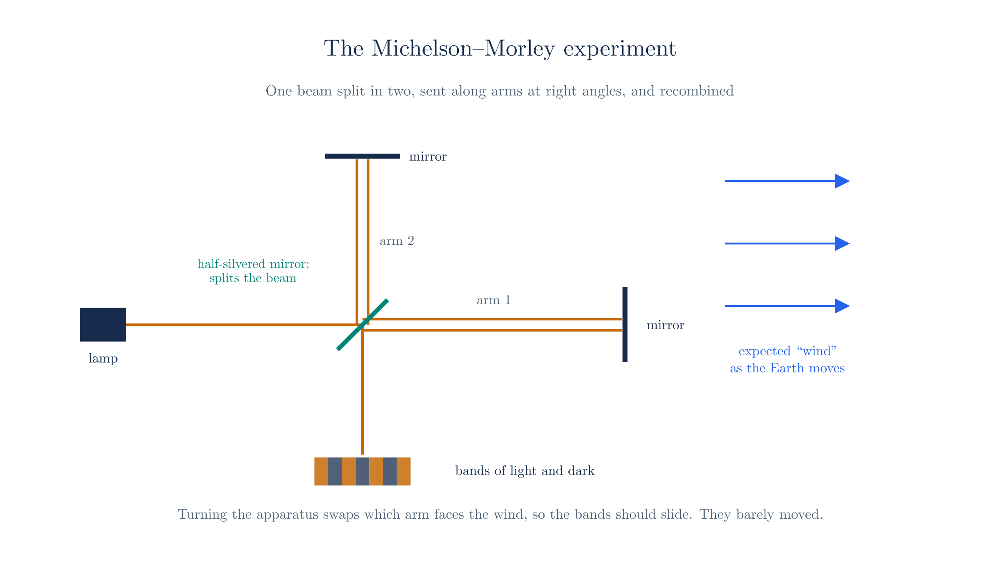
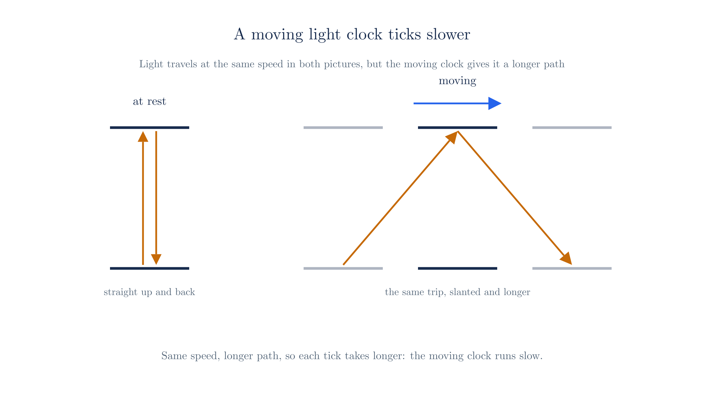
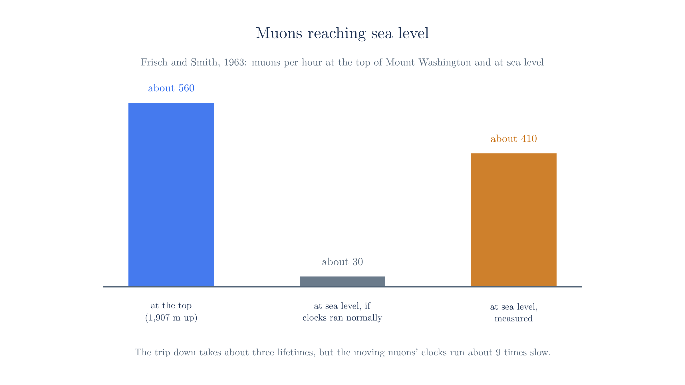
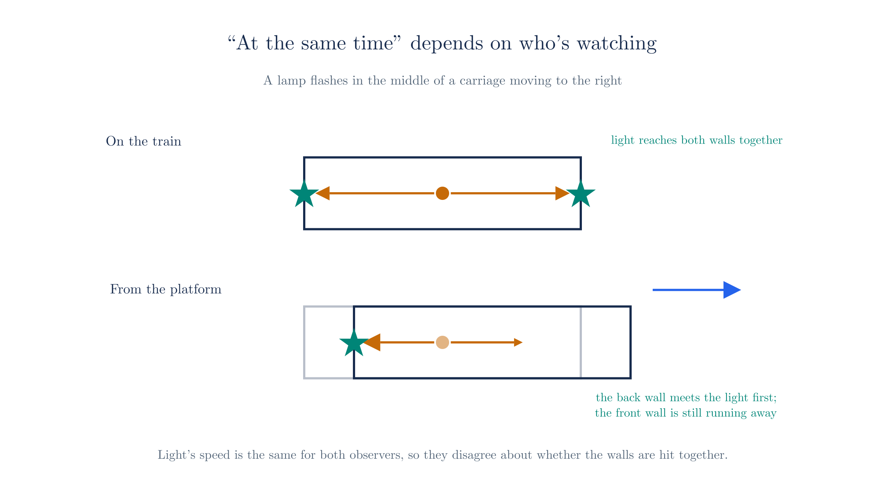
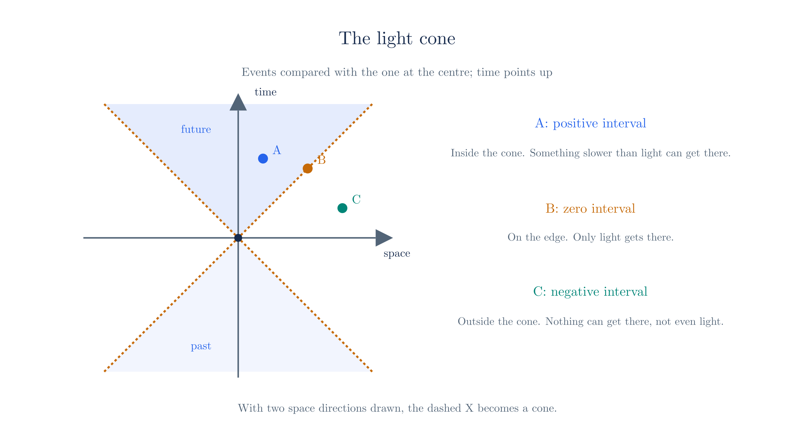

# Special Relativity

The last chapter ended with a promise: before we can build quantum fields, our equations have to agree with relativity. That matters because the particles of quantum field theory often move at close to the speed of light, and near that speed the everyday rules for time, distance and energy stop working.

This chapter starts from one surprising fact about light and follows where it leads: clocks that run slow, lengths that shrink, an energy hiding in every bit of mass, and a test that the Schrödinger equation fails.

| | Everyday speeds | Near the speed of light |
| --- | --- | --- |
| Speeds | Add up: walking on a train, you go faster than the train | Light's speed is the same for everyone, whoever is moving |
| Time | One clock for the whole universe | Moving clocks run slow |
| Lengths | A ruler is a ruler | Moving rulers shrink |
| "At the same time" | The same for everyone | Depends on who's watching |
| Energy | Kinetic energy $\tfrac12 mv^2$ | Even mass at rest holds energy, $E = mc^2$ |

## 1. Light's speed is the same for everyone

Walk forward at 1 m/s on a train doing 30 m/s, and someone on the platform sees you go by at 31 m/s. Speeds add. That's so obvious that nobody questioned it for centuries.

Light breaks it. In the 1860s, James Clerk Maxwell found that his equations for electricity and magnetism predict waves that travel at about 300,000 km per second, exactly the measured speed of light. But his equations don't say *relative to what*. The natural guess was that light moves through some invisible medium, the way sound moves through air, and that its speed is fixed relative to that medium. Then the Earth, racing around the Sun at 30 km per second, should feel a "wind" of that medium, and light should go a little faster in some directions than in others.

In 1887 Albert Michelson and Edward Morley looked for that wind. They split a beam of light, sent the two halves along arms at right angles, and recombined them into a pattern of light and dark bands. If one arm faced into the wind, its half of the beam would take a different time to come back than the other half. Turning the apparatus would swap which arm faced the wind, and the bands would slide. They barely moved: less than a twentieth of the expected slide. Experiments ever since, far more precise, all agree: **every observer measures the same speed of light, $c$, however they are moving.**

In 1905 Albert Einstein took this seriously, together with one more rule: the laws of physics are the same for every observer moving at a steady speed. No experiment inside a smoothly moving train can tell you whether the train is moving. These two rules are the whole of special relativity. The rest of the chapter is what they force.

More detail: the Michelson–Morley experiment

The two halves of the beam travel along arms about 11 m long (folded with mirrors) and come back together. Where their waves meet in step the light is bright, and where they meet out of step it is dark, which is the pattern of bands, called fringes. With the Earth's orbital speed, $v/c \approx 10^{-4}$, rotating the apparatus by 90° should have slid the fringes by about 0.4 of a fringe. Michelson and Morley saw less than a twentieth of that.

The light-speed rule also explains why ordinary velocity addition must fail: if speeds simply added, an observer moving toward a light beam would measure it going faster than $c$.

**Light's speed is the same for everyone, so something else has to give. It turns out to be time and space.**

## 2. Moving clocks run slow

**A light clock.** Picture the simplest possible clock: a pulse of light bouncing between two mirrors, one above the other. Each round trip is one tick.

Now put that clock on a fast train. To you, riding along, the light goes straight up and down, as before. But to someone on the platform, the mirrors move sideways while the light is in flight, so the light has to travel along a slanted zigzag. That path is longer. And light's speed is the same for both of you. A longer path at the same speed takes longer, so from the platform, each tick of the moving clock takes longer. **The moving clock runs slow.**

*Left, a light clock at rest: one tick is a straight trip up and back. Right, the same clock moving: the light travels a longer slanted path at the same speed, so each tick takes longer.*

Every clock on the train runs slow by the same factor, because otherwise you could compare them on the train and tell that you were moving. So it's not the clock that's odd. Time itself runs slow on the train, as seen from the platform. For a train moving at speed $v$, the factor is called gamma:

$$\gamma = \frac{1}{\sqrt{1 - v^2/c^2}}.$$

At everyday speeds gamma is so close to 1 that nobody notices. It only grows when you get near the speed of light:

| Speed | Gamma: how much slower the moving clock runs |
| --- | --- |
| A jet plane, 250 m/s | $1.0000000000003$ |
| 60% of light speed | 1.25 |
| 87% of light speed | 2 |
| 99% of light speed | 7.1 |
| 99.4% of light speed (the muons below) | 9.1 |

**The evidence: muons.** Cosmic rays hitting the top of the atmosphere make particles called muons, which rain down at about 99.4% of the speed of light. Muons decay at random, like radioactive atoms, and at rest half of them are gone after about 1.5 millionths of a second. In 1963 David Frisch and James Smith counted muons on top of Mount Washington, about 1,900 m up, and then at sea level. The trip down takes 6.4 millionths of a second, long enough for all but about 1 in 20 to decay. So of the 560 or so per hour at the top, only about 30 should have reached the bottom. They counted about 410.

The muons' clocks were running slow. With gamma at 9.1, the trip that takes 6.4 millionths of a second on the ground takes only 0.7 millionths on the muons' own clocks, too short for most of them to decay.

*Muons per hour on Mount Washington and at sea level. Without the slowdown, almost all would have decayed on the way down.*

The calculation: gamma from the light clock, and the muon numbers

Let the mirrors be a distance $L$ apart. At rest, one tick takes $t_0 = 2L/c$. Seen from the platform, the train moves at $v$, and in half a tick $t/2$ the light covers a slanted path of length $c\,t/2$ while the mirror moves $v\,t/2$ sideways. Pythagoras gives

$$\left(\frac{ct}{2}\right)^2 = L^2 + \left(\frac{vt}{2}\right)^2 \qquad\Rightarrow\qquad t = \frac{2L/c}{\sqrt{1 - v^2/c^2}} = \gamma\,t_0.$$

For the muons: the average lifetime at rest is $\tau = 2.2$ μs, and the fraction still alive after a time $t$ is $e^{-t/\tau}$ (half are gone after $\tau\ln 2 = 1.5$ μs). At $v = 0.994c$, $\gamma = 9.1$, and the descent of 1,907 m takes 6.4 μs. Without the slowdown, the surviving fraction is $e^{-6.4/2.2} \approx 0.055$, which is 31 of 563. With it, the muons' clocks advance only $6.4/9.1 = 0.70$ μs, and the fraction is $e^{-0.70/2.2} \approx 0.73$, about 410. Frisch and Smith's own analysis, which allowed for the muons slowing in the air, measured a slowdown of $8.8 \pm 0.8$.

**Moving clocks run slow by the factor gamma, which only matters near the speed of light, and muons show it happening.**

## 3. Shrinking lengths, and "at the same time"

**The muon's point of view.** From the muon's own point of view, its clock is perfectly normal. So how does it reach the ground? Because to the muon, the mountain is the thing that's moving, and **moving lengths shrink** by the same factor gamma. The 1,900 m of air shrinks to about 210 m, short enough to cross in 0.7 millionths of a second. The two points of view describe the same events in different words, and they agree on what actually happens: most muons reach the ground.

Lengths shrink only along the direction of motion. A train going by is shorter, but not thinner.

**"At the same time" depends on who's watching.** Put a lamp in the middle of a moving train carriage and flash it. On the train, the light reaches the front and back walls at the same moment, because they're the same distance away. From the platform, the back wall is moving toward the flash and the front wall is moving away, and light's speed is the same either way. So from the platform, the light hits the back wall first. Two events that happen at the same time for one observer happen at different times for another.

*The same flash, seen from the train and from the platform. On the train both walls light up together; from the platform the back wall lights up first.*

The calculation: the Lorentz transformation

Let an observer move at speed $v$ along $x$. Clock slowing, length shrinking and the change of simultaneity all come out of one rule for converting a time $t$ and position $x$ into the moving observer's $t'$ and $x'$, the **Lorentz transformation**:

$$t' = \gamma\!\left(t - \frac{vx}{c^2}\right), \qquad x' = \gamma(x - vt), \qquad y' = y, \qquad z' = z.$$

The $vx/c^2$ term is why simultaneity depends on the observer: two events with the same $t$ but different $x$ get different $t'$. At low speed, $\gamma \approx 1$ and $vx/c^2 \approx 0$, which gives back the everyday rule $t' = t$, $x' = x - vt$.

For the muon, the mountain's 1,907 m shrinks to $1{,}907/9.14 \approx 209$ m.

Velocities no longer simply add. Something moving at $u$ for one observer moves at

$$u' = \frac{u - v}{1 - uv/c^2}$$

for the other. Put in $u = c$ and you get $u' = c$: light's speed comes out the same, as it must.

**Moving lengths shrink by gamma, and whether two distant events happen at the same time depends on the observer.**

## 4. What everyone agrees on

If observers disagree about times and distances, what do they agree on? There's one combination of the two that every observer gets the same answer for. For two events, take the time between them, multiply by $c$ to turn it into a distance, square it, and subtract the square of the distance between them:

$$s^2 = (c\,\Delta t)^2 - (\Delta x)^2.$$

This is the **spacetime interval**. It's a bit like the length of a ruler, which stays the same however you turn the ruler, except with a minus sign.

The muon shows it. Take its birth at the top of the mountain and its arrival at sea level. The ground says about 6.4 millionths of a second and 1,900 m apart. The muon's slowed clock says 0.7 millionths of a second, and no distance at all, since for the muon the mountain moves and it stays put. Work out the interval both ways and you get the same answer, about 210 m. For anything moving, the interval between two moments of its trip is simply the time on its own clock, times $c$.

Because of the minus sign, the interval can come out positive, zero or negative, unlike a length. The sign says how the two events can be connected:

- **Positive:** there's more than enough time for light to cover the distance, so something slower than light can make the trip too. Every observer agrees which event came first.
- **Zero:** there's exactly enough time for light, so only light can connect them.
- **Negative:** not even light has time to get from one to the other, so nothing can. Whether they happen at the same time, or in which order, depends on the observer, as with the train flash. But since nothing can travel between them, neither can cause the other.

*The light cone, with time pointing up. The cone's edge is where light from the event can reach. Events inside it have a positive interval, events on the edge zero, and events outside it negative.*

The calculation: the muon's interval, and why every observer agrees

**The muon.** From the ground, $\Delta t = 1{,}907\text{ m}/(0.994c) = 6.40$ μs, so $c\,\Delta t = 1{,}918.5$ m, and $\Delta x = 1{,}907$ m, giving $s = \sqrt{1{,}918.5^2 - 1{,}907^2} \approx 210$ m. For the muon, $\Delta x = 0$ and $\Delta t = 6.40/9.14 = 0.70$ μs, so $s = c\times 0.70\ \mu\text{s} \approx 210$ m. (The interval is sensitive to rounding here, because it is the small difference of two large numbers.)

**In general.** Put the Lorentz transformation into the interval:

$$c^2\Delta t'^2 - \Delta x'^2 = \gamma^2\left[c^2\left(\Delta t - \frac{v\Delta x}{c^2}\right)^2 - (\Delta x - v\Delta t)^2\right] = \gamma^2\left(1 - \frac{v^2}{c^2}\right)(c^2\Delta t^2 - \Delta x^2).$$

The mixed terms cancel, and $\gamma^2(1 - v^2/c^2) = 1$. In three dimensions the interval is $c^2\Delta t^2 - \Delta x^2 - \Delta y^2 - \Delta z^2$.

The three cases are called **timelike** (positive), **lightlike** (zero) and **spacelike** (negative). For a timelike pair, no observer can see the events at the same time, since that would make the interval $-\Delta x'^2$, which is negative. So the order can't flip.

**Observers disagree about time and distance but agree on the spacetime interval, and its sign decides which events can affect which.**

## 5. Energy and mass

**$E = mc^2$.** Relativity's most famous result says that mass is a form of energy. Anything with mass $m$ holds an energy $mc^2$ even when it sits still. Since $c^2$ is huge, a little mass is a lot of energy: one gram is about $9\times10^{13}$ joules, roughly what a large power station produces in a whole day.

**Energy and momentum together.** Energy and momentum behave like time and distance. Observers moving differently disagree about an object's energy and its momentum, but they all agree on one combination, built just like the interval, and it comes out to the mass:

$$E^2 - (pc)^2 = (mc^2)^2.$$

At rest, the momentum is zero and this gives back $E = mc^2$. For something moving, the energy is gamma times $mc^2$. At everyday speeds that's the rest energy plus the familiar kinetic energy $\tfrac12 mv^2$. Near the speed of light, gamma shoots up (section 2's table), so the energy grows without limit, which is why nothing with mass can ever reach $c$.

**Light.** Light has no mass, so its energy is just $E = pc$. That fits chapter 2: a packet of light carries energy $hf$ and momentum $h/\lambda$, and since $f\lambda = c$, the energy is exactly $c$ times the momentum.

More detail: energy, momentum and the low-speed limit

One gram is $0.001\text{ kg} \times (3.0\times10^8\text{ m/s})^2 = 9.0\times10^{13}$ J. Spread over a day of 86,400 s, that is about 1 GW.

For a particle of mass $m$ moving at speed $v$, the energy is $E = \gamma mc^2$ and the momentum is $p = \gamma mv$. These satisfy $E^2 - (pc)^2 = \gamma^2m^2c^4(1 - v^2/c^2) = (mc^2)^2$.

At low speed, $\gamma \approx 1 + v^2/2c^2$, so $E \approx mc^2 + \tfrac12 mv^2$: the rest energy plus the familiar kinetic energy. The energy beyond the rest energy, $(\gamma - 1)mc^2$, is the kinetic energy at any speed.

For a massless particle, $E = pc$, and it moves at exactly $c$. It has no rest frame, since it can never be at rest.

**Mass is energy, $E = mc^2$, and every observer agrees on $E^2 - (pc)^2 = (mc^2)^2$.**

## 6. The Schrödinger equation fails the test

The rule from section 1 says the laws of physics must look the same to every observer moving at a steady speed. That's a test any equation can be put through: change to a moving observer, and see whether the equation keeps its form.

Maxwell's equations for light pass. They were the starting point, after all, and their light waves travel at $c$ for everyone.

The Schrödinger equation from chapter 2 fails. For a free particle it reads

$$i\hbar\frac{\partial\psi}{\partial t} = -\frac{\hbar^2}{2m}\nabla^2\psi,$$

with one derivative in time on the left and two in space on the right. That lopsidedness is the problem. Changing observer mixes time and space, the way turning a map mixes north–south with east–west. A rule that treats north–south differently from east–west changes when you turn the map, and in the same way an equation that treats time differently from space changes when you change observer. The lopsidedness comes from where the equation started: chapter 2 built it from the low-speed energy $E = p^2/2m$, which has one power of energy and two of momentum.

That's fine at low speeds, where chapters 2 and 3 used it. But for fast particles we need an equation built from the full relativistic energy, with two powers of each, matching the interval. Doing that with chapter 2's trick, where a time derivative stands for energy and a space derivative for momentum, gives the **Klein–Gordon equation**, the subject of the next chapter.

The calculation: why the Schrödinger equation isn't relativistic

Chapter 2 turned energy and momentum into operators, $E \to i\hbar\,\partial/\partial t$ and $\mathbf p \to -i\hbar\nabla$. Applied to $E = \mathbf p^2/2m$, this gives the free Schrödinger equation above.

A change of observer mixes $t$ with $x$, so it mixes $\partial_t$ with $\nabla$. The combination of derivatives that every observer agrees on is $\partial_t^2/c^2 - \nabla^2$, called the d'Alembertian, with two derivatives in time and two in space, mirroring the interval. The Schrödinger equation's one-time, two-space combination is not of that form.

Applied to $E^2 = (pc)^2 + (mc^2)^2$, the same substitution gives

$$\frac{1}{c^2}\frac{\partial^2\psi}{\partial t^2} - \nabla^2\psi + \frac{m^2c^2}{\hbar^2}\psi = 0,$$

the Klein–Gordon equation, which does keep its form for every observer.

**The Schrödinger equation only works at low speeds. A relativistic quantum equation has to start from $E^2 - (pc)^2 = (mc^2)^2$.**

## 7. The notation later chapters use

Later chapters write relativity in a compact notation, where time and space are packed into one four-component object. You don't need it to follow this chapter, so it's all collected here, to come back to when it's used. The [tensor appendix](appendix-math-tensors.md) covers it more slowly.

### Four-vectors, the metric and contractions

Time and position together make a **four-vector**, and so do energy and momentum. The interval and the mass from section 5 are both built the same way from a four-vector, with a plus for the time part and minuses for the space parts. The notation does that bookkeeping for you.

The notation: four-vectors, the metric, indices

**Four-vectors.** Position in spacetime is written $x^\mu = (ct, x, y, z)$, where the index $\mu$ runs over $0, 1, 2, 3$. Energy and momentum make $p^\mu = (E/c, p_x, p_y, p_z)$. When the observer changes, the four components mix together, the way $t$ and $x$ mix in the Lorentz transformation.

**Signs and the summing rule.** The plus and minus signs of the interval are stored in a table called the **metric**, $\eta_{\mu\nu} = \mathrm{diag}(+1, -1, -1, -1)$, also written $g_{\mu\nu}$. Writing an index down instead of up flips the sign of the space parts, $x_\mu = (ct, -x, -y, -z)$. The [tensor appendix](appendix-math-tensors.md#_3-the-metric) shows how the metric moves indices up and down.

An index that appears twice, once up and once down, is summed over:

$$A^\mu B_\mu = A^0B^0 - \mathbf A\cdot\mathbf B.$$

The two examples from this chapter are the interval, $x^\mu x_\mu = c^2t^2 - |\mathbf x|^2$, and the mass, $p^\mu p_\mu = E^2/c^2 - |\mathbf p|^2 = m^2c^2$. Anything summed this way comes out the same for every observer, and an equation whose two sides carry the same leftover indices holds for every observer.

**Derivatives.** $\partial_\mu = \partial/\partial x^\mu$, so $\partial_0 = \partial_t/c$. Summing two of them gives section 6's d'Alembertian, $\partial_\mu\partial^\mu = \partial_t^2/c^2 - \nabla^2$.

From here on, expressions that leave out $c$ use $c = 1$. Why indices go up or down, and how each kind changes between observers, is in the [tensor appendix](appendix-math-tensors.md).

### Maxwell's equations in four-vector form

Electric and magnetic fields turn out to be two parts of one object. A charge sitting still makes only an electric field. But to an observer moving past it, the charge is moving, a moving charge is a current, and currents make magnetic fields. So that observer sees a magnetic field too. Different observers split the same field into electric and magnetic parts differently. The box writes Maxwell's four equations as two short ones in this notation.

The notation: the field tensor and Maxwell's equations

With $c = 1$ and the constants absorbed, Maxwell's equations are

$$\nabla\cdot\mathbf E = \rho, \qquad \nabla\cdot\mathbf B = 0, \qquad \nabla\times\mathbf E = -\frac{\partial\mathbf B}{\partial t}, \qquad \nabla\times\mathbf B = \frac{\partial\mathbf E}{\partial t} + \mathbf j.$$

The charge and current densities form the four-current $J^\mu = (\rho, \mathbf j)$, and charge conservation is $\partial_\mu J^\mu = 0$. The scalar and vector potentials form $A^\mu = (\varphi, \mathbf A)$, and the **field tensor** is

$$F^{\mu\nu} = \partial^\mu A^\nu - \partial^\nu A^\mu = \begin{pmatrix} 0 & -E_x & -E_y & -E_z \\ E_x & 0 & -B_z & B_y \\ E_y & B_z & 0 & -B_x \\ E_z & -B_y & B_x & 0 \end{pmatrix}.$$

All four Maxwell equations become

$$\partial_\mu F^{\mu\nu} = J^\nu, \qquad \partial_\lambda F_{\mu\nu} + \partial_\mu F_{\nu\lambda} + \partial_\nu F_{\lambda\mu} = 0.$$

Setting $\nu = 0$ in the first gives Gauss's law and $\nu = 1, 2, 3$ gives Ampère's law. The second holds automatically once $F^{\mu\nu}$ is built from $A^\mu$, and contains $\nabla\cdot\mathbf B = 0$ and Faraday's law. Both sides of each equation carry the same free indices, so the equations hold for every observer.

**Next:** with relativity in hand, [Relativistic Quantum Mechanics](./relativistic-qm.md) builds the Klein–Gordon equation and finds out what goes wrong with it.

---

Previous: [The Harmonic Oscillator](./harmonic-oscillator.md)

Next: [Relativistic Quantum Mechanics](./relativistic-qm.md)
